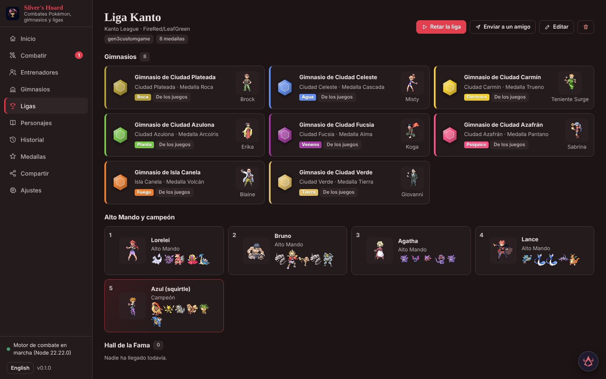
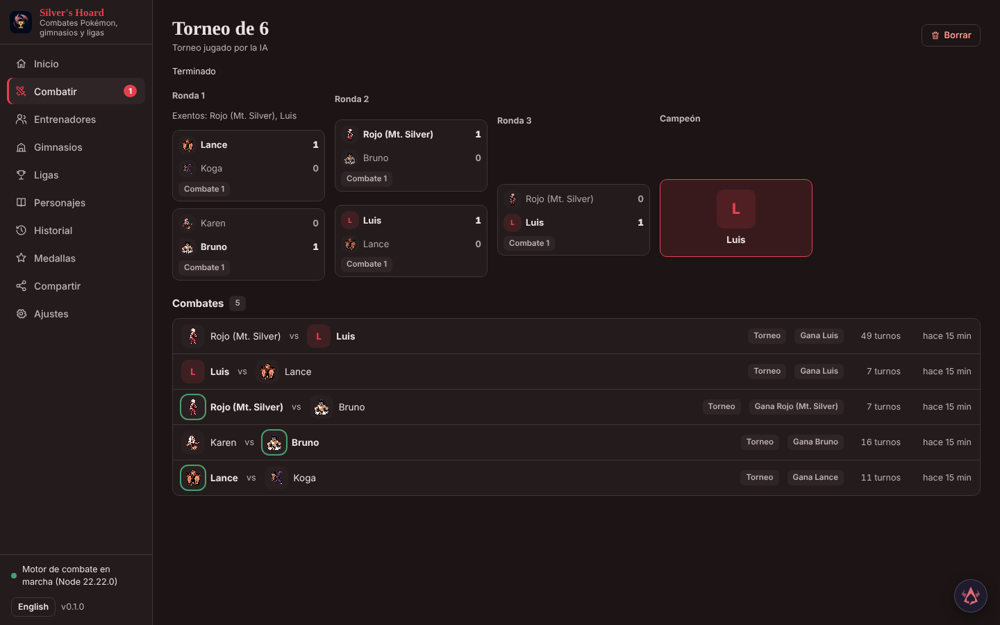
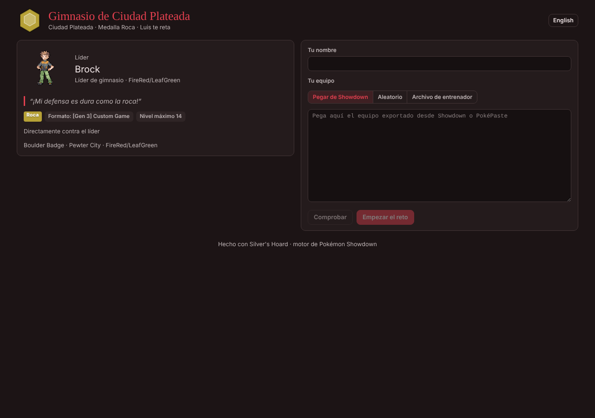
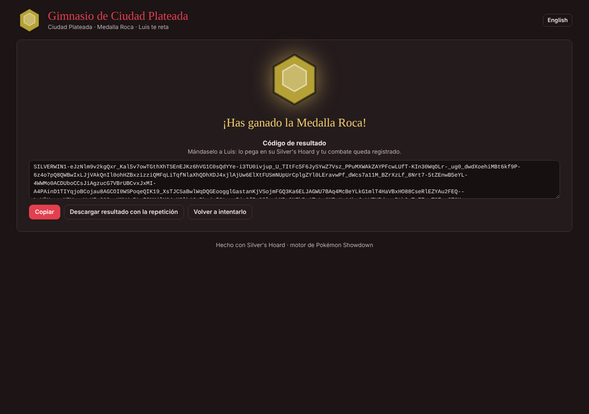

# Silver's Hoard

Un simulador de combates Pokémon sobre el motor de Pokémon Showdown, con entrenadores, rivales con IA, gimnasios, ligas, combates en tiempo real y páginas jugables que se pueden enviar a amigos. Forma parte de la familia Hoard. [English](README.md)


## Qué es

Silver's Hoard ejecuta combates de todas las generaciones, individuales y dobles, con el simulador `@pkmn`. Creas entrenadores (equipo, nivel y estilo de IA, avatar, frases de combate), los juegas contra la IA o contra otra persona, o dejas que dos IA luchen y ves la repetición. Además incluye series, torneos, copas, gimnasios, ligas, los personajes de todos los juegos principales, instalaciones de combate y minijuegos.

Todo combate puede jugarse también en tiempo real: los mismos equipos en una arena 2D vista desde arriba, con tiempos de enfriamiento en lugar de turnos. Cualquier cosa que construyas se exporta como una única página HTML que un amigo abre en el navegador, con el motor y la IA dentro.

Funciona en local (puerto 5230 por defecto), guarda sus datos en SQLite y también lo manejan asistentes mediante un servidor MCP.

## Qué hace

### Entrenadores y equipos
- Crea entrenadores pegando una exportación de Showdown, PokéPaste, JSON o un equipo empaquetado, o armando el equipo en el editor; cada uno tiene nivel y estilo de IA, avatar, título y frases (inicio, último Pokémon, poca vida, victoria, derrota, después del combate).
- Cambio de táctica opcional, como los jefes de los juegos: cuando el equipo baja a la mitad de vida o saca al último Pokémon, la IA cambia de nivel o estilo y el entrenador dice una frase.
- El modelo de lenguaje de la familia (a través de Hoard Hub) puede escribir las frases a partir de un equipo y una personalidad, y la IA puede comentar sus propios movimientos en personaje.
- Avatares: cualquier sprite de entrenador de Showdown, una imagen propia, el arte oficial de personajes y clases de entrenador de los juegos, pixel art a partir de una foto o arte dibujado por Prospero's Hoard.
- Calculadora de daño, sets populares, puntos de estadística y regulaciones de Pokémon Champions, y niveles igualados (50 o 100) en cualquier combate.

### Personajes y ligas de los juegos
- 214 líderes de gimnasio, miembros del Alto Mando, campeones, rivales, villanos, Cerebros de la Frontera y jefes de instalaciones, de Rojo/Azul a Escarlata/Púrpura, con sus equipos combate a combate (primeros combates, revanchas, torneos, instalaciones, combates múltiples).
- Ligas completas de los juegos listas para instalar: gimnasios con medallas, Alto Mando y campeón. Cristal, Rojo Fuego/Verde Hoja, Esmeralda y HeartGold/SoulSilver usan equipos leídos del código de los juegos; el resto se construye con los equipos de los personajes.
- Instalaciones de combate con rachas (Torres Batalla, Metro, Maison, Árbol, Frontera Batalla de HeartGold/SoulSilver) y los diez eventos del Pokéathlon.

### Combates
- Juega contra la IA, dos personas en un ordenador, o dos IA en segundo plano. La pantalla muestra sprites, PS, estados, mejoras, teracristalización, clima, terreno y trampas, con un registro en español o inglés, animaciones por movimiento y sonido.
- Siete niveles de IA, de aleatorio a maestro (búsqueda de árbol Monte Carlo con poke-engine opcional); un modo de IA que solo conoce lo que el combate ha revelado; un nivel neuronal para individuales de las generaciones 1–4 y 9.
- Series de N combates con porcentajes de victoria, KO y MVP; torneos de hasta 64 entrenadores (eliminatoria o liguilla); bancos de pruebas de variantes de equipo; copas con cuadro en vivo donde juegas tus partidos y la IA juega el resto.
- Combates masivos de hasta 1.100 Pokémon en un mismo campo: todos contra todos, ejércitos, o muchos contra unos pocos gigantes.
- Repeticiones con búsqueda turno a turno, avisos de habilidades, posiciones de práctica sugeridas a partir de una repetición terminada, ejercicios guardados y la rama «probar otro movimiento».
- Combates en directo con un amigo en otro ordenador mediante el enlace de una sala (por turnos o en tiempo real).

### Tiempo real
- Una segunda forma de jugar cualquier combate: sin turnos ni PP, con enfriamiento por movimiento, tiempo de preparación y formas de movimiento (golpes, embestidas, proyectiles, rayos, conos, áreas) que caen donde estaba el objetivo.
- Presentación con pantalla VS, Poké Balls lanzadas, rótulos, fotogramas de impacto, efectos de cámara, público y bocadillos con las frases de los entrenadores.
- Diseñador de arenas propias (rocas, suelos, simetría, plantillas) y suelos tomados de los juegos.
- Efectos de movimiento en pixel art (`pixelfx`) y un explorador de efectos.

### Gimnasios, ligas y copas
- Gimnasios con líder, entrenadores, medalla y reglas de nivel; ligas con gimnasios, Alto Mando, campeón y salón de la fama.
- Mapas de gimnasio andables pintados casilla a casilla, con línea de visión de los entrenadores, hielo, flechas, interruptores y edificios de pixel art; los entrenadores que te ven te retan.
- Progreso por entrenador: récords, rachas, KO, medallas, logros y una Pokédex de especies usadas, vistas y derrotadas.

### Retratos, sprites y medios
- Biblioteca de retratos PMD: 16 expresiones en paleta normal y variocolor para cada forma, usadas en la introducción VS, las barras y las reacciones, e incluidas en las páginas exportadas.
- Sprites, gritos y música de Showdown guardados en caché al primer uso; la animación de Showdown de cada movimiento y sus fondos de combate.
- Exportación de combates a MP4, carteles de entrenador, concursos, bases secretas y otras funciones de ocio.

### Compartir con amigos
- Exporta entrenadores, gimnasios y ligas como archivos (`.hoardtrainer`, `.hoardgym`, `.hoardleague`), códigos para pegar en un chat, texto de Showdown, o una **página HTML jugable** con el motor, la IA y los retratos instalados dentro.
- El amigo juega tu gimnasio o entrenador por turnos o en tiempo real y te devuelve un código de resultado; al importarlo se reproduce el combate para comprobarlo y se registra la medalla. Los códigos no van firmados: la comprobación por repetición detecta códigos editados, no juego automatizado.
- Los ejercicios se comparten como archivos `.silverexercise`.

## Qué no hace
- El repositorio no incluye arte de Pokémon: sprites, gritos y música se descargan de los servidores de Showdown la primera vez y se guardan en `data/cache`. Sin conexión, el campo muestra iniciales hasta que estén en caché.
- Los personajes distintos de Cristal, Rojo Fuego/Verde Hoja, Esmeralda y HeartGold/SoulSilver salen de tablas públicas, así que se desconocen sus IV y EV (31 IV, sin EV). Los combates usan solo objetos equipados, no objetos de la mochila.
- El tiempo real solo juega individuales y dobles y deja fuera la teracristalización y algunos movimientos de copia o dirigidos a aliados.
- La IA maestra solo busca en individuales de novena generación; la experta busca en individuales y dobles.
- Noland, Thorton y Argenta no tienen equipo fijo en sus juegos y no están entre los personajes.

## Cómo arrancarlo

Requisitos: Node.js 20 o superior, Python 3.11 o superior.

```bash
npm ci                       # motor y cliente
npm run build                # interfaz y plantilla de la página jugable
python -m venv venv && venv/Scripts/pip install -r requirements.txt   # venv/bin/pip en Linux y macOS
venv/Scripts/python -m silvers_hoard    # http://127.0.0.1:5230
```

Extras opcionales: `requirements-master.txt` (poke-engine, IA maestra), `requirements-video.txt` (Playwright, exportación MP4), `requirements-icon.txt`.

Los datos van en `data/` (o `SILVER_DATA_DIR`): `silver.db`, imágenes, exportaciones y las cachés de sprites, audio y créditos.

## Conexión con Faustus y Hoard Hub

- Hoard Hub encuentra la app mediante `faustus-plugin.json` (id `silver`, puerto 5230). El copiloto de Faustus está disponible en todas las páginas y la app publica eventos en el bus de la familia.
- `python mcp_server.py` es un puente MCP por stdio hacia la app en marcha (la arranca si hace falta). Cerca de 190 herramientas cubren toda la app, agrupadas en: combates (`battle_start`, `battle_choose`, `battle_practice`, `battle_compare`), series, torneos, copas y bancos de pruebas, personajes y ligas, instalaciones, entrenadores y equipos (`damage_calc`, `stat_points`), avatares, arenas y reglas de tiempo real, exportar e importar, progreso y créditos. El puente las lista desde `GET /api/agent/tools`.

## Estructura del proyecto

| Ruta | Contenido |
|---|---|
| `silvers_hoard/` | Backend FastAPI, controlador de combates, IA, compartir, herramientas MCP |
| `engine/` | Puente Node con `@pkmn/sim`, reglas, comprobaciones de paridad y tests |
| `client/` | Aplicación React, página jugable y página de amigos |
| `mcp_server.py` | Puente MCP para asistentes |
| `scripts/` | Constructores de personajes, sprites, biblioteca PMD y otros datos |
| `docs/` | Notas de funciones y capturas |
| `tests/` | Suite de tests de Python |
| `faustus-plugin.json` | Manifiesto del plugin |

## Desarrollo

```bash
npm test               # tests de Python y luego los del motor
npm run test:engine    # solo los tests del motor
npm run client         # servidor de desarrollo de Vite
python scripts/parity_poke_engine.py   # compara poke-engine con @pkmn/sim (requiere el extra master)
```

El trabajo previsto está en [OBJETIVOS.md](OBJETIVOS.md) y lo abierto en [PENDIENTES.md](PENDIENTES.md). El detalle de cada función está en [docs/](docs/); la biblioteca PMD se describe en [docs/PMD_LIBRARY.md](docs/PMD_LIBRARY.md).

## Capturas

<details>
<summary>Más capturas</summary>







</details>

## Créditos y licencia

La página de Créditos de la app lista cada fuente con su licencia y los artistas de los sprites. Motor de combate: Pokémon Showdown a través de los paquetes `@pkmn` (MIT). Equipos de los juegos de los desensamblados de pret; los equipos del resto de personajes, de Bulbapedia (CC BY-NC-SA 2.5). Nombres y descripciones en español de PokeAPI. Los sprites, gritos y música los sirven los servidores de Showdown y pertenecen a sus autores y estudios.

Es un proyecto de aficionados y no está afiliado a Nintendo, Game Freak, Creatures ni The Pokémon Company. Pokémon y los nombres relacionados son marcas de sus propietarios.

Código bajo licencia MIT, véase [LICENSE](LICENSE).
