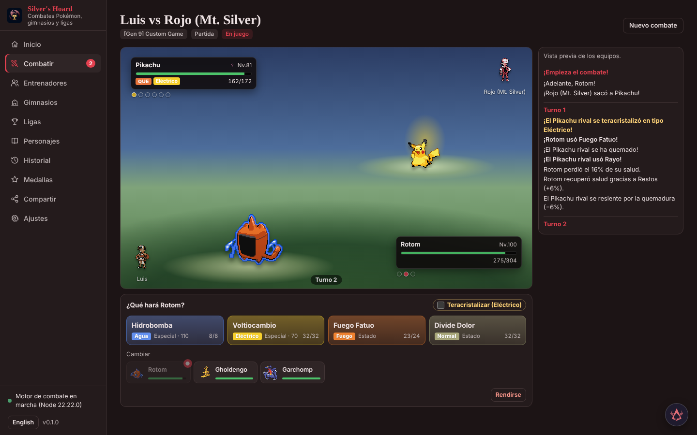
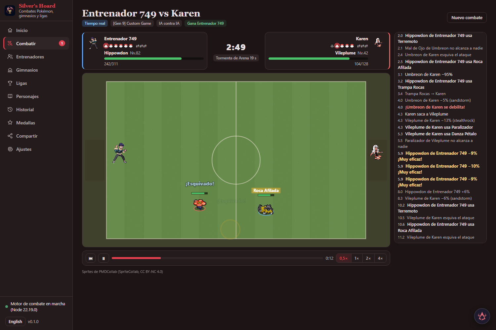

# Retratos PMD · Source113 · 2 de noviembre de 2026

Se completan16expresiones normales yshiny de Glimmet, Torracat, Flamigo, Yungoos, Mimikyu Busted yBusted-Totem:138vinculaciones nuevas/114PNG únicos.54vinculaciones ya instaladas permanecen exactas a sus originales físicos (46PNG únicos; ocho originales heredados porTotem). Doce registros de atlas usan diezPNG físicos: Totem comparte el arteBusted y su herencia existente, sin carpeta/alias/escala/regla de juego nuevos; foldernull ydisplay_scale1.2 permanecen. Se conservan40píxeles, encuadre, orientación hacia la derecha ypaleta propia; cada expresión usa su color, gradiente y símbolos canónicos. Root vio todas las cuadrículas finales ycomparadores completos. Es revisión de esta selección de retratos, no aprobación global de anatomía, cuerpos oanimaciones.

Autoría nueva:76caras únicasClaude, seisreparacionesRoot, ochoart30 y24Mimikyu únicospeer84 compartidos por dosformas.540documentos completos conservan componentes, fuentes y artistas originales. CryingTorracatRoot mantiene boca/aguaClaude; ShoutingFlamigo usa poseJoyous de pico abierto publicada, componenteAngryClaude yajusteRoot. Mimikyu conserva componentes válidosClaude ypeer84 retira añadidosorales/cejas yrediseña siete gestos; los trazos inferiores publicadosPain/Crying siguen literales, sin afirmar que todoslos originales carezcan de boca. Se conserva historiaHOLD/flags/alternativas. Soportespositivos nuevos,noalfa histórico recuperado. Procedencia:art/portraits/reviewed113-provenance.json.

Biblioteca:457registros,36.935vinculaciones,35.666PNG,15packs activos;2250conjuntos completos,682parciales,6ausentes.1125de1469formas tienen ambas paletas16;344incompletas y10.073vinculaciones pendientes. Las36.797vinculaciones,445registros/fuentes/aliases y15packs físicos previos se mantienen. Ninguna forma seleccionada tenía registro generated anterior; se añaden doce respetando la herenciaTotem existente.

Verificación:192lectores/307.200RGBA,29pruebas; MCPstdio valida antesdedos equipos aislados,900ticks nativos por tiempo/paridadreplay. HTML71.688binarios/40fragmentos/cero inline/192HTTP exactos. Root vionativo pausado5s/150ticks Glimmetshiny571/600vsTorracatnormal668/668, ambosConfused/Dynamax16s yHUDDizzy/Dizzy nuevos exactos40/display96. EnHTMLhumano ConfuseRay7.0 se ejecuta, Dynamaxpropio10.1/rival3, MaxStrikepropio16.8 conecta17.7 crítico−5%. Primerapausa reloj4:40,últimolog19.9,433/600vs635/668,HUDrealNormalGlimmet/DeterminedTorracat. Segundapausa4:15,últimolog45,159/300vs318/334: ambos regresan vivos a tamañonormal21/28.1. CuatroHUDPNG ycuatroLuxury/DiveBall exactos; dos tarjetasVS completas vistas. Otrascuatroformas porAPI/portable/cuadrículas,sinbatallas separadas. Sin curación/KO/móvil/importación/MP4/buildUI o motor nuevos. Consolanativa vacía,HTMLunerror deextensión64MiB,sinerrorappobservado; timeoutlectura inicial resuelto sinreload,favicon404 incidental. Servicios/pestañas cerrados,59028/29off,compartidaapagada,sinpush.

Autoridades:research-inbox/silver-portraits1372/Source113-six-forms-actual-compile-root-v1/receipt.json yqa113-six-forms-data-consumer-root-v1/data-and-visible-consumer-result.json. Dospreparaciones pararonantesdeatlas/producto al recorrer referencias históricas ajenas; recolectorfinal conserva íntegros loslinajes seleccionados,sin atribuirles snapshots globales enmendados. Después se ejecutó elbuilderexistente unasolavez. QA delworktreeSource113; integraciónMainregistrada aparte. Catálogorestanteabierto.

# Retratos PMD · Source112 · 2 de noviembre de 2026

Se completan las16 expresiones normales yshiny de Cinccino, Bellibolt, Quilladin, Wattrel, Thwackey yElectivire:138retratos nuevos y54ya instalados exactos, doceatlas. Los54incluyen51originales publicados ytresderivados Quilladinshiny anteriores (Happy/Pain/Inspired). Normalshiny es publicado originalbyteexacto aunque el registro anterior figurecomo generated. Se conservan40píxeles, orientación, escala ymateriales propios; lasexpresiones nuevas usan suscolores/gradientes/símbolos canónicos. Root vio lasdocecuadrículas completas yloscomparadores actuales. Reparaciones localesRootDizzyBellibolt/Quilladin/Electivire yCryingWattrel; ClaudeCryingCinccino ysoporte/DizzyThwackey. Versiones rechazadas excluidas.369documentos completos (367decompilación ydosdeaclaración deprocedencia) conservan fuentes, flags, soportesBODY/agua yautoría por emoción/componente; máscaras positivas nuevas,noalfa histórico recuperado.

Biblioteca:445registros,36.797vinculaciones,35.552PNG,15packs activos;2238conjuntos completos,694parciales,6ausentes.1119de1469formas tienen ambas paletas16;350incompletas y10.211vinculaciones pendientes. Las36.659vinculaciones y54keepers anteriores exactos. Seañaden11registros yseamplíaQuilladinshiny de4a16 conservando registro/fuente previos íntegros, cuatroPNG, atlas/referencias yflags históricos. Losotros433registros yrestodefuentes/aliases sonliterales, como15packs físicos previos. Cobertura no equivale aGOanatómico global, cuerpos oanimaciones.

Verificación:192lectores/307.200RGBA,29pruebas de retratos,MCPstdio genuino valida antesdedos equipos aislados,900ticks nativos por tiempo/paridadreplay. HTML71.574binarios/40fragmentos/cero inline/192HTTP exactos. Root vionativo pausado5s conElectivireshiny708/708vsWattrelnormal568/568, ambosConfused yDynamax17/16; HUDDizzy/Dizzy. Partida humanaHTML pausada reloj4:35,últimolog25,2,310/354vs284/284. Dynamaxpropio0/rival3 vuelvenvivos18/21. MaxStrikepropio13,5 bloqueado14,4; sin golpepropio conectado,KO,curación oataquenormalpropio acreditados. Ray/Dynamax tempranos se procesaron comoMaxGuard/Dynamax0,noConfuseRayhumano. HUDHTMLDizzyElectivire/DeterminedWattrel; cuatroPNG reales exactos40/display96 ycuatroLuxury/DiveBall asignadas exactas18. Lasotrascuatroespecies pasanAPI/portable/cuadrículas,sinbatallas vivas separadas. Consolanativa vacía,HTMLunerrorZotero64MiB,sinerrorappobservado. TimeoutlecturaHTML/selectoratributotype resueltossinreload ni cambioproducto. Servicios/pestañas propioscerrados,59026/59027off,compartidaapagada; sinbuildUI/motor,suitesgeneralesrepetidas,móvil,importación,MP4 opush.

Procedencia:art/portraits/reviewed112-provenance.json. Autoridades:research-inbox/silver-portraits1372/Source112-six-species-actual-compile-root-v1/receipt.json yqa112-six-species-data-consumer-root-v1/data-and-visible-consumer-result.json. Guardia inicialdelcompiler paróantesdeescribir al encontrarregistroparcialQuilladinS; compilacióncorregidaejecutóbuilderexistente unasolavez. QA delworktreeSource112; integraciónMainregistradaaparte. Catálogorestanteabierto.

# Retratos PMD · Source111 · 2 de noviembre de 2026

Se completan las16 expresiones de Drapion, Litleo y Gothita en ambas paletas:68 retratos nuevos y28 publicados exactos, seis atlas finales. Se conservan resolución40, cámara y materiales propios, con colores/gradientes/símbolos canónicos por emoción. Drapion usa cuatro reparaciones Inspired/DizzyV2; Litleo dosInspiredV2; Gothita22 reparaciones de cincoalfas de exterior. Los borradores rechazados se excluyen. Root vio personalmente las seis cuadrículas finales completas. Fuentes/créditos originales completos, flags, planes, soportes positivos y roles deagua constan en157 documentos completos. Las máscaras son soportes positivos nuevos declarados, no alfa histórico recuperado.

Biblioteca:434registros,36.659vinculaciones,35.414PNG,15packs activos;2226conjuntos completos,706parciales y6ausentes. De1469formas,1113tienen ambas paletas completas;356siguen incompletas y faltan10.349vinculaciones. Las36.591vinculaciones,428registros, fuentes/aliases y15packs físicos anteriores se conservan literales. La cobertura no certifica anatomía, cuerpos o animaciones de todo el catálogo.

Verificación:96lectores reales/153.600RGBA,29pruebas de retratos, MCPstdio genuino valida antes de escribir datos aislados,900ticks nativos por tiempo y paridad de replay. HTML con71.436binarios,40fragmentos,cero inline y96retratosHTTP exactos. Root vio replay nativo pausado5,13s conDrapionshiny/Litleonormal, ambosDynamax16s y los dosDizzy nuevos. Una partida humanaHTML acabaKO93,26s,0/344vs328/328. Dynamaxrival3s ypropio17,5s vuelven vivos21/35,5s. Tacklehumano75,2s falla75,9s; Recover no se aceptó y el controlMaxStrike intentado ya no existía tras expirarDynamax. Sin curación, golpepropio conectado oMaxAttackpropio acreditados. La captura pausada0s muestra las tarjetasVS reales. CuatroPNG reales deHUD coinciden conDizzy/Dizzy nativos ySad/Joyous terminalesHTML, nativo40/display96; cuatroLuxury/DiveBall asignadas exactas alcatálogo a18. Gothita pasaAPI/portable/cuadrículas, sin batalla viva separada. Consola nativa vacía, HTMLunerror deextensiónZotero64MiB, sinerror appobservado. Sin nuevo buildUI/motor, suitesgenerales repetidas, móvil, importación oMP4. Servicios/pestañas propios cerrados,59024/59025apagados; appcompartida sinarrancar. Sinpush.

Procedencia completa:art/portraits/reviewed111-provenance.json. Autoridades enresearch-inbox/silver-portraits1372:Source111-three-species-actual-compile-root-v1/receipt.json yqa111-three-species-data-consumer-root-v1/data-and-visible-consumer-result.json. LaQA viva corresponde alworktree aisladoSource111; integraciónMain registrada aparte en1372. Elresto delcatálogo sigue abierto.

# Retratos PMD · Source110 · 2 de noviembre de 2026

Se completan las16 expresiones de Golem, Hitmontop, Lickitung y Frogadier en normal y shiny:106 expresiones nuevas y22 retratos publicados exactos. Se conservan encuadre nativo de40 píxeles, orientación, anatomía y materiales propios, con gradientes y símbolos canónicos por emoción. La revisión por casilla incluye seis gestos corregidos deGolem, dosDizzyV4 locales deLickitung y dosCryingV2 deFrogadier. Los borradores rechazados quedan fuera; Root inspeccionó las ocho cuadrículas finales16. Fuentes/créditos originales completos, flags, planes dispersos, roles deagua separados y recepción independiente constan en177 documentos completos. Las máscaras son soportes positivos nuevos declarados, no alfa histórico recuperado.

Biblioteca:428 registros,36.591 vinculaciones,35.346PNG y15 packs activos;2220 conjuntos completos,712 parciales y6 ausentes. De1469formas,1110 tienen ambas paletas completas;359 quedan incompletas y faltan10.417 vinculaciones. Las36.485 vinculaciones anteriores,420registros, fuentes, aliases,22publicados y15packs físicos anteriores siguen exactos. La cobertura no equivale a aprobación anatómica, de sprites de cuerpo o animaciones de todo el catálogo.

Verificación:128lectores reales/204.800RGBA y29pruebas del área; MCPstdio genuino valida antes de escribir datos aislados. Batalla nativa900ticks por tiempo y paridad de inputs guardados. HTML con71.368 binarios,40fragmentos,cero recursos inline y128retratosHTTP exactos. Root vio repetición nativa pausada7,26s con ambosDizzy nuevos y cuerposPMD. Una partida humana HTML Lickitungshiny/Hitmontopnormal quedó pausada cerca de38s,319/768vs296/304,Dynamaxpropio1s. Tackle normal golpeó17,0s; Dynamaxrival volvió vivo21s, el propio empezó20,9s yMaxStrike propio se ejecutó30,7s/falló31,9s. CuatroPNG reales deHUD coinciden conDizzy/Dizzy nativos yPain/ShoutingHTML, nativo40/display96; cuatroLuxury/DiveBall asignadas coinciden con el catálogo actual a18. Sin nuevoVSfrío,móvil,KO,importación,curación,MP4 o expiraciónDynamax propia. UI/motor sin cambios, sin nuevo build ni repetición de suites generales. Servicios y pestañas propios cerrados,puertos59022/59023apagados; app compartida sin arrancar. Sin push.

Procedencia completa:art/portraits/reviewed110-provenance.json. Autoridades locales enresearch-inbox/silver-portraits1372:Source110-four-species-actual-compile-root-v1/receipt.json yqa110-four-species-data-consumer-root-v1/data-and-visible-consumer-result.json. La QA viva corresponde aSource110 en el worktree aislado; la integración y recepción de archivos exactos enMain se registran aparte en1372. El resto del catálogo sigue abierto.

# Retratos PMD · Source109 · 2 de noviembre de 2026

Se añaden 60 expresiones revisadas de Linoone y Seadra, normal y shiny, conservando cuatro Normal publicados. También se recuperan los cuatro Normal originales de Ogerpon Tera mediante sus propias carpetas de máscaras publicadas: cuatro equivalencias de nombre resuelven las rutas antes ausentes. Sus otras expresiones y shinies siguen pendientes. No se sustituye ningún retrato existente.

Las 64 casillas de Linoone/Seadra mantienen encuadre nativo de 40 píxeles, anatomía y materiales propios, con los fondos y símbolos canónicos de cada emoción. La revisión por casilla y las cuatro cuadrículas finales vistas por Root incluyen correcciones locales de Dizzy, Shouting e Inspired; los borradores rechazados no se seleccionan. Se conservan planes, fuentes/créditos originales completos, roles de material oral nuevo y agua separada en 120 documentos de procedencia. La cobertura no equivale a aprobación anatómica ni de animaciones de todo el catálogo.

Biblioteca: 420 registros, 36.485 vinculaciones, 35.240 PNG y 15 packs activos; 2.212 conjuntos completos, 720 parciales y seis ausentes. De 1.469 formas, 1.106 tienen ambas paletas completas; quedan 363 incompletas y 10.523 vinculaciones ausentes. Las 36.421 vinculaciones anteriores, 416 registros, fuentes, aliases y 15 packs físicos previos siguen exactos.

Verificación: 68 lectores reales/108.800 posiciones RGBA y 29 pruebas del área, incluida la regresión de las cuatro rutas que fallaba antes del arreglo. MCP valida antes de escribir en datos aislados; batalla nativa de 900 ticks por tiempo y paridad de inputs guardados. HTML con 71.262 binarios, 40 fragmentos, cero recursos inline y 68 retratos HTTP exactos. Root vio los HUD Dizzy/Normal/Determined nativos, el VS HTML pausado con ambos Determined y una partida humana Linoone shiny contra Seadra normal pausada cerca de 28s. Tackle golpeó a4,1s; el Dynamax rival expiró vivo a21s y el propio empezó a21,5s. Seis PNG reales de HUD y las Luxury/Dive Ball asignadas coinciden byte a byte: nativo40/display96 y Ball18. Sin nueva prueba móvil, KO, importación, curación, MP4 o transformación Tera. UI/motor sin cambios, sin nuevo build ni repetición de suites generales. Servicios y pestañas propios cerrados, puertos59020/59021 apagados; app compartida sin arrancar. Sin push.

Procedencia completa: art/portraits/reviewed109-provenance.json. Autoridades locales en research-inbox/silver-portraits1372: Source109-two-species-Tera-actual-compile-root-v1/receipt.json y qa109-two-species-Tera-data-consumer-root-v1/data-and-visible-consumer-result.json. Main108 sigue entregada mientras se revisa e integra109. La tarea1372 continúa abierta.

# Retratos PMD · Source108 · 2 de noviembre de 2026

Se añaden 270 expresiones de Unown O/P/T/U/V/Y/Z/!/?, en normal y shiny, conservando sus 18 Normal publicados. Las 288 casillas finales mantienen los 40 píxeles nativos, silueta, encuadre y materiales de cada letra; usan los fondos y símbolos canónicos de cada expresión. La recepción combina revisión independiente por casilla, inspección de las 18 cuadrículas completas y correcciones locales de material, iris y párpados. No se rehacen los originales ni las caras buenas.

Biblioteca: 416 registros, 36.421 vinculaciones, 35.176 PNG y 15 packs; 2.208 conjuntos de paleta completos, 720 parciales y 10 ausentes. Las 36.151 vinculaciones anteriores, 398 registros, fuentes, aliases, 18 Normal y 15 packs físicos anteriores siguen exactos. Son cifras de cobertura; no constituyen aprobación anatómica global.

Verificación: 288 lectores reales/460.800 posiciones RGBA y 28 pruebas del área. MCP valida antes de escribir; batalla nativa de 900 ticks terminada por tiempo y paridad de inputs guardados. HTML con 71.198 binarios, 40 fragmentos, cero recursos inline y 288 respuestas HTTP exactas. Root vio repetición nativa pausada a 9,43 s y una partida humana HTML de ! shiny contra ? normal, terminada por KO a 54,63 s. Ambos Dynamax expiraron con el Pokémon vivo, a 18 y 21 s. Los retratos reales de resultado, ! Sad y ? Joyous, coinciden con los PNG compilados; se muestran a 96 píxeles desde su resolución nativa de 40, con Luxury/Dive Ball a 18. No se afirma un VS frío ni nuevas pruebas móviles. UI y motor no cambian; no se repiten builds o suites generales. Instancias y pestañas propias cerradas, puertos 59018/59019 apagados; app compartida sin arrancar. Sin push.

Procedencia completa: art/portraits/reviewed108-provenance.json. Autoridades locales en research-inbox/silver-portraits1372: ROOT-Claude-remainingUnown270-expressions-received-root-v1.json, Source108-remainingUnown-actual-compile-root-v1/receipt.json y qa108-remainingUnown-data-consumer-root-v1/data-and-visible-consumer-result.json. La tarea 1372 continúa abierta para el resto del catálogo.

# Retratos PMD · Source107 · 2 de noviembre de 2026

Se añaden120 expresiones de Unown Q/R/W/X, normal y shiny, conservando ocho Normal publicados exactos. Las128 casillas finales mantienen40 píxeles nativos, encuadre y silueta propios; fondos y símbolos por expresión se componen desde la plantilla canónica. Lascaras nuevas tienen revisión independiente porcasilla y recepciónvisual deRoot, sin aprobar porherencia las demásletras.

Biblioteca actual:398registros,36.151vinculaciones,34.906PNG,15packs;2.190conjuntos completos,738parciales y10ausentes.120vinculaciones nuevas; las36.031anteriores,390registros previos, fuentes, aliases y ochoNormal siguen exactos. Son recuentos de cobertura, no unGOanatómico global.

Verificado:128lectores reales/204.800RGBA,28pruebas delárea, MCP con validación anterior a escrituras,900ticks/time nativos y paridad delreplay, HTMLcon70.928binarios/40chunks/cero inline y128retratosHTTP exactos. Root vio repetición Qshiny/Wnormal pausada20s y unapartida humanaHTML Xshiny/Wnormal pausada33s:95/600 frentea300/300, Dmax11s; ConfuseRay25,6s antesdeDmax26,1s. LosPNG reales delHUD coinciden conXshinyDizzy/WnormalNormal. No se afirma unVS frío, nuevo móvil, KO, importación oMP4. UI/motor permanecenidénticos aMain106; no se repiten builds o suites generales sin cambios. Instanciasaisladas/pestañas propias cerradas, puertos59016/59017 apagados; appcompartida sinarrancar. Sinpush.

Procedencia completa y planes: art/portraits/reviewed107-provenance.json. Autoridades locales: ROOT-Claude-QRWX120-expressions-received-root-v1.json, Source107-QRWX-actual-compile-root-v1/receipt.json y qa107-QRWX-data-consumer-root-v1/data-and-visible-consumer-result.json en research-inbox/silver-portraits1372. Los restantesretratos continúanpendientes; la1372 sigueabierta.

# Silver's Hoard

**Main106 entregada.** Unown F/N/M/S añaden120 expresiones revisadas y conservan ocho Normal publicados.1.091 formas tienen16 expresiones en ambas paletas; quedan378 formas incompletas. Fuente aprobada y errata menor del créditoN integradas, compiladas y comprobadas con128 lecturas/HTTP, MCP/repetición nativa y HTML completo. [Alcance](docs/PMD_LIBRARY.md#main106-current-delivery). Reexporta los HTML anteriores; las candidaturas inferiores son históricas.


**Candidatura106.** Unown S se une a F/N/M:120 expresiones nuevas desde Main100, conservando ocho Normal publicados. La fuente tiene1.091 formas completas en ambas paletas,378 incompletas y36.031 expresiones vinculadas. S pasa32 lecturas/HTTP,28 pruebas y entrega MCP/nativa/HTML completa. M tiene comprobación visual nativa y HTML. Main100 no cambia; falta revisión formal e integración. Las candidaturas anteriores son históricas.


**Candidatura105 de retratos.** Unown M añade treinta expresiones revisadas y conserva sus dos Normal publicados; F/N/M tienen16 por paleta en la fuente aislada. Pasan32 lecturas/HTTP,28 pruebas, MCP/repetición nativa y HTML con70.778 binarios. Main100 sigue intacta; faltan revisión formal e integración.


**Candidatura104 de presentación.** Si falta la imagen del entrenador en un HTML, el VS muestra el retrato PMD exacto. Comprobados VS frío, conservación del entrenador disponible, móvil390px y repetición nativa; compilaciones y suites Python/motor pasan. Los datosF/N de103 siguen exactos. Main100 no cambia; faltan revisión e integración. Las notas de candidaturas anteriores son históricas.


**Candidatura de arte Source103.** Unown N se une a F con dieciséis expresiones normales y shiny, conservando sus dos Normal publicados y añadiendo treinta retratos. Pasan32 lecturas,28 pruebas y una comprobación MCP/nativa/portable; el nuevo HTML verifica70.748 binarios y32 respuestas N. Main100 sigue integrado; faltan la reproducción visual y la revisión/integración.

**Comprobación de recursos Source102.** MCP valida ambos equipos F antes de escribirlos en la instancia aislada; el combate nativo de900ticks coincide con su replay guardado. El nuevo HTML verifica los70.718 recursos binarios, cuarenta bloques y32 respuestas exactas de retratos F. La reproducción visual en navegador y la integración enMain siguen pendientes.

**Candidatura de arte Source102.** Unown F tiene las dieciséis expresiones normales y shiny en la fuente aislada: treinta retratos nuevos conservan los dos Normal publicados. Pasan32 lecturas nativas y28 pruebas de retratos. Main100 sigue siendo la entrega integrada; faltan la comprobación del primer VS en HTML/móvil de la interfaz101 y la integración.

**Cambio pendiente en la fuente: retratos VS.** El renderizador en tiempo real precarga y decodifica el retrato Determined exacto de cada miembro antes de la presentación, respetando forma y shiny. Pasan las regresiones, las suites completas, los builds, MCP/replay nativo y los recursos portables; falta la comprobación visual del primer VS en HTML y en pantalla estrecha. Main100 sigue siendo la entrega integrada.

**Main100 entregada.** Unown H, J y K completan16 expresiones en ambas paletas con90 retratos nuevos y seis neutros originales conservados. Pasan las96 lecturas nuevas de Main. [Alcance](docs/PMD_LIBRARY.md#main100-current-delivery). Reexporta los HTML anteriores; las candidaturas previas son históricas.

**Candidatura Source100.** Unown H, J y K completan16 expresiones por paleta con90 retratos nuevos y sus seis neutros publicados conservados. [Pruebas y alcance](docs/PMD_LIBRARY.md#source100-candidate). Main99 sigue entregada.

**Main99 entregada.** Unown I completa16 expresiones por paleta con30 retratos nuevos y sus neutros publicados conservados. Pasan las32 lecturas nuevas de Main. [Alcance](docs/PMD_LIBRARY.md#main99-current-delivery). Reexporta los HTML anteriores; las candidaturas siguientes son históricas.

**Candidatura Source99.** Unown I completa las16 expresiones en ambas paletas con30 retratos nuevos y conserva sus neutros publicados. [Pruebas y alcance](docs/PMD_LIBRARY.md#source99-candidate). Main97 sigue entregada.

**Main97 entregada.** Unown D tiene las16 expresiones en ambas paletas, con30 retratos nuevos y los neutros publicados conservados. Pasan las32 lecturas nuevas de Main. [Alcance](docs/PMD_LIBRARY.md#main97-current-delivery). Reexporta los HTML anteriores; las candidaturas siguientes son históricas.

**Candidatura Source97.** Unown D completa las16 expresiones en ambas paletas y conserva sus retratos neutros publicados. Añade30 mapeos sin alterar los anteriores. [Pruebas y alcance](docs/PMD_LIBRARY.md#source97-candidate). Main96 sigue entregada.

**Main96 entregada.** Urshifu Gigamax fluido tiene las16 expresiones en ambas paletas. Pasan las32 lecturas nuevas de Main. [Alcance](docs/PMD_LIBRARY.md#main96-current-delivery). Reexporta los HTML anteriores; las candidaturas siguientes son históricas.

**Candidatura Source96.** Urshifu Gigamax fluido tiene las16 expresiones en ambas paletas, con retratos nativos40, fondos por emoción y revisión independiente de materiales. Añade32 mapeos sin alterar los anteriores. [Pruebas y alcance](docs/PMD_LIBRARY.md#source96-candidate). Main93 sigue entregada.

**Main93 entregada.** Añade 101 retratos shiny y completa las expresiones de Ariados, Dustox, Illumise, Makuhita, Politoed, Slakoth y Staryu. Cobertura: 2.162 conjuntos completos, 764 parciales y doce ausentes. Pasan las 118 lecturas nuevas en Main. [Alcance](docs/PMD_LIBRARY.md#main93-current-delivery). Reexporta los HTML anteriores; las candidaturas siguientes son históricas.

**Candidata93.** Añade 101 retratos shiny y completa las expresiones de Ariados, Dustox, Illumise, Makuhita, Politoed, Slakoth y Staryu. La cobertura pasaría a 2.162 conjuntos completos, 764 parciales y doce ausentes. [Pruebas](docs/PMD_LIBRARY.md#source93-candidate). Main91 sigue entregada; las notas anteriores se conservan debajo.

**Main91 entregada.** Corregidos los fondos de 564 retratos, conservando las caras y 143 selecciones Normal. Seis selecciones derivadas existentes reciben las mismas imágenes corregidas. Cobertura: 2.155 conjuntos completos, 771 parciales y 12 ausentes. Pasan las 713 lecturas en Main. [Alcance](docs/PMD_LIBRARY.md#main91-current-delivery). Reexporta los HTML existentes; las candidaturas siguientes son históricas.

**Candidata91.** Corrige los fondos de564 retratos respetando las caras, los píxeles semitransparentes y143 selecciones Normal. Seis selecciones derivadas existentes reciben la misma imagen corregida. Cobertura:2.155 completos/771 parciales/12 ausentes. [Pruebas y límites](docs/PMD_LIBRARY.md#source91-candidate). Main88 sigue entregada; reexporta el HTML tras la integración.

**Main88 entregada.** Mega Raichu Y y Tauros de Paldea ardiente/acuático completan sus expresiones shiny; se corrigen15 fondos normales. Cobertura:2.155 completos/771 parciales/12 ausentes. Pasan102 lecturas en Main y sus archivos de interfaz coinciden con la fuente probada. [Alcance](docs/PMD_LIBRARY.md#main88-current-delivery). Las candidaturas siguientes son históricas. Reexporta los HTML existentes.

**Candidata Source88.** Mega Raichu Y y Tauros de Paldea ardiente/acuático completan sus15 expresiones shiny ausentes; se corrigen15 selecciones normales de fondos. Fuente:2.155 completos/771 parciales/12 ausentes,35.628 mapeos y34.383 PNG. Main87 sigue entregada hasta revisión e integración. [Comprobaciones de Source88](docs/PMD_LIBRARY.md#source88-candidate).

**Main87 entregada (30 de octubre de 2026).** El producto revisado0b82ba47 añade Urshifu Estilo Brusco Gigamax N/S16, 45 expresiones Mega shiny y diez reparaciones locales. Cobertura:2.152 completos/774 parciales/12 ausentes. Main lee112 retratos y seis Normal publicados byteexactos y compila app/play en6,77/10,24s. [Entrega y límites de las pruebas de fuente](docs/PMD_LIBRARY.md#main87-current-delivery). Las notas anteriores de candidatura son históricas; reexporta los HTML existentes.

**Candidata Source87 (30 de octubre de 2026; Main86 sigue entregada).** Añade los retratos Gigantamax de Urshifu Estilo Brusco en ambas paletas, 45 expresiones shiny de Mega Gyarados, Mega Heracross y Mega Meganium, y diez reparaciones locales. Cobertura: 2.152 completos, 774 parciales y 12 ausentes; 35.583 mapeos y 34.338 PNG en 15 packs. Pasan las comprobaciones de app, HTML portátil y retratos reactivos de fuente; quedan revisión formal e integración en Main. [Pruebas y límites de Source87](docs/PMD_LIBRARY.md#source87-candidate).

**Main86 integrada y comprobada (30 de octubre de 2026, Europe/Madrid).** El producto `f1a8736be839f8fa325c82f3455f6fb5b4ab742c` añade 45 expresiones shiny de Mega Gengar, Weezing de Galar y Mega Pinsir y corrige 218 mapeos de fondos existentes. La biblioteca tiene 347 registros, 35.506 mapeos y 34.261 PNG en 15 packs: 2.147 conjuntos completos, 777 parciales y 14 ausentes. Se conservan la prioridad de los Normal publicados y las fuentes históricas; los 55 casos de fondos legacy congelados siguen HOLD. La [entrega Main86, su QA y sus límites](docs/PMD_LIBRARY.md#main86-current-delivery) quedan separados del snapshot anterior de fuente que se conserva debajo.

**Snapshot histórico Source86 (29 de octubre de 2026, anterior a revisión formal, integración y QA de Main).** La nota de fuente siguiente se conserva literal; sus estados de candidata/pendiente y Main85 entregada describen aquella observación, no la entrega Main86 actual.

**Candidata Source86 (29 de octubre de 2026; Main85 sigue entregada).** La fuente revisada añade 45 expresiones shiny de Mega Gengar, Weezing de Galar y Mega Pinsir, y corrige 218 mapeos de fondos existentes. Cobertura: 2.147 conjuntos completos, 777 parciales y 14 ausentes; 35.506 mapeos y 34.261 PNG en 15 packs. La QA acotada de fuente está terminada; siguen pendientes envío formal, integración y QA nueva de Main86. Los 55 casos de fondos legacy congelados conservan HOLD, sin aprobación artística global. Autoridad: `qa-next86-source-delivery-root-v1.json`; [detalle de biblioteca](docs/PMD_LIBRARY.md) con límites del export y las rondas humanas.

**Fin del snapshot histórico Source86.**

**Main85 integrado y comprobado (29 de octubre de 2026).** El producto 94a0e532e92246a088cd20b10130234c089ee379 recibió dos revisiones exactas CAS35. Tauros-Paldea-Combat shiny y ambos conjuntos de Hatterene Gigamax completan 16 expresiones; Grimmsnarl Gigamax shiny tiene sólo su Normal recuperado. Permanecen 2.144 conjuntos completos, 780 parciales y 14 ausentes: 344 registros, 35.461 mapeos, 34.216 PNG y 15 packs. Se conservan objetos fuente, créditos por componente, flags históricos y packs físicos retirados.

Builds Main app/play nuevos correctos en 6,59/10,23s. Las 38 pruebas Python y 16 frontend pertenecen a la fuente revisada sin cambios y no se repiten en Main. Seis configuraciones Custom preceden seis escrituras de entrenadores. Tres combates nativos únicos terminan a 879/826/895 ticks con paridad de inputs guardados y expiración viva de ambos lados de cada pareja. Cada uno de tres HTML nuevos verifica 70.238 binarios, 40 chunks, cero fallback inline y 49 respuestas de retratos seleccionados. ROOT ve 16 capturas completas y verifica 32 PNG en caché (40 nativos, mostrados a 96), Balls Luxury/Dive asignadas de 18 y barras PS asentadas con error <0,001.

Tres rondas humanas únicas terminan a 1213/586/386 ticks. Tauros transforma a 2,8s, impacta con Maxiataque a 4,8s, expira vivo a 20,8s y se cura a 23,8s mostrando Happy; Golpe Cuerpo falla a 25,2s. Hatterene transforma a 0s, impacta a 3,2s, bloquea a 7,6s y expira viva a 18s antes del KO. Grimmsnarl transforma a 0s, atraviesa Protección ordinaria a 2,1s y termina antes de expirar; Maxibarrera a 6,1s acredita sólo uso. Códigos sólo decodificados, sin importación/replay nativo HTML/MP4. Consola app vacía; HTML conserva tres errores Zotero de 64MiB y dos de receptor ausente de la misma extensión. Se cierran dos pestañas propias exactas, seis identidades de proceso y cuatro leases temporales; 58982/58983 apagados. El inventario de pestañas ajenas cambió durante la prueba: no se afirma que siguieran abiertas todas las iniciales; sólo se llamó a cerrar nuestros dos IDs. Autoridad: qa-next85-main-delivery-root-v1.json, SHA c07eca953cf0f96aacab39009ae7ee2771d4b15e8c190901082929a12bd7bdc2.

**Sigue pendiente corregir fondos.** Una auditoría nueva encuentra cinco plantillas con diferencias en el campo de color (Crying, Shouting, Determined, Inspired y Dizzy); otras once son compatibles. No se demuestra intercambio de etiquetas de emoción. El fallo de fondo no implica rechazar las caras: se conservarán y se corregirá su capa aparte. Las comprobaciones técnicas anteriores no certifican calidad global ni finalización del catálogo. Los HTML antiguos requieren reexportar para incorporar recursos nuevos; gameplay y funciones se conservan.

--- Las observaciones anteriores conservan su alcance histórico ---

**Candidata de retratos fuente85 (29 de octubre de 2026; integración pendiente).** Tauros-Paldea-Combat shiny completa 16 expresiones. Hatterene Gigamax completa ambos conjuntos con dos Dizzy nuevos y dos Inspired reparados orientados a la derecha; las otras 28 casillas permanecen literales. Grimmsnarl Gigamax shiny recibe sólo su Normal recuperado y le faltan 15 expresiones. Hay 2.144 conjuntos completos, 780 parciales y 14 ausentes; 344 registros, 35.461 mapeos, 34.216 PNG y 15 packs. Son 18 mapeos nuevos y sólo dos Inspired sustituidos. Se conservan packs, atlas y objetos fuente anteriores; reviewed85-provenance.json mantiene créditos por componente, planes y flags históricos.

Pasan 38 pruebas Python de retratos/exportación, 16 frontend y builds app/play 9,04/9,88s. Seis configuraciones Custom se validan antes de escribir entrenadores. Tres combates nativos únicos terminan por KO a 1290/600/661 ticks con paridad de inputs; ambos Tauros y ambos Grimmsnarl expiran vivos, Hatterene termina antes. Cada uno de los tres HTML verifica 70.238 binarios, 40 chunks y cero entradas fallback inline, incluidas 49 respuestas de retratos. ROOT ve 15 capturas completas y verifica 30 PNG visibles nativos de 40/mostrados a 96, Balls Luxury/Dive de 18 y barras PS asentadas con error <0,001.

Las tres rondas humanas únicas terminan a 827/441/306 ticks. Tauros usa Dynamax a 15,2s, impacta con Maxiataque a 23,7s y el rival expira a 21,0s; su propia forma termina por debilitarse. Hatterene transforma a 0,3s, impacta a 3,5s y muestra el Dizzy shiny reparado; Recuperación a 0s sólo acredita uso a PS completos. Grimmsnarl transforma a 1,4s e impacta a 3,7s; Rayo Confuso falla a 1,2s. Hatterene/Grimmsnarl terminan antes de expirar. Códigos sólo decodificados, sin importación/replay nativo HTML/MP4. Consola app vacía; se conservan cinco errores de límite 64MiB de la extensión Zotero y sus URLs en HTML. Dos pestañas propias, seis identidades de proceso y cuatro leases temporales cerrados; 58980/58981 apagados. Autoridad: qa-next85-source-delivery-root-v1.json, SHA c0ea1fa438caa911810dcf4fe4310b616953c63b23a0fc4ea5465edb95ad70c5. Main84 continúa integrado hasta revisión y nueva QA Main85. Reexportar HTML tras integrar. Se conservan gameplay y funciones; catálogo y revisión histórica siguen abiertos.

--- Las observaciones anteriores conservan su alcance histórico ---

**Retratos integrados: Main84 (29 de octubre de2026).** Victreebel shiny tiene las dieciséis expresiones conservando su Normal publicado y el arte normal anterior. Quince mapeos y PNG nuevos dejan2.141conjuntos completos,782parciales y quince ausentes;35.443mapeos,34.198PNG y quince packs. reviewed84-provenance.json conserva fuentes completas, planes, créditos y revisiones acotadas. Los recuentos no certifican la calidad global.

Dos revisiones técnicas exactas aprueban 53cb2bc52ced7bba520593440ee521f026961ea6 después de revisión independiente de materiales. Builds nuevos Main app/play9,65/8,88s; MCP196herramientas y ambos equiposCustom validados antes de escribir entrenadores. Un combate nativo y su repetición lleganKO1.039ticks, con expiraciones Dynamax vivas630/631. Dos vistas app pausadas y tres HTML humanas verifican diez PNG reales,40/96, Balls Lujo/Buceo18 y barrasPS. El HTML verifica70.220binarios/40chunks/0inline;338.769.315bytes, SHA8f329cd59ed4f3315bd140ec29312efde23b072c437ae185efddd0cee41b92ef. Consola app vacía; HTML registra un error de la extensión Zotero sobre su límite de mensajes64MiB.

La única ronda humana termina348ticks/11,6s: RayoConfuso0falla1,2; Dynamax1,1; Maxiataque2,0atraviesaProtección3,0/5%; Maxibarrera7,3sólo uso. KOantesexpirar, sin acreditar Recuperación/GolpeCuerpo. Código sólo decodificado, sin importación/replaynativoHTML/MP4. Autoridad:qa-next84-main-delivery-root-v1.json SHAebbbed174b7968a3090072337c814cd961b05f4dc468764155e867afe6b8af36. Dos pestañas propias, seis identidades de proceso y cuatroleasesQA cerrados;58978/58979apagados y nuevebloqueos permanentes conservados. Reexportar HTML anteriores. Gameplay y funciones intactos; completar catálogo y revisar calidad histórica sigue pendiente. Las notas fuente/Main anteriores conservan su alcance.


**Candidata de retratos fuente84 (29 de octubre de 2026; integración pendiente).** Victreebel shiny completa sus dieciséis expresiones conservando su Normal publicado y el arte normal anterior. Quince mapeos y PNG nuevos dejan 2.141 conjuntos completos, 782 parciales y quince ausentes; 35.443 mapeos, 34.198 PNG y quince packs. `reviewed84-provenance.json` conserva fuentes completas, planes, créditos y revisiones independientes. Estos recuentos no certifican la calidad global.

Pasan 38 pruebas Python y dieciséis frontend del área; builds app/play de 6,75/10,24s. MCP ofrece 196 herramientas y valida ambos equipos Custom antes de escribir entrenadores. El combate nativo y su repetición terminan por KO a 780 ticks, con expiraciones Dynamax vivas a 630/634. Dos vistas app pausadas y tres vistas humanas HTML verifican diez PNG reales, retratos40/96, Balls Lujo/Buceo18 y barras PS. El HTML contiene 70.220 binarios, cuarenta chunks y cero inline.

La única ronda humana HTML termina por KO a 361 ticks/12,0333s: Rayo Confuso0 falla1,2; Dynamax1,1; Maxiataque2,0 atraviesa Protección3,0 y hace5%; Maxibarrera7,7 sólo acredita uso. Termina antes de expirar, sin acreditar Recuperación ni Golpe Cuerpo. Código sólo decodificado. Durante la pausa solicitada por Luis se cerraron seis procesos propios y dos pestañas; los leases temporales caducaron después. No se guardaron informes de consola y no se afirman consolas vacías. Puertos58976/58977 apagados. Autoridad:`qa-next84-source-delivery-root-v1.json`, SHA`897afc53c2997593668a5595a4f1879db33cf7c72b749f95e88dd6db68aefeee`. Main83 continúa integrado hasta revisión y nueva QA Main84. Reexportar HTML tras integrar. El catálogo y la revisión histórica siguen pendientes; se conservan gameplay y funciones.


**Retratos integrados: Main83 (29 de octubre de 2026).** Weezing shiny ya tiene las dieciséis expresiones y conserva su Normal publicado. Quince mapeos y PNG nuevos mantienen el arte normal anterior y los objetos completos, planes de materiales, revisiones acotadas y créditos en reviewed83-provenance.json. La biblioteca tiene 2.140 conjuntos completos, 783 parciales y quince ausentes; 35.428 mapeos, 34.183 PNG y quince packs. El recuento no certifica la calidad artística global.

Dos revisiones técnicas exactas aprueban 73b34bb9a360c85c7989685c6b05ac7a0d4ae485 después del peer independiente de materiales. Pasan builds nuevos app/play en Main en 11,03/13,18s; MCP196herramientas y ambos equipos Custom validados antes de escribir entrenadores. Un combate nativo y su repetición de entradas llegan a KO a 1.043 ticks, con dos expiraciones vivas de Dynamax a630/634. Dos vistas app pausadas y cinco HTML humanas contrastan catorce PNG cacheados, Balls Lujo/Buceo18, retratos40nativos/96mostrados y barras PS asentadas; dos consolas vacías. El nuevo HTML verifica 70.205 binarios, cuarenta chunks y cero inline.

La única ronda humana termina naturalmente a991ticks/33,0333s. Rayo Confuso0 falla; Dynamax1,1, Maxiataque2,1 impacta3,2 y Maxibarrera7,9 acredita sólo uso. Ambos expiran vivos19,1/21,1; Recuperación23,3 cura50%23,5 y Golpe Cuerpo24,6 impacta24,8 y paraliza. Código sólo decodificado, sin importación/replay nativo HTML/MP4. Autoridad final Main:qa-next83-main-delivery-root-v1.json, SHAdd3002b959e227f01edd10329aad02eb62ffa0aa67823eb2af022c7bf0189589. Dos pestañas propias, seis identidades de proceso y cuatro leases temporales cerrados;58974/58975 apagados. Hay que reexportar HTML anteriores. Gameplay, reglas, lector e interfaz permanecen. El catálogo y la revisión histórica continúan abiertos; las secciones anteriores conservan su alcance histórico.


**Candidata de retratos fuente83 (29 de octubre de2026; integración pendiente).** Weezing shiny completa dieciséis expresiones conservando su Normal publicado. Quince mapeos y PNG nuevos mantienen exactos el arte normal anterior,340registros,35.413mapeos y34.168PNG. La biblioteca fuente tiene2.140conjuntos completos,783parciales y quince ausentes;35.428mapeos,34.183PNG y quince packs. Planes de materiales, objetos completos, revisiones acotadas y créditos permanecen literales en`reviewed83-provenance.json`. No se renueva la aprobación anatómica N16 ni se certifica la calidad global.

Pasan38pruebas Python y16frontend nuevas sin omitidas; builds app/play11,31/17,61s. MCP196herramientas y dos equipos Custom validados antes de escribir entrenadores. El combate nativo y su repetición de entradas llegan a KO a1.763ticks, con dos expiraciones vivas630/633. Dos vistas app pausadas y cinco HTML humanas verifican catorcePNG cacheados reales,40nativos/96mostrados, Balls Lujo/Buceo18, barrasPS asentadas y dos consolas vacías. El HTML nuevo verifica70.205binarios/40chunks/0inline.

La única ronda humana usa Rayo Confuso0/Dynamax1,1; Maxiataque3,0 queda protegido y Maxibarrera8,1 acredita sólo uso. Ambos expiran vivos19,1/21s; Recuperación23,9 cura50%24,1, Golpe Cuerpo25,2 falla25,5 y KO natural a913ticks/30,4333s. Códigos sólo decodificados, sin importación/replay nativoHTML/MP4. Autoridad:`qa-next83-source-delivery-root-v1.json`, SHA`25532e062085b4ae8c4bbe664c0eab970d05d6d68b8778191f13de269be0a40b`. Dos pestañas propias, seis identidades de proceso y cuatro leasesQA cerrados;58972/58973 apagados. Main82 sigue integrado hasta revisión y nueva QA Main83. Gameplay, reglas, lector e interfaz no cambian. Hay que reexportar HTML después de integrar. El catálogo y la revisión histórica continúan abiertos.


**Retratos integrados: Main82 (29 de octubre de2026).** Starmie shiny ya tiene las dieciséis expresiones y conserva su Normal publicado. Centiskorch Gigamax añade Normal, Happy, Crying y Teary-Eyed normales y Normal shiny. Siguen pendientes doce expresiones normales y quince shiny de Centiskorch. Esta entrega añade veinte mapeos y PNG; los retratos anteriores y su procedencia completa permanecen exactos. La biblioteca tiene2.139conjuntos completos,784parciales y quince ausentes. El recuento no acredita la calidad artística global.

Dos revisiones exactas aprueban`4465cfc591476df4b6c568157f256d058206554f`. Pasan builds nuevos app/play en Main y cuatro equipos Custom validados por MCP antes de escribir entrenadores. Dos combates nativos y sus repeticiones de entradas llegan a KO a1.000/1.099ticks, con cuatro expiraciones vivas de Dynamax. Cuatro vistas app pausadas y cinco vistas HTML humanas contrastan dieciocho PNG visibles, Balls asignadas, retratos de40nativos/96mostrados y barrasPS asentadas; tres consolas vacías. Ambos HTML nuevos verifican sus70.190binarios. Las dos rondas humanas separadas terminan a399/605ticks. Maxiataque de Starmie impacta y su Dynamax expira vivo a19s; no se acredita ataque normal ni curación en estas rondas. Los códigos sólo se decodifican.

Autoridad final Main:`qa-next82-main-delivery-root-v1.json`, SHA`5bb8759ee9443b6b54d7c1ac0f98f7657585b655393bda5821a8baf79cb389c3`. Pestañas, servicios y cuatro leasesQA propios cerrados; la tarea de retratos continúa abierta. Hay que reexportar HTML anteriores. Gameplay, reglas, lector e interfaz no cambian. Weezing shiny está revisado para el lote siguiente y aún no se incluye. Las secciones anteriores mantienen su alcance histórico.


**Candidata de retratos fuente82 (29 de octubre de2026; integración pendiente).** Starmie shiny completa dieciséis expresiones conservando el Normal publicado. Centiskorch Gigamax añade Normal/Happy/Crying/Teary-Eyed normales y sólo Normal shiny; siguen pendientes doce normales y quince shiny. Son21casillas seleccionadas,20mapeos/PNG nuevos y tres registros. Los337registros/35.393mapeos/34.148PNG anteriores permanecen exactos. Cobertura fuente:2.139completos/784parciales/15ausentes,35.413mapeos/34.168PNG y quince packs. Se conservan geometría normal, objetos, revisiones acotadas y créditos completos; no es aprobación global del arte.

Pasan38pruebas Python y16frontend nuevas del área; builds app/play18,76/8,89s. Las suites generales anteriores mantienen su atribución histórica. Cuatro equipos Custom validados antes de escribir entrenadores/MCP196. Dos repeticiones nativas de entradas guardadas llegan a KO511/878ticks. Centiskorch pasa de base a Gigamax en90ticks por lado y termina a17,033s antes de expirar; sólo los dos Starmie expiran vivos a630ticks. Las cuatro vistas app son repeticiones pausadas, no partidas humanas app.

ROOT vio doce capturas válidas y contrastó24PNG visibles reales con la biblioteca:40nativos/96mostrados, Balls asignadas18, barrasPS asentadas y tres consolas vacías. Cada HTML conserva70.190binarios/40chunks/0inline. Tres rondas humanas separadas: CentiskorchR1/R2 terminan14,333/13,467s antes de expirar; R2 usa Maxiataque sin impacto confirmado. StarmieR1 usa Rayo Confuso0/Dynamax1,1; Maxiataque2,2 impacta3,1 atravesando Protección, Maxibarrera7,9, expiración viva19,1/21, Recuperación23,2 cura23,4 y Golpe Cuerpo27,2 falla27,5 antes del KO30. Se decodifican códigos públicos, sin importación/replay nativoHTML. Los incidentes de controles/capturas se conservan fuera de las observaciones válidas.

Autoridad fuente:`qa-next82-source-delivery-root-v1.json`, SHA`3ce3249446fd89049ca2f99d65989c8941115d1438fd128a9ee882a9c4ed6bcb`. Dos pestañas propias, seis identidades de proceso y cuatro leasesQA cerrados;58968/58969 apagados. Procedencia completa en`reviewed82-provenance.json`. Main81 sigue integrado hasta la revisión y entrega Main82; después hay que reexportar HTML anteriores. WeezingS16 está revisado OUT para un lote futuro y no se incluye aquí. El catálogo y la revisión histórica permanecen abiertos.


**Retratos Main 81 (29 de octubre de 2026; integrado y comprobado).** Los datos están integrados en `b2668eecebb0a8b2a2755fd7edda7c2bde39a963`, tras dos votos exactos CAS1372 revisión 31. Pelipper dispone de dieciséis expresiones shiny; Hatterene Gigamax, de quince por paleta sin Dizzy; Copperajah Gigamax, de Normal/Happy normal y sólo Normal shiny; Terapagos Stellar shiny, sólo de Normal. Son cincuenta selecciones, incluido el Normal shiny publicado de Pelipper que permanece exacto: 49 mapeos y 49 PNG nuevos. Biblioteca: 2.138 conjuntos completos, 783 parciales y 17 ausentes; 35.393 mapeos, 34.148 PNG, quince packs y 337 registros. Los pasajes fuente 81 y Main 80 anteriores conservan su alcance histórico.

Main compila app/play en 12,05/12,28 s. El recibo MCP de ROOT acredita 196 herramientas y fixtures Custom validadas, sin certificar legalidad general. Tres combates guardados entre IA y sus replays nativos terminan por KO a 1.369/1.855/532 ticks. Sólo hay cuatro expiraciones Dynamax con vida: Hatterene a 630 en ambos lados y Copperajah a 630 lado 1/634 lado 0. Stellar/Pelipper acaba a 532 ticks (17,7333 s), antes de expirar. Las seis vistas app de ROOT son repeticiones pausadas: Hatterene/Copperajah a 5/22 s y Stellar/Pelipper a 5 s/terminal 17,7333 s; no combates humanos app.

Tres rondas humanas HTML separadas terminan por KO a 642/1.048/1.308 ticks (21,4/34,9333/43,6 s). Hatterene usa Rayo Confuso normal a 0 s y Dynamax a 1,1 s; ambos lados expiran con vida a 19,1/21 s antes del KO. Copperajah usa Rayo Confuso a 0 s y Dynamax a 1,1 s, expira vivo a 19,1/21 s y acierta Golpe Cuerpo normal a 24,8/33,8 s. Su clic de Recuperación no se acepta: no se acredita curación. Stellar usa Rayo Confuso a 0 s y Dynamax a 2,1 s, expira vivo a 20,1/21 s y acierta Golpe Cuerpo a 32/39,5/43,6 s; los otros dos golpes son protegidos a 28,5/35,5 s. Usar Maxibarrera no demuestra por sí solo bloquear un impacto. Stellar directo Custom comprueba el retrato, sin acreditar activación Tera ni legalidad general. Los códigos públicos y sus textos terminales quedan separados y decodificados, sin replay nativo ni importación HTML.

ROOT ve catorce capturas completas y lee veintiocho PNG visibles HTTP/blob reales de seis estados de repetición app y ocho estados humanos HTML. Coinciden los bytes instalados, retratos nativos 40/mostrados 96, Balls asignadas 18 y barras de PS con error inferior a 0,001; las cuatro consolas están vacías. El archivo StellarPelipper-R1-terminal corresponde a un estado pausado NO terminal con 146 PS de Pelipper; el archivo -KO separado es la observación terminal real. Ambos se conservan. Dos pestañas temporales, seis identidades de proceso y cuatro leases QA cerrados; puertos 58966/58967 apagados y nueve bloqueos permanentes de retratos conservados. Autoridad final Main: `qa-next81-main-delivery-root-v1.json`, SHA `c49a15f6679d71c4f4fee16f8097e58ddd2154c6c04407c4b462a24963ebbc6d`.

El recibo de los tres exports Main verifica 70.170 binarios por HTML, cuarenta chunks y cero imágenes inline; verificar payloads no sustituye observar el navegador. Las 38 pruebas Python y 16 frontend sin omisiones y los builds 9,42/11,51 s corresponden a fuente 81. Las suites completas fuente 80 son históricas; no se presentan como una suite completa nueva Main 81.

Reexportar los HTML anteriores. Se preservan publicados, objetos completos, créditos, procedencia y mapeos previos, sin cambios de gameplay, reglas, lector ni interfaz. La tarea 1372 continúa abierta para completar y revisar parciales, ausentes y calidad histórica; no se aprueba el catálogo entero ni cada expresión en vivo. Centiskorch, Cosplay y futuro 82 siguen fuera. Sin claims de replay nativo/importación HTML, MP4, hardware o push.

**Candidata de retratos fuente81 (29 de octubre de 2026; integración pendiente).** Pelipper completa sus dieciséis expresiones shiny. Hatterene Gigamax incorpora quince por paleta, sin los Dizzy rechazados; Copperajah Gigamax incorpora Normal y Happy normal, además de Normal shiny; Terapagos Stellar shiny incorpora Normal. Son seis registros y cincuenta casillas seleccionadas, con 49 mapeos y PNG nuevos. Se conserva el Normal shiny publicado de Pelipper, su conjunto normal completo y todos los registros y PNG anteriores. La cobertura fuente es de 2.138 conjuntos completos, 783 parciales y 17 ausentes: 35.393 mapeos, 34.148 PNG y quince packs. Las expresiones que faltan siguen pendientes.

Pasan 38 pruebas Python y 16 de interfaz del área de retratos y exportación, sin omitidas; las compilaciones app/play tardan 9,42/11,51 segundos. Las suites generales de fuente80 conservan su atribución histórica y no se presentan como pruebas nuevas de esta tanda. MCP ofrece 196 herramientas y valida los seis equipos Custom antes de escribir entrenadores. Los tres combates nativos terminan por KO a 1.653/1.938/1.075 ticks, con repetición de entradas coincidente y seis expiraciones Dynamax con vida. Hatterene y Copperajah se transforman desde su especie base, muestran el retrato Gigamax y recuperan después la forma base. Stellar directo en Custom sólo comprueba el retrato, sin acreditar activación Tera ni legalidad general.

Los tres HTML nuevos verifican 70.170 binarios, cuarenta chunks y cero imágenes inline. Veintiséis PNG visibles de seis estados de repetición app y siete estados humanos HTML coinciden con la biblioteca: retratos nativos de 40 mostrados a 96, Balls asignadas a 18, barras de PS correctas y consolas vacías. Se conservan cuatro rondas humanas separadas. Hatterene R1 cae a los 12 segundos sin Dynamax del jugador; R2 lo activa a 0 y expira con vida a 18/21 segundos. Copperajah usa Rayo Confuso a 0 y Dynamax a 1,1, con expiración viva a 19,1/21; Stellar lo hace a 0 y 1,2, con expiración viva a 19,2/21. Los retratos alternativos no cuentan como expresiones nuevas. No se acredita importación ni repetición nativa del HTML.

Autoridad fuente: `qa-next81-source-delivery-root-v1.json`, SHA `b44db8f9f6ea7e17d23accdaa4fe6325c66a253adb684212fcdff3bd2ee00aae`. Dos pestañas, seis identidades de proceso y cuatro leases temporales cerrados; puertos 58964/58965 apagados. La procedencia y los créditos completos están en `reviewed81-provenance.json`. Main80 sigue siendo la versión integrada hasta revisar e integrar81; después habrá que reexportar los HTML anteriores. El catálogo y la revisión del arte histórico siguen abiertos; las secciones anteriores conservan su alcance histórico.


**Retratos integrados: Main80 (29 de octubre de 2026).** Slaking y Cloyster ya tienen las dieciséis expresiones shiny. Los Normal publicados mantienen prioridad y los retratos normales anteriores conservan sus píxeles y procedencia. Pasan las dos revisiones, las compilaciones y las comprobaciones en la app y en HTML nuevos. La biblioteca tiene 2.137 conjuntos completos, 779 parciales y 22 ausentes: 35.344 mapeos, 34.099 PNG y quince packs.

Los dos HTML contienen 70.121 binarios verificados, cuarenta chunks y cero inline. Dieciocho PNG visibles coinciden con la biblioteca, con expresiones de confusión, derrota y victoria, Balls asignadas y barras de PS correctas. Las dos rondas humanas duran 35,5/18 segundos: Slaking completa Dynamax con vida y Cloyster cae antes de agotarlo. Los recursos temporales están cerrados. Hay que volver a exportar los HTML anteriores. Continúan las expresiones pendientes y la revisión del arte histórico; los apartados fuente80 y Main79 inferiores conservan su alcance previo.


**Retratos fuente80 (29 de octubre de 2026; integración Main pendiente).** Slaking y Cloyster completan sus quince expresiones shiny pendientes cada uno. Los cuatro Normal publicados conservan sus PNG, procedencia y prioridad. Permanecen intactos los 329 registros anteriores, 35.314 mapeos y 34.069 PNG. La fuente tiene 2.137 conjuntos completos, 779 parciales y 22 ausentes: 35.344 mapeos, 34.099 PNG y quince packs.

Pasan 729 pruebas Python con once omitidas, 672 del motor con una omitida y las dos compilaciones. La revisión incluye dos combates guardados, cuatro vistas de repetición app y dos rondas humanas HTML. Cada HTML contiene 70.121 binarios, cuarenta chunks y cero inline; los dieciséis PNG visibles comprobados coinciden con la biblioteca, con retratos grandes, Balls asignadas y barras de PS correctas. Los recursos temporales están cerrados. En la ronda humana de Slaking, Dynamax termina con vida; Cloyster cae antes de agotarlo. Véanse los [detalles de la biblioteca](docs/PMD_LIBRARY.md). La integración y prueba Main80 siguen pendientes, y el catálogo continúa abierto. Los apartados Main79 inferiores conservan su alcance histórico.


**Retratos de expresiones Main79 (29 de octubre de 2026).** Wooper de Paldea y Meditite ya tienen sus quince expresiones shiny pendientes; Ludicolo incorpora el conjunto shiny revisado y quince reparaciones del exterior normal. Los retratos publicados mantienen prioridad. Se añaden 45 mapeos shiny, se reparan 15 normales y se conservan 36 mapeos previos entre los seis conjuntos normales/shiny. La biblioteca tiene 2.135 conjuntos completos, 781 parciales y 22 ausentes, con 35.314 mapeos, 34.069 PNG y quince packs.

El QA Main pasa en `fb89c26f1596c0cbdd488ef95ab98bf30c68c87a`, después de dos votos exactos CAS1372r29 sobre `ce1a2d82`/`f7a64f22`. Pasan los builds Main app/play en 9,36/30,01 s. ROOT comprobó dos combates guardados entre IA, repeticiones app pausadas y tres rondas humanas HTML separadas. Cada HTML Main nuevo contiene 70.091 binarios verificados, cuarenta chunks y cero imágenes inline; los exports históricos fuente conservan diez fallback inline cada uno. Los resultados de 729 Python/siete omitidas y 669 motor/una omitida corresponden a fuente19117188, sin atribuir una suite nueva al Main posterior. Véanse los [detalles de entrega Main79](docs/PMD_LIBRARY.md).

Hay que volver a exportar los HTML anteriores. Continúan la ampliación de expresiones y la revisión del arte histórico; este QA no certifica todas las expresiones en combate vivo. Los resúmenes Main78 y apartados fuente79 que siguen conservan su alcance histórico de entrega y pruebas; esta nota Main79 recoge el estado integrado actual.

**Ultraexplosión (reglas 14)** transforma en combate a Necrozma Melena Crepuscular o Alas del Alba con Ultranecrostal Z. Se activa con M (el control de megaevolución en el mando), sin gastar megaenergía ni el uso Z; después se prepara Z y se elige Géiser Fotónico para Fotodestrucción Apocalíptica. Cambian estadísticas, tipos Psíquico/Dragón, Fuerza Cerebral y PMD normal/shiny. La forma se mantiene al cambiar y se revierte al debilitarse o terminar. Los equipos nuevos empiezan fusionados; las repeticiones de reglas 1–13 conservan su comportamiento.

Los combates en tiempo real ya permiten **Dynamax/Gigamax y movimientos Z** (reglas 13). Dynamax dura 18 s, aumenta los PS y el tamaño visible y convierte los cuatro movimientos en movimientos Max; un cristal compatible permite un movimiento Z por entrenador. La transformación concentra energía, crece y aterriza con una onda expansiva; las nubes de tormenta acompañan al gigante. Los Z cargan un cristal, lanzan una descarga según su tipo y remarcan sólo los impactos confirmados. Botones, teclado/mando, IA, repeticiones, entradas en línea y páginas portátiles nuevas comparten las reglas. Se han vuelto a revisar visualmente las 138 variantes generadas normales/shiny; los puños del Darmanitan de Galar Zen shiny están corregidos sin cambiar sus poses. Los 52 Max/Gigamax y 35 Z usan ahora recetas por movimiento y los atlas pixel art disponibles: Ultra Necrozma concentra luz, Hidrovórtice forma un remolino y Meowth Gigamax hace llover monedas. Véanse las [mecánicas de tiempo real](docs/RT_DYNAMAX_Z.md).

Los menús y el HUD de combate comparten una presentación arcade: selección dorada, bandos cian y coral, retratos grandes y tipografía incluida en la aplicación. Se conservan los controles y las reglas. Los combates en tiempo real añaden ondas de impacto y estelas en la entrada VS, con una señal estática al reducir movimiento. Los HTML jugables nuevos incluyen esta presentación. Véase [presentación visual y límites](docs/VISUAL_PRESENTATION.md).

Los combates ordinarios en tiempo real añaden contactos direccionales de píxeles sólo en el primer impacto confirmado, dos arcos en los cortes compatibles y auras breves de mejora/transformación que siguen la silueta real del Pokémon. Se usan los estilos de partículas existentes: Formas dibujadas conserva los efectos anteriores, Con textura emplea menos fragmentos de contacto y Con textura y golpes en pixel art usa la densidad completa. Código y aviso MIT van incluidos; estos efectos no necesitan cuenta de Sprite Fusion, generador remoto ni conexión MCP. Los HTML jugables nuevos usan el mismo renderizador. No cambian las reglas, entradas ni formatos de repetición guardada.

La comprobación final de la versión integrada pasa en la app y en un HTML recién exportado, con luchadores PMD reales, impactos confirmados, mejoras y ataques Mega. Hay que volver a exportar las páginas anteriores para que incluyan estos efectos. La ampliación y revisión de retratos continúa por separado.

La ampliación de retratos de expresiones sigue en curso. Las caras generadas y revisadas reciben dieciséis plantillas de fondos PMD con los colores y símbolos de cada expresión; los retratos publicados conservan sus píxeles originales. Los HTML nuevos incluyen esos mismos PNG compuestos. `pmd_library_status` distingue la cobertura parcial; una cara neutra de respaldo no cuenta como conjunto completo. Véase [creación de retratos](docs/PMD_LIBRARY.md#expression-portraits-work-in-progress).

Flabébé y Floette azul, naranja, blanca y amarilla ya tienen las dieciséis expresiones normales y shiny mediante una equivalencia de encuadre revisada: los pétalos variables quedan fuera de estos retratos publicados concretos. Se conservan los PNG y sus créditos, cada forma mantiene su identidad y una imagen de origen que cambie necesitará otra revisión.

Klefki, Carbink y Tornadus Therian ya tienen las dieciséis expresiones normales y shiny, con reparaciones individuales de ojos y gestos y el primer plano original hacia la derecha. Sus 96 retratos actuales coinciden entre la biblioteca instalada y el HTML exportado. Los PNG publicados y sus créditos mantienen prioridad; la revisión del catálogo continúa.

Gengar, Magneton y Goldeen ya tienen las dieciséis expresiones normales y shiny, revisadas por casilla frente a sus originales. Los primeros planos PMD publicados también cubren los tamaños pendientes de Pumpkaboo y Gourgeist Super tras revisión visual; sus identidades y tamaños de combate siguen separados. La procedencia conserva los componentes geométricos realmente usados y sus artistas.

Mantyke, Boltund y Dartrix también tienen ya las dieciséis expresiones normales y shiny, con retoques de píxeles, referencias publicadas propias y efectos físicos por gesto. Los retratos publicados conservan sus píxeles; la revisión visual del resto del catálogo sigue en marcha.

La parcial Main78 está integrada en b90153a7a7d99908264931f65634e27866730ba0 tras dos revisiones exactas CAS1372r27. La biblioteca tiene 2.132 conjuntos completos de expresiones, 784 parciales y 22 ausentes. Pasan los builds Main nuevos app/play en 15,28/16,99 s; ROOT observó repetición app y dos rondas humanas HTML separadas, con comprobaciones actuales de assets, blobs y barras. Las pruebas completas fuente conservan la atribución de sus recibos. El cierre de recursos tiene recibo separado; los apartados anteriores conservan sus observaciones históricas. Las correcciones de encuadre se hacen por casilla: conservan las válidas, comparan orientación y primer plano con la referencia propia de cada forma y mantienen exactos los retratos publicados. La revisión general sigue abierta; estas cifras indican cobertura, sin dar por aprobada de nuevo la calidad de todas las imágenes generadas.

Los retratos corregidos anteriormente incluyen Swalot, Bibarel, Necrozma Melena Crepuscular, Mega Glalie y Mega Metagross, normales y shiny. Los recortes y las ediciones por casilla mantienen el primer plano hacia la derecha de sus propias referencias y conservan completas las expresiones adecuadas. Sus 160 expresiones coinciden entre los archivos instalados, las respuestas HTTP reales y un HTML recién exportado. Los combates en tiempo real de la app y el HTML mostraron a Necrozma, Swalot y Bibarel, y a Metagross después de megaevolucionar. Los lotes posteriores también corrigen Groudon Primigenio; continúan las demás expresiones pendientes.

La biblioteca también recupera los retratos Normal publicados de las ocho gorras de Pikachu y Dudunsparce de tres segmentos, con sus paletas shiny. Estas 18 fuentes conservan sus propios píxeles y créditos y coinciden entre las respuestas HTTP reales y el HTML integrado. Hay 2.068 conjuntos completos, 814 parciales y 56 sin retrato; las formas recuperadas aún necesitan sus demás expresiones.

Pidgeotto ya tiene las 16 expresiones revisadas en ambas paletas, conservando sus retratos publicados y corrigiendo los gestos por casilla. Tres fuentes Normal publicadas adicionales cubren Mega Meowstic normal/shiny y Calyrex Jinete Glacial; la equivalencia visual existente de Mega Meowstic hembra resuelve esas mismas fuentes. La aplicación y el HTML autónomo confirman el encuadre, las paletas y los archivos revisados. Las demás expresiones de las formas recuperadas siguen en curso.

Pikachu con Gorra Original ya tiene las 16 expresiones revisadas en ambas paletas; Groudon Primigenio recibe correcciones por casilla. Exploud shiny utiliza sus expresiones PMD publicadas de Moo y Morei. Las 80 caras coinciden en la app y el HTML autónomo; un combate real en cada uno confirma el nuevo retrato de reacción de Exploud.

Mega Baxcalibur y Butterfree Gigamax tienen expresiones corregidas por casilla; Dudunsparce e Hitmonchan ya tienen las dieciséis caras revisadas en ambas paletas. Se conservan completas las casillas válidas y los retratos publicados; cada cuadrícula se compara con su propio primer plano hacia la derecha. Las 128 expresiones actuales coinciden entre HTTP real, archivos instalados y HTML. Un combate por turnos del HTML confirma que Hitmonchan pasa de dolor a determinación después del daño; los combates en tiempo real de la app y el HTML también terminan con los retratos PMD cargados. El reloj de expresiones arranca desde el primer turno y la ausencia de un retrato portátil exacto conserva el respaldo de forma/shiny, sin tomar un Normal de la especie base en caché.

Mega Charizard Y tiene cuatro caras corregidas por separado: determinación y mareo, normal y shiny. La revisión completa conserva las otras 28 caras, sus retratos Normal publicados, el primer plano hacia la derecha y el hocico sin cuerno añadido. La megaevolución normal de la app y el HTML carga los retratos corregidos; Beso Dulce también activa el nuevo gesto shiny de mareo durante la confusión.

Las 2.938 variantes instaladas, contando normales y shiny, ya tienen secuencias rasterizadas Pain y HitGround, con prioridad de las publicadas. Los 2.425 conjuntos de exportaciones revisados incluyen poses derivadas y composiciones manuales explícitas; no equivalen a animaciones nuevas e independientes para cada forma. En los combates en tiempo real, un impacto que quite más del 35 % de los PS máximos activa Pain; el KO reproduce HitGround y mantiene el cuerpo en el suelo hasta su retirada. La cobertura distingue las secuencias publicadas de las reacciones derivadas del dibujo propio. La aplicación, los HTML nuevos y los MP4 comparten este comportamiento; los HTML anteriores necesitan volver a exportarse. Véanse [las reacciones y sus límites](BATTLE_REACTIONS.md).

**Reto de tipos**, en Instalaciones, ofrece diez preguntas con semilla: atacar a un Pokémon con el mejor tipo o elegir el Pokémon que mejor resiste un ataque. Ambas variantes admiten generaciones 1–9, uno o dos tipos defensivos, explicación de los factores, rachas y repaso de errores. Puedes repetir el mismo intento o empezar otro. Los handlers nativos `type_challenge` / `type_challenge_score` también sirven a REST/MCP. La práctica es local y de solo lectura, sin reloj ni historial guardado; el multiplicador excluye habilidades, objetos y daño real. Véanse el [comportamiento y los límites](docs/TYPE_CHALLENGE.md).

Cinco motivos más de Siniestro animan Mordisco, Triturar, Desarme, Persecución y Tormento con 30 cuadros de la hoja local de Red Rescue Team. Comparten el renderer de combates, páginas portátiles y vídeo, conservan el arte anterior y las reglas de replay, y no requieren descargas. Véanse los [sprites de Siniestro](docs/DARK_SPRITES.md).

El editor visual incluye **Análisis del equipo**: debilidades por tipo de la generación, cobertura de ataques ordinarios y velocidad sin modificadores, calculadas con el borrador actual sin guardarlo ni acceder a Internet. El mismo handler `team_analysis` sirve a UI/REST/MCP. El informe estático excluye habilidades, objetos y efectos de combate; [comportamiento y límites](docs/TEAM_ANALYSIS.md).

Instalaciones también ofrece un reto diario de alquiler: elige tres de los seis Pokémon de la fecha y afronta siete rivales por turnos a nivel 50. Juega en la app o prepara una página HTML autónoma; Importar verifica el código de resultado y lo registra en la clasificación local de esa fecha. El reto semanal sigue disponible. Véase [retos diarios](docs/DAILY_CHALLENGE.md).


El editor de arenas ofrece sol, lluvia, nieve y niebla, visibles en las miniaturas y en el selector de combate. Por defecto cambian el aspecto; una opción explícita activa sus reglas de combate existentes. Los combates guardados y las exportaciones de gimnasios conservan la elección. La versión 12 del tiempo real lo admite; las versiones 1–11 mantienen su comportamiento grabado. Se reutilizan los suelos, el arte y los sprites actuales. Véase el [clima de las arenas](docs/ARENA_WEATHER.md).


**Biblioteca de música.** La pestaña **Música** permite añadir varios MP3 propios o arrastrarlos, escucharlos mientras navegas y guardar playlists con nombre y una cola ordenada. Incluye avance, retroceso, posición, reproducción aleatoria, repetición y el mezclador de volumen existente. Puedes renombrar y archivar/restaurar canciones, además de elegirlas en el selector de combate. Biblioteca, playlists y cola comparten seis herramientas de UI/REST/MCP. El audio se guarda en el servicio local; al recargar se recupera la cola pausada. Las páginas portátiles no incrustan los MP3 y el grabador conserva las preferencias de su propio navegador. Véanse los [controles y API de música](docs/MUSIC_LIBRARY.md).

Fuera de la biblioteca instalada, los sprites PMD sin shiny se completan al necesitarlos recoloreando las hojas originales de la misma forma. Una paleta normal/shiny de referencia se aplica a todas las animaciones y direcciones, conservando transparencia, geometría y tiempos; los originales quedan intactos y el shiny publicado por SpriteCollab tiene prioridad. Las hojas derivadas y su procedencia se guardan en una caché separada. Se prefiere la paleta de la forma exacta; para variantes cosméticas sin referencia propia se usa la de la especie. La generación necesita una referencia descargable o ya guardada. La transferencia de paleta no inventa una silueta inexistente; la biblioteca instalada aporta arte suministrado o generado y revisado para esas formas.

**Revanchas en tiempo real.** **Otra vez** reutiliza los equipos y nombres guardados de los asientos directos, conserva los identificadores de entrenadores y las opciones de persona o IA, y mantiene formato, reglas de nivel, límite de tiempo y arena. Cada revancha es un combate independiente con semilla nueva y controles desde cero. La arena personalizada se toma de la instantánea del campo guardado aunque su entrada original se haya editado o borrado. La interfaz, REST y MCP `battle_start` aceptan esa instantánea como `rt_arena: {name, floor, rocks}`, con la validación de arenas existente y sin crear otra entrada en la colección.

Los combates en tiempo real esperan las imágenes iniciales, incluida la de cada posible Mega, antes de avanzar. Cuando falta la animación de una Mega, la arena utiliza la imagen estática de esa forma. La megaevolución muestra una ráfaga y un cartel legible con su forma real; si coinciden varias, conserva los carteles en orden, también con movimiento reducido y en las páginas jugables exportadas. Los datos de repetición de battle_get y las reglas de combate se conservan.

Elige **Pista de música** al preparar la partida en Combatir o abre **Sonido → Pista de música** durante un combate clásico o en tiempo real para elegir cualquiera de las 48 pistas existentes, mantener la música automática o quedarte sin música. El cambio se aplica mientras juegas y se recuerda en este navegador con los volúmenes. Los efectos y gritos de Pokémon son independientes. El selector permanece accesible fuera del campo en pantallas pequeñas; las páginas sin conexión siguen teniendo solo efectos y las grabaciones usan las preferencias del navegador que las graba.

Los combates ofrecen presentación horizontal y vertical. La misma repetición guardada se exporta como vídeos independientes 16:9 y 9:16 (vertical 1080p: 1080 × 1920), con vista previa y sonido. En tiempo real sólo gira la cámara: entrenadores y Pokémon siguen de pie con la orientación disponible correspondiente, y se reproducen las entradas originales sin cambiarlas. UI, REST y MCP comparten la selección `aspect`. Véanse los [formatos de encuadre](docs/VIDEO_FORMATS.md).

Las repeticiones y los clips de combates en tiempo real aplican la rendición guardada en su tick exacto. Los saltos y el reinicio usan el mismo lector. `battle_get` devuelve el lado que se rindió a partir del resultado comprobado, también en registros antiguos con motivo de rendición y ganador guardados, sin reescribir sus datos.

Pulsa **Editar nombre** junto al nombre del entrenador para abrir y enfocar su campo Nombre en Datos e IA y pulsa Guardar. El cambio conserva el mismo entrenador, equipo e imagen; REST/MCP utilizan el campo `name` existente de `trainer_update`.

Puedes crear un entrenador solo con su nombre y elegir sus Pokémon después en el editor visual. Pegar un equipo o rellenarlo al azar durante la creación sigue siendo opcional. El entrenador vacío queda guardado; necesita un equipo para combatir. El mismo flujo está disponible mediante `trainer_create` y `trainer_update` en REST/MCP.

La niebla mecánica de tiempo real muestra ahora la bruma existente en cualquier campo mientras el simulador indique `fog`. Monte Pírico conserva su niebla decorativa sin duplicarla; las reglas y los ajustes de las arenas se mantienen.

Compartir agrupa ejercicios guardados de repeticiones en un paquete temático `.silverexercise`, permite importar sus posiciones en una biblioteca nueva y practicarlas por separado. Las temáticas las elige quien prepara el paquete; la importación reconstruye todas las posiciones antes de guardarlas juntas. Los archivos individuales siguen siendo compatibles. UI, REST y MCP comparten `exercise_pack_export` y la importación normal. Véanse los [paquetes de ejercicios](docs/EXERCISE_PACKS.md).

`trainers_list` devuelve el catálogo completo de entrenadores coincidentes por REST/MCP, incluidos los campos largos, sin el recorte genérico de respuestas. Conserva los filtros por búsqueda, origen, juego y región.

Las fichas de entrenador se pueden exportar como póster PNG con el retrato actual, el equipo y las medallas ganadas, reutilizando sprites y medallas existentes. Las referencias de estilo aportan la paleta; los créditos y la procedencia registrados se conservan en la imagen y sus metadatos. Disponible en la ficha y en `trainer_poster` (REST/MCP), como trabajo local con Playwright y Chrome/Edge. [Detalles](docs/TRAINER_POSTER.md).

Los combates de dobles de la IA experta pueden señalar los dos movimientos que ejecutaron sus dos puestos, una vez resuelto el turno. Las mismas parejas aparecen en el registro y en `battle_explain`, con un ajuste guardado para ocultarlas. Las repeticiones no adelantan la etiqueta a su límite público. Véanse [las parejas ejecutadas](docs/EXPERT_COMBINATIONS.md).

Las repeticiones terminadas permiten exportar un periódico del combate imprimible en castellano o inglés, con el resultado guardado, tabla de daño, MVP compartido en caso de empate y registro original. Usa las cifras del motor con unidades y avisos sobre datos ausentes; no necesita simular ni generar imágenes. Véase [periódico del combate](docs/BATTLE_JOURNAL.md).

El Historial busca en todas las repeticiones guardadas por especie, movimiento usado, entrenador, formato y resultado, con enlaces en pausa al turno o momento de tiempo real coincidente. Los filtros siguen al mismo actor registrado, muestran la cobertura de los datos y conservan los originales. Véase [búsqueda de repeticiones](docs/BATTLE_SEARCH.md).

El historial incluye frecuencias de movimientos, especies participantes y especies de apertura, con filtros de tipo, modo y entrenador. Las tablas indican la cobertura y omiten identidades ambiguas; leen los registros guardados sin simular combates. La misma herramienta `replay_statistics` está disponible por UI, REST y MCP. Véase [estadísticas de repeticiones](docs/REPLAY_STATISTICS.md).

Ajustes incluye **Diagnóstico del mando**: ver sticks, gatillos analógicos y botones en el navegador, consultar las asignaciones de tiempo real, campales, mapas, Pokéathlon y la ruleta del Frente, y descargar un registro JSON acotado. No cambia controles ni envía lecturas al servidor. `controller_guide` ofrece la misma guía y un comando de firewall de solo lectura para el puerto configurado de Silver; el mando solo es visible desde su navegador. Véanse los [límites y la ayuda de diagnóstico](docs/CONTROLLER_DIAGNOSTICS.md).

Los sprites aportados aparecen en la navegación, concursos, bases secretas y efectos de combate: 783 entradas, con los 138 objetos de cuarta generación, 2836 fotogramas y texturas de ataques y estados y 128 tarjetas de movimientos Z en español e inglés. La opción Z existente previsualiza el arte de Sol/Luna y la ejecución muestra el de Ultrasol/Ultraluna, sin cambiar las reglas del movimiento. Hay 117 accesorios y 276 objetos para bases, con búsqueda; los muebles grandes reservan todas sus casillas y se conservan al compartir JSON. `leisure_catalog` permite recorrerlos por sección, búsqueda y página, con idioma y variante de las tarjetas, desde API/MCP. [Créditos, cobertura y límites](docs/SUPPLIED_SPRITES.md), incluidas las hojas todavía sin utilizar.

Los tipos de sonido de los movimientos se cargan como datos JSON generados; el HTML jugable incorpora la misma tabla. Se conservan las 935 correspondencias y el respaldo existente si los datos no pueden cargarse.

Los comentarios nuevos de la IA usan el idioma elegido al iniciar el combate, reto, copa, práctica o ejercicio (inglés por defecto mediante API/MCP). Las fases posteriores conservan esa elección aunque cambie el idioma de la interfaz. Las frases ya guardadas y los diálogos de los entrenadores se conservan literalmente.

Las megas de Z-A conservan su aspecto cuando no existe una animación PMD de esa forma, incluidas las 49 variantes nuevas de género y aspecto, normales/variocolor y de frente/espalda. `overworld_import` y `overworld_list` incorporan el ZIP de megas, la hoja de la línea Delphox y la hoja de Mega Swampert de Jhony-Rex como arte persistente del usuario: diez megas caminan en cuatro direcciones y Mega Swampert en ocho, normal y shiny, con créditos y las mismas imágenes incluidas en las páginas jugables exportadas. Su shiny recolorea las poses importadas con la paleta canónica; el original completo queda intacto. Las demás se resuelven en la biblioteca PMD instalada; las identidades personalizadas no compatibles conservan el respaldo estático. Consulta las [fuentes](docs/MEGA_SPRITES.md) y la [importación de hojas](docs/OVERWORLD_SPRITES.md).

Los combates nuevos en tiempo real usan las reglas 11: el **Especial de Silver es opcional y viene desactivado**. Se activa en Ajustes para los nuevos combates y páginas jugables exportadas; cada partida y resultado conserva su elección, y las repeticiones de las versiones 5–10 mantienen su ataque especial. La megaevolución sigue disponible de forma independiente. Se conserva el movimiento más lento de la versión 10, los desplazamientos laterales parciales de la IA, las esquivas más cortas con 2 s de recuperación y su reacción con una oportunidad por peligro continuo. Las arenas guardadas de hierba y arena muestran sus texturas originales en el selector de combate.

El tiempo real distingue visualmente Excavar (ocultación y salida), Volar y Bote (ascenso y descenso), Rodar y Bola Hielo (giro del sprite), y el impacto de Movimiento Sísmico (elevación breve del rival). Las poses PMD ajustan su ritmo a la preparación del motor. Son efectos visuales: no añaden invulnerabilidad, daño ni desplazamiento real. Movimiento Sísmico no introduce una cinemática que pare a los otros combatientes.

Los suelos de hierba y arena tienen texturas originales y variantes visuales estables; los proyectiles de agua añaden un atlas animado con transparencia. Se conserva el estilo de partículas simple y los dibujos de respaldo si una imagen no carga. El reloj de repetición controla estos efectos; reducir movimiento elimina los giros y saltos decorativos. Todo viaja con la página jugable exportada.

193 herramientas compartidas, incluidas `practice_suggestions`, `battle_abilities`, ejercicios, concursos y bases secretas; `import` lee los textos y archivos de ejercicios.

Desde Combatir puedes cambiar la foto del entrenador y elegir y ordenar seis Pokémon de sus reservas más amplias. Las fotos de referencia siguen visibles al dibujar; **Style references** admite imágenes propias, sprites de entrenadores y arte oficial, con selección explícita de las referencias activas. Las Poké Balls animan el lanzamiento y la apertura en ambos modos de combate y en las páginas exportadas. Las animaciones PMD usan `SpAttack` y las marcas reales `HitFrame` cuando existen, conservando los recursos anteriores si faltan hojas o no hay conexión.

**Concursos** ofrece presentación, baile de ocho pasos y cuatro exhibiciones ante tres jueces, con partidas guardadas y cintas. **Bases secretas** permite decorar una sala 8×8 con muebles y muñecos Pokémon, recorrerla, retar al propietario, archivar y restaurar, e intercambiar JSON. Son reglas propias de Silver inspiradas en los juegos; las [reglas y límites](docs/LEISURE.md) concretan el alcance. El ataque adicional de tiempo real se llama **Especial de Silver**, separado de los cuatro movimientos del Pokémon.

Los ejercicios se guardan desde una repetición por turnos con decisiones: eliges turno, lado y objetivo (ganar, con límite opcional de turnos; mantenerse un número de turnos o ganar antes). Se comparten como texto o archivo `.silverexercise` y se importan en Compartir, incluso en una biblioteca sin el combate original. Contienen la posición y el pasado, nunca las jugadas futuras. Cada intento es una práctica independiente y reanudable, sin récords, medallas ni avance de copas. La lista muestra los intentos y explica el nivel propuesto: tres éxitos o tres fallos completados en el mismo nivel hacen subir o bajar uno, entre aleatorio y experto. Puedes elegirlo manualmente, incluido el nivel maestro existente. Los ejercicios se archivan y restauran. Las repeticiones antiguas sin decisiones, resultados importados, muestras simuladas y tiempo real no proporcionan estas posiciones por turnos.

Un simulador de combates Pokémon local de la familia Hoard. Funciona con el motor de combate de Pokémon Showdown (a través de `@pkmn/sim`), así que todas las generaciones de la 1 a la 9, individuales y dobles, se juegan con las mecánicas reales. Guardas entrenadores, combates contra ellos o los ves combatir, montas gimnasios y ligas, y mandas tus entrenadores y gimnasios a tus amigos como una página que abren en cualquier navegador.

[English version](README.md)





## Qué hace

- **Posiciones sugeridas.** En una repetición por turnos con decisiones, compara las jugadas de cualquiera de los lados con un entrenador experto equilibrado que solo conoce lo revelado entonces. Analiza tramos de diez turnos y continúa hasta el final; muestra la jugada registrada y la alternativa con objetivo y transformación especial, permite practicar, guardar un ejercicio o descartar. La diferencia es una puntuación orientativa del entrenador, no una probabilidad de victoria ni una prueba de error. Funciona en individuales y dobles; cuenta las decisiones sin alternativa comparable. El análisis se ejecuta aparte del motor en vivo y conserva el original y los récords.
- **Avisos de habilidades.** Ambas pantallas y las páginas jugables exportadas muestran un aviso lateral con el Pokémon y la habilidad activada, en castellano o inglés. Leen activaciones públicas reales, conservan las animaciones de daño, agrupan mensajes del mismo efecto, respetan el movimiento reducido y se limpian al saltar o reiniciar la repetición. `battle_abilities` consulta las mismas activaciones con turno o instante. Las partidas nuevas en tiempo real usan reglas v7: Rompemoldes sigue los efectos anulables del Pokédex en inmunidades, modificadores defensivos, Robustez e inmunidad de estado; Onda Trueno activa absorción eléctrica, dos usuarios de Espejomágico rebotan una sola vez y Neblina deja de anunciar una habilidad falsa. Las repeticiones v1–6 conservan sus reglas. Se han comprobado casos representativos de entrada, inmunidad, absorción, contacto, estado y anulación; el tiempo real sigue siendo un simulador adaptado, sin prometer paridad completa de todas las habilidades.

- **Entrenadores.** Nombre, título, equipo, nivel y estilo de IA, imagen y frases de combate (al empezar, último Pokémon, último Pokémon a media vida o menos, al ganar, al perder, y una para después del combate en la pantalla final), y si se quiere un cambio de táctica como los jefes de los juegos: cuando su equipo baja del 50 % de PS, o con su último Pokémon, su IA pasa a otro nivel o estilo y dice su frase, que cruza el campo con la cara enfadada de su Pokémon (por turnos y en tiempo real, en los retos de gimnasio y en la página jugable, donde la comprobación del resultado de un amigo repite la IA con el mismo cambio). Se crean pegando lo que exporta Showdown (o PokéPaste, JSON, un equipo empaquetado), con el editor visual de equipos (especie, objeto, habilidad, naturaleza, teratipo y movimientos; cada hueco de movimiento abre la lista de lo que aprende la especie (en un formato National Dex, o con un Pokémon que no está en los juegos de su generación, la de National Dex, con lo que su línea aprendía en juegos anteriores) con tipo, categoría, potencia, precisión, PP y la descripción del juego en castellano, filtros y búsqueda, y se puede seguir escribiendo a mano; el entrenamiento como en Pokémon Champions, 66 puntos con 32 como máximo en una característica y cada uno un punto más de característica a nivel 50, guardados como EV, o EV e IV clásicos; las tarjetas del equipo enseñan los puntos; debajo, una calculadora de daño: cada movimiento de un Pokémon del equipo contra cualquier Pokémon o uno de otro entrenador, con las 16 tiradas, crítico y golpes para el KO, mejoras, teracristalización, megaevolución, tiempo, campo, pantallas y PS restantes, con la fórmula del propio juego) o sacando uno aleatorio de los sets de Random Battle de Showdown. La lista tiene desplegables por región, juego y origen: todos, propios (los aleatorios que sacas también son tuyos, y uno al que cambias el nombre, el equipo o la imagen deja de figurar como aleatorio), de amigos, de los juegos y aleatorios. Duplicar, favoritos, papelera y recuperar. *Sets* en cada Pokémon del equipo muestra los sets populares de Smogon para el formato (o el más cercano con datos) y su uso en el ranking de Showdown (objetos, habilidades, movimientos, teratipos, compañeros); con un clic rellena el Pokémon. *Equipo de muestra* monta un equipo con los Pokémon más usados del formato. Vienen de data.pkmn.cc al pedirlos y se guardan una semana. Desde el copiloto o por MCP, `team_popular_sets` pone a un entrenador un equipo entero con los Pokémon que nombres, escritos como sea («Mega Delphox», «Shaymin Forma Cielo», «Raichu de Alola»), cada uno con su set más popular: el primer set escrito del formato más cercano, los sets de Pokémon Champions para las megas de Leyendas Z-A (con la especie base y su piedra, puntos pasados a EV) o lo más jugado en el ranking si no hay set escrito; un nombre que no es un Pokémon no guarda nada y vuelve con sugerencias. `sets_popular` acepta los mismos nombres.
- **Personajes de todas las generaciones.** Más de 240 líderes de gimnasio, miembros del Alto Mando, campeones, rivales, villanos y sus comandantes, ases del Frente Batalla y otros jefes de instalaciones desde Rojo y Azul hasta Escarlata y Púrpura (y los Stadium y Leyendas Pokémon: Arceus), con más de 1.800 equipos que usaron juego a juego y combate a combate: primer combate, revanchas, torneos, instalaciones de batalla (la Clase Maestra de la Torre Batalla de los remakes de Sinnoh, símbolos y emblemas del Frente Batalla, Metro, Mansión, grupos del Árbol y la Torre), combates múltiples (solo su lado), los equipos del rival según el inicial. Se recorren por juegos: cada juego es una tarjeta que abre sus personajes por secciones (líderes, Alto Mando, campeones, capitanes y kahunas, rivales, villanos, instalaciones de batalla, torneos, otros), o por personaje con filtros de generación, juego y categoría. Cada equipo trae niveles, movimientos, objetos equipados, habilidades y naturalezas, dónde se le combate y la nota del juego, todo comprobado con la Pokédex de esa generación. El romhack **Pokémon Unbound** tiene su propia tarjeta con su Frente Batalla: 14 entrenadores especiales (Palmer, Pat, Pablo, Paula, Skeli, Golche, Gail, Lixdel, Cintia, Red, Big Mo, Galavan, Inverna y Giovanni) con los 67 grupos de sets de los que sacan sus equipos (especial, legendarios, Copa Media y Copa Pequeña; 816 sets), cada uno con la habilidad que Unbound da a esa especie (cambió las de más de 500), jugados como combates libres de 8.ª generación; un entrenador creado desde un grupo lleva los seis primeros, todos de especies distintas, y los creados solo para Unbound llevan un sprite de clase de entrenador de Showdown. Al abrir un personaje eliges su aspecto entre todos sus sprites de Showdown (Rojo y Azul, Amarillo, Oro/Plata/Cristal, Rubí/Zafiro, Let's Go, Masters EX…), eliges un equipo y lo añades como entrenador, o le creas un equipo propio a partir de ese equipo o desde cero.
- **Ligas de los juegos.** Los equipos exactos de Cristal (Johto y Kanto, con Rojo en el Monte Plateado), Rojo Fuego/Verde Hoja y Esmeralda, leídos del código de los juegos, y sus ligas enteras: ocho gimnasios con medallas y tipos, el Alto Mando y el campeón, con cada gimnasio limitado al nivel de su líder. Doce ligas más salen de los equipos de los personajes en cada juego: Rojo/Azul, Oro HeartGold y Plata SoulSilver (Johto, y Kanto con sus gimnasios, el Alto Mando de la revancha y Lance), Rubí Omega y Zafiro Alfa, Platino, Negro y Blanco, Negro 2 y Blanco 2, X e Y, Sol y Luna y Ultrasol y Ultraluna (Alto Mando y campeón), Espada (los gimnasios, la Copa de Campeones y Lionel) y Escarlata y Púrpura, con sus ciudades, medallas y tipos. La página de Ligas las enseña las dieciséis desde el principio en su pestaña, junto a las tuyas y las que te pasan tus amigos; la que aún no has abierto monta sus gimnasios, Alto Mando y campeón la primera vez que la abres (`leagues_catalog`).
- **Datos del cartucho de Oro HeartGold y Plata SoulSilver.** Los equipos de Oro HeartGold y Plata SoulSilver de los personajes son los del propio cartucho, leídos de su descompilación (pret/pokeheartgold) con el generador de personalidad del juego: naturaleza, IV, habilidad, género, objeto y movimientos como los crea el juego (el Miltank de Blanca: Baya Ziuela, Desenrollar, Atracción, Pisotón y Batido, naturaleza Serena, IV 12). Cada equipo conserva las banderas de IA de su entrenador, que dan el nivel y el estilo de IA al añadirlo como entrenador, y sus frases del juego en castellano e inglés, incluidas la del último Pokémon a media vida o menos y la de después del combate. Las Chicas Kimono, los comandantes del Team Rocket y Eusine llegan como personajes nuevos. Las ligas de Johto y de Kanto de Oro HeartGold y Plata SoulSilver traen a los entrenadores reales de cada gimnasio, en el orden de la sala, con sus equipos, IA y frases, y un mapa del gimnasio donde cada uno está, mira y ve como en el juego (`hgss_rom_get`; `character_get` marca estos equipos como `cartridge`).
- **Pokémon Champions.** Pokémon Champions juega con sus propias reglas en sus formatos ([Gen 9 Champions] OU y UU, Battle Stadium Singles y VGC 2026 reglamentos M-A y M-B, partidas personalizadas individuales y dobles; los mods champions de Showdown, que @pkmn/sim no trae, registrados por el motor): puntos de estadística en vez de EV (PS = base + puntos + 75, el resto base + puntos + 20, y luego la naturaleza; los puntos de Silver entran tal cual), ningún movimiento con más de 20 PP, sus megas, objetos y cambios de movimientos, y el validador de cada reglamento; el tiempo real usa las mismas estadísticas.
- **Combates.** Tú contra la IA, dos personas en el mismo ordenador o dos IA (se juega en segundo plano y luego se ve la repetición). La pantalla de combate muestra los dos bandos con sus sprites, PS, estados, cambios de características, teracristalización, tiempo, campo y trampas; un registro en castellano o inglés (movimientos, habilidades y objetos con su nombre en español, y los mensajes propios del simulador en castellano de España para los efectos de movimientos, habilidades y objetos, el campo, el tiempo y por qué un Pokémon no puede moverse); controles de movimientos (con tipo, potencia, PP y Teracristal / Mega / Z / Dinamax cuando la generación los tiene), objetivos en dobles, cambios, vista previa de equipos y rendirse. Los movimientos también se animan en la pantalla por turnos. Por defecto cada uno reproduce la animación propia que tiene en Pokémon Showdown (las 934 de su cliente de combate: Rayo Hielo con su línea de carámbanos, Rayo cayendo del cielo, Golpe Cuerpo saltando sobre el rival, Terremoto sacudiendo el campo, el fondo que se oscurece con Hiperrayo…), con los sprites moviéndose como allí y los dibujos de efectos descargados una vez en `data/cache/fx` (la herramienta `fx_cache` puede bajarlos todos antes para combatir sin conexión); un tercer estilo pone las animaciones de Pokémon Reborn (748 movimientos y los estados, de The Pokémon Reborn Team, con sus fondos y sonidos) con un reproductor propio, cada una descargada de pokerogue-assets la primera vez que sale (`reborn_cache` las baja todas); el campo muestra uno de los fondos de Showdown según la generación del formato, con sus capas de tiempo atmosférico y de campo (o, en Ajustes, uno de tres fondos en pixel art: pradera, playa, nieve). En Ajustes se puede cambiar a los efectos propios de Silver, que también cubren los movimientos sin animación en Showdown, y al campo con degradado. Los efectos de Silver tienen el aspecto que tienen en tiempo real: rayos, proyectiles, zarpazos, mordiscos y puñetazos, rayos y rocas que caen del cielo, terremotos que hacen temblar la pantalla, estallidos por tipo al golpear (con un destello en los golpes críticos y más peso en los muy eficaces), auras al subir características o curarse, partículas de estado y de tiempo atmosférico; el daño aparece cuando el movimiento llega, en individuales y dobles, en combates en juego, en repeticiones y en la página jugable. Ajustes tiene un interruptor para ello (también en la arena); respeta la preferencia del sistema de reducir movimiento y se omite a la máxima velocidad de reproducción. Los combates terminados se repiten con reproducir, pausa, paso a paso, saltar a un turno y cuatro velocidades. Los combates en juego sobreviven a un reinicio. Los combates tienen sonido, en los dos modos: golpes (normales, muy eficaces, poco eficaces, críticos), fallos, debilitados, cambios de características, estados, curaciones, cambios de Pokémon, un silbido por cada movimiento teñido según su tipo, clics y fanfarrias de victoria y derrota se generan en el navegador (sin archivos de audio); cada Pokémon suelta su grito al salir (más grave y más corto al debilitarse) y una pista de combate elegida según el combate y la generación del formato suena en bucle y se apaga al terminar. Ajustes puede cambiar la música a las pistas de la comunidad de PokeRogue (solo las que compusieron sus autores, CC BY-NC-SA): los combates de gimnasio suenan con una pista que encaja con su tipo, el campeón y el Alto Mando tienen la suya y el resto sale del repertorio. Los gritos y la música se descargan una vez y se guardan en `data/cache/audio`; sin internet el combate suena solo con efectos. Un botón de altavoz en el campo y una sección Sonido en Ajustes regulan los volúmenes general, de música, efectos y gritos, y el silencio; la página jugable lleva también los efectos. Bajo la arena, *Por qué* muestra cada decisión de la IA en el turno que se ve: las opciones que valoró con el daño esperado y los K.O., la amenaza que tenía encima, quién era más rápido y, en la IA experta, los turnos que simuló (en la maestra, los futuros que exploró, con la parte de la búsqueda y la victoria estimada de cada opción); en un combate en directo además te dice qué haría la IA experta en tu lugar (`battle_explain`). Un combate terminado, por turnos o en tiempo real, se convierte en un clip de vídeo con su sonido (*Vídeo*, `battle_video`): un Chrome o Edge sin ventana reproduce la repetición sola en un escenario 16:9 (uno en tiempo real, en su arena con las barras y la línea de créditos, a 1× o 2×), graba la imagen de la pestaña y los efectos, gritos y música de la página, y deja un MP4 en la carpeta de exportaciones; si quieres, lo manda a Lumiere's Hoard, el editor de vídeo de la familia (necesita `requirements-video.txt`). Las frases de los entrenadores llevan la cara de su Pokémon en el campo (retratos de SpriteCollab: decidido al empezar, eufórico al ganar, triste al perder); un Pokémon que se debilita enseña su cara de dolor; la megaevolución, los movimientos Z y la teracristalización cruzan el campo con una franja y la cara decidida del Pokémon; y el resultado enseña la cara eufórica del ganador junto a la del perdedor llorando (se descargan una vez en `data/cache/pmd/portrait` y, si un Pokémon no tiene esa emoción, se usa la más parecida; en la página jugable salen directamente de SpriteCollab). Además de los de Showdown, los Pokémon pueden verse con los sprites 3D de Pokémon Champions, Leyendas Z-A o Escarlata y Púrpura de la colección de PokeAPI (se descargan una vez; las formas que no tienen usan el pixel art de 5.ª gen.), y un Pokémon que recibe un golpe destella en blanco.
- **Tiempo real.** Una segunda forma de jugar cualquier combate, como en Leyendas Pokémon Z-A: los mismos entrenadores y equipos en una arena 2D vista desde arriba, sin turnos ni PP. Cada movimiento tiene un tiempo de recarga en segundos (el de ese juego para los 337 movimientos que tiene; el resto, calculado con sus PP, su potencia y su tipo, a 1,3 s de media de su tabla) que la Velocidad acorta, una preparación en la que el Pokémon se queda quieto y una forma en el campo: golpes, embestidas, proyectiles, rayos, conos, áreas e impactos que caen donde estaba el rival. No hay precisión: un ataque acierta si llega, así que se esquiva moviéndose o con la voltereta. El daño, los tipos, las habilidades y los objetos siguen la fórmula de los combates por turnos; los cambios de características son de un nivel y duran 20 s; el sueño pasa a ser somnolencia (recargas a mitad de velocidad); cada entrenador tiene tres cambios, que vuelven tras cada K.O.; al acabar el tiempo gana quien tenga más Pokémon en pie y luego más PS. Mientras fijas al rival, el Pokémon lo mira siempre, así que se desplaza de lado y sus ataques apuntan al rival; sin fijar, mira hacia donde camina y sus ataques salen hacia allí (solo se corrigen hacia el rival si está a menos de 30°), así que los proyectiles y los rayos pueden fallar y los golpes avanzan un paso y solo aciertan si llegan. La arena es libre o, por defecto en los combates nuevos, tiene de 3 a 6 rocas colocadas con la semilla del combate y simétricas para los dos lados: bloquean el paso, las volteretas, las embestidas, los proyectiles y los rayos, mientras que los terremotos y lo que cae del cielo pasan por encima, y la IA las rodea. Cada entrenador tiene una barra de megaenergía de tres segmentos que llena uno cada 8 s (15 s en los combates guardados con las reglas de la versión 2; antes si hace daño); la barra llena megaevoluciona al Pokémon que lleva su megapiedra (o a Rayquaza con Ascenso Draco) una vez por combate: estadísticas, tipos, habilidad y sprite de la forma Mega mientras la barra se vacía un segmento cada 8 s, y luego vuelve a su forma. No hay movimientos Plus (reglas de la versión 4); los combates guardados con las versiones 2 y 3 se repiten con los suyos. En los formatos dobles cada entrenador tiene dos Pokémon a la vez en la arena: mueves uno (Tab o C cambia cuál, L en el mando) y la IA lleva a su compañero, que no se aleja, esquiva, se aparta de tus terremotos y ataca al rival que fijas (X o el clic del stick derecho lo cambia) salvo que el otro sea claramente mejor; la pantalla marca el que mueves y el rival fijado, y enseña los dos Pokémon de cada lado con su hueco. Los movimientos de área (Terremoto, Surf, Chispazo, Avalancha, Onda Ígnea, Vozarrón...) alcanzan a todos los Pokémon de su zona, también al compañero en los que golpean todo alrededor del usuario, con daño ×0,75 si alcanzan a más de uno; Refuerzo potencia ×1,5 el siguiente ataque del compañero y Señuelo y Polvo Ira atraen los ataques rivales durante 3 s y desvían hacia el usuario los proyectiles que ya están en el aire; el hueco de cada Pokémon debilitado se rellena con uno del banquillo (lo eliges en la barra del equipo), los tres cambios y la barra son del entrenador y pierde quien ya no puede sacar a nadie. Los entrenadores de la IA llevan a sus dos Pokémon igual, eligiendo objetivo por el daño y la amenaza. Los combates guardados antes de estas reglas conservan las de entonces (siempre fijado, arena libre, sin barra; los dobles como individuales), así que sus repeticiones siguen siendo exactas. Se juega con teclado o mando, con los controles de Leyendas Z-A (mantén Mayús / ZL para fijar al rival, los cuatro movimientos en rombo como X A B Y en I L K J o los botones, Espacio / Y para la voltereta, M / R para megaevolucionar, Q / E y la cruceta para elegir Pokémon y R / ▲ para sacarlo; un modo sencillo deja A B X Y para los movimientos, fija siempre y usa L para la megaevolución) contra la IA (los mismos cinco niveles y estilos, ahora con reflejos: esquivar, guardar la distancia, cambiar), dos personas en un teclado, o dos IA mientras miras. Los combates se repiten exactos desde su semilla y sus pulsaciones, en la app y en el motor, y así se comprueba el resultado de una partida. Los retos de gimnasio y liga, las series y los torneos también se pueden jugar en tiempo real (y tus amigos pueden retar tus gimnasios y entrenadores en tiempo real en la página jugable), y la ficha de cada entrenador enseña las recargas de sus movimientos. La arena dibuja sprites de Mundo Misterioso que caminan en ocho direcciones, descargados una vez de SpriteCollab de PMDCollab, y cada movimiento tiene su aspecto: rayos continuos (cristales a lo largo del Rayo Hielo, relámpagos en zigzag, chorros de fuego y de agua, anillos psíquicos, hélices de dragón, Hiperrayo), proyectiles con forma (bolas de fuego, esquirlas de hielo, hojas, rocas, bolas sombra, estrellas, medias lunas), zarpazos, puñetazos y mordiscos, rayos y rocas que caen del cielo, terremotos que agrietan el suelo y hacen temblar la pantalla, estallidos por tipo al golpear, auras al subir características o curarse, partículas de estado y el tiempo atmosférico. Los golpes fuertes congelan la acción un instante (hitstop: más largo en un K.O., luego en críticos y súper eficaces) y la pantalla tiembla según el «trauma» (poco con golpes flojos, mucho con los fuertes); los movimientos de área (terremotos, explosiones alrededor del usuario y conos) se dibujan en el suelo mientras se preparan y se van llenando hasta que salen, para saber cuándo salir con la voltereta; la megaevolución cruza la pantalla con una franja y el retrato decidido del Pokémon. Todo es solo de la pantalla: el combate y sus repeticiones no cambian. El entrenamiento (Combatir > Entrenamiento) pone a tu entrenador contra un muñeco que no se debilita (un K.O. lo cura entero, y a tu Pokémon también, para que el retroceso no corte la práctica: un Sudowoodo o el equipo de cualquier entrenador) que se queda quieto, camina en círculos, esquiva con voltereta o contraataca como la IA fácil, con un panel de daño por segundo (total y de los últimos 5 s), daño total, golpes y críticos y lo que aporta cada movimiento; no cuenta para récords, progreso ni medallas (`training_start`). Las reglas versión 5 añaden la barra de definitiva: hacer daño (una barra de PS entera = media barra), recibirlo y dejar K.O. la llenan, y llena, la tecla del movimiento Plus (F, ZL + + en el mando) desata el ataque especial del Pokémon: un ataque de 150 de potencia de su tipo que cae sobre el rival a los 0,9 s en un círculo dibujado en el suelo, así que se esquiva con la voltereta; la IA también la usa y los combates antiguos conservan sus reglas. Las partículas usan las texturas de Kenney (luces, chispas, estrellas, humo y burbujas teñidas de cada efecto; en Ajustes se puede volver a las formas dibujadas), y en Ajustes se pueden añadir los impactos en pixel art de Scarloxy: los golpes de fuego, agua, hielo, planta, garra y energía se animan en 4 fotogramas.
- **Presentación del tiempo real.** Como los combates de pixel art de los vídeos: pantalla de VS con los dos entrenadores y su primer Pokémon, Poké Balls lanzadas con «¡Adelante, X!» y «¡X, vuelve!», rótulos grandes (¡A luchar!, ¡K.O.!, se ha debilitado, último Pokémon de un entrenador, combos de 3 golpes o más, choques cuando los dos golpean cuerpo a cuerpo a la vez), viñeta de impacto con líneas de velocidad y las siluetas de los dos Pokémon en los golpes más fuertes, bordes rojos, cámara que se acerca en críticos, K.O., megaevoluciones y ataques especiales, marcas que se quedan en el suelo (grietas, cráteres, quemaduras, cortes, frenazos), una ola que cruza la pantalla con Surf y la franja del ganador antes del resultado. Barras con la cara del Pokémon (gris al debilitarse) y un trozo blanco que se vacía tras el daño. Efectos propios de Hipnosis y sus parientes (anillos en el suelo), Lengüetazo (lengua), Mazazo y martillos, Engranaje y Cambio de Marcha (ruedas dentadas), Maleficio y Atadura (cadenas), Gigadrenado y demás drenajes (un hilo de luz hacia quien drena), Fuego Fatuo, Cometa Draco (lluvia de meteoritos), Doble Equipo (copias) y esferas que se juntan antes de Bola Sombra o Bomba Lodo. Solo dibujo: el combate es el mismo con y sin ella (prueba en `engine/test/rt-show.test.mjs`). En Ajustes: espectáculo o sobria, números de daño en porcentaje o PS, y apagar la cámara o la viñeta de impacto.
- **Lugares, público y frases en el tiempo real.** El diseñador de arenas tiene cinco lugares de los juegos como suelo y como plantilla (Monte Pírico con tumbas y niebla que pasa, Monte Plateado nevado con nieve cayendo, Cascada Meteoro con charcos, estalagmitas, cristales y luz desde arriba, la sala del campeón con baldosas, emblema dorado que brilla, alfombras y columnas, y un castillo con borde dorado, muros de ladrillo y columnas). En cada arena miran desde los bordes Pokémon que viven en ese sitio (fantasmas en Monte Pírico, Pokémon de hielo en Monte Plateado…), con sprites de SpriteCollab, y saltan con los golpes grandes, los K.O., las megaevoluciones y el final. Los entrenadores dicen sus frases en bocadillos durante el combate: la presentación al empezar, al quedarse con el último Pokémon, al debilitar o perder uno, con un golpe muy eficaz, al cambiar y al ganar o perder. El público y los bocadillos se apagan en Ajustes; los lugares no cambian las reglas.
- **La IA.** Siete niveles: al azar, fácil, normal, difícil (la mejor opción calculada en cada turno: daño medido con la fórmula del propio juego sobre una copia del combate, estados, mejoras, trampas, recuperación, cambios, teracristalización), experto (juega cada turno candidato en copias del combate contra las respuestas probables del rival y se queda con el de mejor resultado; en dobles hace lo mismo con parejas de las mejores opciones de sus dos Pokémon) y maestro (explora cientos de miles de futuros posibles del turno, en torno a un segundo por turno, con la búsqueda en árbol de Montecarlo de poke-engine, un motor de combate opcional en Rust: `requirements-master.txt`, `ai_levels`; individuales de 9.ª generación; en otros casos, o sin poke-engine, juega como el experto). y neuronal (una política de aprendizaje por refuerzo entrenada con millones de combates reales, Kakuna del proyecto metamon, en tu GPU mediante un pequeño servidor local con su propio entorno de Python y PyTorch: `scripts/neural_ai_server.py`, ajustes en Ajustes › IA neuronal o `neural_ai_*`, la herramienta `neural_ai`; solo ve lo que ve su lado, juega individuales de las generaciones 1-4 y 9 en unos 0,2 s por decisión y, en lo demás o si su servidor no está en marcha, juega como el experto; las notas del combate dicen cuándo eligió la red). Cinco estilos: equilibrado, agresivo, defensivo, mejoras y desgaste.
- **Series, torneos y comparación de equipos.** Los mismos dos entrenadores N veces (porcentaje de victorias, turnos medios, KO, daño y supervivencia de cada Pokémon, el MVP de cada lado y un combate de ejemplo de cada resultado), un torneo de hasta 64 entrenadores (eliminatoria con exentos o liguilla con clasificación, al mejor de 1, 3, 5 o 7), o una comparación de variantes de equipo: dos o más entrenadores contra los mismos rivales con una semilla maestra compartida (victorias/derrotas/empates por rival, diferencia frente a una referencia, listas de mejoras y empeoramientos, MVP; el palmarés no se escribe). Van como trabajos en segundo plano; Trabajo muestra las tablas al terminar.
- **Copas.** Un cuadro de eliminatoria que se va rellenando en pantalla según se juega: eliges a los participantes, los sorteas entre los tuyos (con filtro si quieres) o las dos cosas, el cuadro es aleatorio o con cabezas de serie en el orden elegido, y puedes jugar tú con uno. La IA juega el resto de combates uno tras otro en segundo plano al ritmo que elijas, el cuadro anima cada resultado hasta el campeón y tus combates te esperan para jugarlos (por turnos o en tiempo real) o mandarlos al simulador; cualquier combate de la IA se puede ver en directo. Al mejor de 1 a 7, pases directos para los mejores cabezas de serie, cada partida guardada y repetible, y una tira en la pantalla de combate para volver al cuadro (`cup_start`, `cup_get`, `cup_play`, `cup_simulate`, `cup_watch`…).
- **Diseñador de arenas.** Dibuja tus propias arenas de tiempo real: hasta 16 rocas colocadas a mano (arrastrar para mover, tamaño, simetría izquierda-derecha, plantillas) y un suelo (hierba, arena, hielo, cueva, interior, agua). Cualquier combate, serie, torneo o copa se puede jugar en una, cada combate guarda el campo en que se jugó para que las repeticiones no cambien y *Probar* lanza un combate IA contra IA allí (`arena_save`, `rt_arena=custom:<id>`).
- **Niveles igualados.** Cualquier combate, reto, serie o torneo puede poner todos los Pokémon a nivel 50 o 100 para esa pelea, para que un equipo de nivel 88 no aplaste a uno de nivel 44 si no quieres (también como opción por defecto en Ajustes).
- **Gimnasios y ligas.** Un gimnasio puede tener mapa: un recinto que pintas casilla a casilla (suelo, paredes, agua, rocas, plantas, alfombra, hierba), dibujado con los colores del tipo del gimnasio o con casillas en pixel art, o que se hace solo, con su entrada, su líder y cada entrenador donde lo pongas, mirando hacia un lado con su campo de visión (o girando sobre sí mismo cada poco, como los entrenadores de los juegos). El mapa admite los puzles de los gimnasios de los juegos: hielo que te hace resbalar hasta que algo te para, baldosas con flecha que te llevan en su dirección e interruptores que abren las puertas; y edificios en pixel art (centro Pokémon, tienda, tres gimnasios y cuatro casas) que ocupan su sitio y no se atraviesan. La generación automática puede añadir un puzle de hielo, de flechas o de interruptores, y al guardar se comprueba que todo se alcanza con las reglas del puzle (`gym_map_generate`, `gym_save`). El reto se recorre con teclado, mando o la cruceta en pantalla: un entrenador que te ve te para, se acerca y combate, y el líder solo te acepta cuando has vencido a todos; también funciona en la página jugable que mandas a tus amigos, cuyo resultado lista los combates en el orden en que se encontraron. Un gimnasio también puede jugar todos sus combates en tiempo real en su propia arena y mostrar un fondo elegido en los combates por turnos (uno de los del simulador, uno de los de pixel art o una imagen tuya, reducida para que viaje); mapa, arena y fondo viajan con el gimnasio. Un gimnasio tiene entrenadores (en orden) y un líder, un tipo, una medalla con su color e imagen (una de 18 formas dibujadas, una imagen tuya o medallas que dibuja Prospero's Hoard a partir de una descripción; la imagen viaja con el gimnasio y las medallas ganadas la conservan) y reglas (nivel fijo, nivel máximo, nivel mínimo, reglas extra de Showdown). Lo retas tú o dejas que lo haga la IA de tu entrenador; entre combates tu equipo se cura; ganar todos los combates da la medalla. Una liga pide sus medallas y luego el Alto Mando y el campeón; quien la supera entra en el Hall de la Fama. Un reto puede jugarse con la generación del gimnasio o con las reglas actuales.
- **Amigos.** Exporta un entrenador, gimnasio o liga como archivo (`.hoardtrainer`, `.hoardgym`, `.hoardleague`) para otro Silver's Hoard, como código para pegar en un chat (con tu sprite propio dentro; los dibujos grandes, reducidos), el equipo como texto de Showdown, o como **página jugable**: un solo HTML que incluye la biblioteca PMD instalada y los recursos de presentación guardados con el motor de combate y la IA dentro (comprimido; se descomprime solo al abrirlo). Tu amigo lo abre en cualquier navegador actual (Chrome, Edge, Firefox o Safari desde 2023), pega o genera un equipo y combate contra tu gimnasio o entrenador, por turnos o **en tiempo real** (al exportar eliges «Modo para tu amigo»: por turnos, tiempo real o a elegir en cada combate, que es lo predeterminado; `friend_mode` en la ruta y la herramienta `export`). En tiempo real la página trae la misma arena, reglas, controles de teclado y mando, fijar al rival, rocas y megaevolución que la app, con efectos de sonido y sprites PMD animados sin conexión; los gritos y la música habituales no se incrustan. Al acabar la página le da un código de resultado (y un archivo con la repetición). Un resultado con combates en tiempo real (`SILVERWIN2-`) lleva, de cada uno, la versión de las reglas, la semilla, la arena, el tiempo límite, una clave del equipo rival y el registro de pulsaciones (empaquetado: unos 4-6 caracteres por cambio de pulsación, así que un combate de unos minutos con teclado son 2.000-6.000 caracteres y con un stick puede ser varias veces más: pasados los 6.000 la página propone «descargar el código como archivo», y la app acepta el texto o el archivo). Al importarlo aquí se repite cada combate en tiempo real con el mismo simulador contra el rival tal como lo tiene esta app, y el combate, la medalla o la victoria solo se guardan si la repetición acaba con la victoria del amigo; un código editado, un gimnasio cambiado o un equipo ilegal se rechazan con un mensaje. Los resultados por turnos (`SILVERWIN1-`) llevan el registro de cada combate y se repiten igual (los códigos de páginas antiguas, sin él, se siguen aceptando sin comprobar). Todos los resultados importados van a **Amigos**: una clasificación por gimnasio o entrenador con el mejor resultado de cada amigo (victoria completa, comprobada repitiendo los combates, el combate más lejano, menos turnos y más PS; un código cuenta una sola vez; se pueden quitar entradas), y el **reto de la semana**: una página exportada con «Reto de la semana» juega cada combate por turnos con la semilla y la suerte de la IA de esa semana, iguales para todos los que la jueguen esa semana, y sus resultados se clasifican por semana (`weekly` en `export`, herramientas `leaderboard` y `leaderboard_remove`). Los equipos también viajan como enlaces de pokepast.es: *Enlace de pokepast.es* publica el equipo de un entrenador (público, tras confirmarlo) e Importar convierte un enlace en un entrenador nuevo, con el título del paste y el formato de sus notas. También se puede importar una partida de Pokémon Unbound (el .sav o .srm de la versión 2.1 que escribe el emulador), desde el mismo recuadro o con `unbound_save_import`: su equipo se convierte en un entrenador con la forma de cada Pokémon, su objeto, la habilidad que le dio Unbound (también las ocultas), movimientos, nivel, naturaleza, EV, IV, mote y si es variocolor, y juega como partida personalizada de 8.ª generación, igual que los entrenadores del Frente Batalla de Unbound; los huevos y lo que Showdown no conoce se dejan fuera y quedan anotados en las notas del entrenador. La **liga de amigos** suma lo que traen tus amigos, temporada a temporada (meses, o todo): por amigo y gimnasio o entrenador cuenta su mejor resultado, victoria completa 3 puntos (+1 si al repetirla salió bien), cada combate ganado por el camino 1, el reto de la semana +1; Amigos muestra la tabla y *Exportar y publicar* la guarda como página para mandarla y la anuncia en el bus de la familia (`friends_league`, `friends_league_export`). La **votación de la semana** elige la regla del reto de la semana: propón unos Pokémon o reglas de equipo (monotipo, Copa Pequeña, equipo de tres, sin objetos repetidos), manda el enlace (lo sirve el mismo servidor de salas que los combates en directo) y tus amigos votan con su nombre desde cualquier navegador; al cerrarla, lo ganador pasa a ser la regla de esa semana, que la página jugable pide y la app comprueba en el equipo que vuelve (`poll_open`, `poll_get`, `poll_vote`, `poll_close`, `week_rule_clear`).
- **Combates en directo con un amigo.** Combate contra alguien que está en otro ordenador (Combatir › En directo, `pvp_open`): abres una sala con uno de tus entrenadores, por turnos o en tiempo real, y mandas su enlace; tu amigo lo abre en cualquier navegador (no instala nada), trae un equipo (pegado, al azar o de un archivo de entrenador) y se une, y empezáis (`pvp_start`). Por turnos, esta app lleva el combate y cada lado solo ve su parte (tu amigo nunca recibe los sets de tu equipo, ni tú los suyos) y manda sus propias decisiones; en tiempo real las dos pantallas ejecutan el mismo simulador con la misma semilla, a la par, a través de la sala (cada entrada se aplica cuatro ticks después de leerse, una pantalla que se recarga se pone al día desde el principio, las dos comparan una huella del combate cada dos segundos y Esc abre un menú para rendirse en vez de pausar). El combate se guarda aquí como cualquier otro y se repite desde sus entradas. Mientras hay una sala abierta, Silver escucha en un segundo puerto (`pvp_port`, 5240) que solo sirve las salas, cada una tras una clave que va en su enlace; los enlaces funcionan en tu red y Ajustes › Combates en directo admite la dirección pública (un túnel o un puerto abierto) para amigos de fuera. Cada sala tiene además un enlace para mirar: el público ve el combate sin poder jugar (por turnos, la vista pública del registro, sin los equipos ocultos; en tiempo real, su propia copia del simulador con las entradas de los dos jugadores, que la sala le reenvía), y la sala cuenta cuántos miran. Para buscar rival sin pasar enlaces, tu vestíbulo (`pvp_lobby`, `/lobby?c=…`) lista tus salas abiertas: a una que espera rival se une quien tenga la dirección y una en juego se puede mirar (una página que se abre en cualquier navegador, o desde otro Silver); al abrir una sala eliges si sale en él. Las direcciones de los vestíbulos de tus amigos se guardan en Silver (`pvp_friend_add`) y sus salas abiertas salen juntas en Combatir › En directo (`pvp_friends`) y en el Hoy del Hub, con su botón de unirse o mirar. `pvp_lobby_new_code` cambia el código si una dirección se ha repartido de más.
- **Batalla campal.** Decenas o cientos de Pokémon a la vez en un mismo campo (hasta 1100: cabe la Pokédex Nacional entera), cada uno con su propia IA, al estilo de los simuladores de batallas épicas (Batalla campal, `mass_start`): todos contra todos hasta que queda uno (battle royale), por equipos (dos ejércitos o las nueve generaciones a la vez) o muchos contra pocos (uno o varios gigantes, más grandes, con mucha más vida y golpes más fuertes, calculados según la multitud que tienen enfrente). Quién lucha sale de generaciones enteras de la Pokédex, de los más fuertes de cada generación, de los 27 iniciales, de los legendarios, al azar, de una lista de nombres (formas incluidas, como Eternatus Dinamax Infinito) o del equipo de tus entrenadores; los movimientos de cada uno se eligen de lo que puede aprender (sus tipos primero, cobertura y un extra: curarse, subir características o un estado). Las reglas son las del tiempo real (recargas, formas de los movimientos, alcance, sin precisión) con la fórmula de daño, tipos, críticos, algunas habilidades y los estados; los movimientos de área reparten el daño entre los que alcanzan. Hay batallas listas sacadas de los vídeos de battle royale (las 1025 de la Pokédex Nacional, la Pokédex de Kanto, los iniciales, los legendarios shiny, Paldea, el top 15 de cada generación por equipos, la Gen 1 contra la Gen 3, Johto contra Hoenn contra Sinnoh, Eternatus Dinamax Infinito contra la Gen 1 o contra Necrozma Ultra, Groudon y Kyogre, Mewtwo contra los iniciales) y un constructor para montar la tuya (nivel, suelo, tiempo, equipos con nombre y color, shiny, multiplicadores de los gigantes). El motor juega la batalla entera en segundos y la guarda; la pantalla la vuelve a jugar desde su semilla y comprueba que acaba igual: intro con cuenta atrás, el campo con todos (sprites de Mundo Misterioso que caminan, hojas PMD compactas en las multitudes de más de 300 y los iconos existentes mientras se cargan las hojas), el nombre del movimiento en una pastilla de su tipo, rayos, proyectiles, zonas marcadas en el suelo, K.O. que se deshacen, barras de cada equipo y la del gigante, lista de K.O., velocidad hasta ×8, ir al final, cámara con zoom y seguimiento de un Pokémon, y el resultado con la clasificación y el mejor. Cada batalla se puede repetir con otra semilla. **Jugar con un Pokémon de la multitud** (`mass_play`): eliges cualquiera (un gigante incluido) y lo llevas tú con WASD o el stick, sus cuatro movimientos con 1-4 (o los botones del mando) hacia el ratón o al rival más cercano, y una voltereta con Espacio durante la que nada te toca; el resto sigue con su IA. La pantalla graba lo que haces tick a tick y el motor lo repite para comprobarlo antes de guardar la partida (puesto, K.O., daño, si tu bando ganó); cada batalla tiene su tabla de partidas jugadas y cada partida se puede volver a ver. **Página para amigos** (`mass_export`): un HTML con la batalla dentro que tu amigo abre en cualquier navegador para verla o jugar con uno de sus Pokémon; al acabar le da un código `SILVERMASS1-` que pegas en Importar y la app repite su partida antes de apuntarla (importar la página en otro Silver añade la batalla). **Vídeo** (`mass_video`): la batalla o una partida jugada, con sonido y la cámara siguiendo la acción, como MP4 (también a Lumiere's Hoard). En pantalla se oyen los movimientos, los golpes y los K.O., y hay cámara automática que encuadra a los que quedan en pie.
- **Instalaciones de combate.** Rachas de victorias como en la Torre Batalla: las Torres Batalla de Esmeralda y Sinnoh, el Metro Batalla (trenes individuales y dobles), la Batalla Chatelet y el Árbol Batalla (individuales y dobles) y la Torre Batalla de Galar. Un rival tras otro a nivel 50, tres Pokémon por bando (cuatro en dobles) elegidos en la vista previa, rivales más duros en cada ronda de siete, y los jefes de cada instalación en su combate con sus equipos de los juegos (Palmer en el 21 y el 49, Ingo y Emmet en el 21 y el 49, las Damas de la Batalla Chatelet en el 20 y el 50, Rojo y Azul en el 20 y el 50, Anabel en el 35 y el 70, Lionel cada 10; las leyendas del Árbol Batalla aparecen de vez en cuando). Juegas cada combate o dejas que la IA juegue la racha hasta un tope; por turnos o en tiempo real. El récord es la racha más larga de cada entrenador. La Fábrica Batalla (Esmeralda, Platino y una con sets de Escarlata/Púrpura) presta el equipo: tres de seis Pokémon de alquiler en cada ronda de siete, y tras cada victoria se puede cambiar uno por uno del rival vencido.
- **Frente Batalla de Oro HeartGold y Plata SoulSilver.** La Sala Batalla, la Ruleta Batalla y el Castillo Batalla con las reglas del cartucho, leídas de su descompilación (pret/pokeheartgold). Sala Batalla: uno de tus Pokémon contra rivales del tipo que eliges en una tabla de 17 tipos, cada uno con su rango de 0 a 10; el nivel del rival sale de la fórmula del juego (tu nivel, el rango de ese tipo y cuántos tipos llevas con rango), su set y su clase de entrenador del rango, y Argenta espera en los combates 50 y 170. Ruleta Batalla: tres Pokémon; antes de cada combate gira una ruleta de 16 casillas a la velocidad de la racha, que se para cuando pulsas (Espacio, Intro, clic o A) o sola, y su evento se aplica al combate siguiente: tu bando o el del rival envenenado, paralizado, quemado, dormido o congelado, PS rebajados, sol, lluvia, tormenta de arena, granizo, niebla o Espacio Raro, bayas u objetos repartidos, tres niveles más, cambio de equipos, combate saltado o Puntos de Batalla; la probabilidad de cada color depende de cómo te fue en el combate anterior; Delila en el 21 y el 49. Castillo Batalla: tres Pokémon cuyos PS y PP pasan de un combate a otro; los Puntos de Castillo, ganados con la fórmula del juego, compran curación, PP, curar estados, bayas y objetos de alquiler, ver los Pokémon del rival, su ficha y sus movimientos, subir o bajar el nivel del rival, subir de rango cada servicio y saltarse un combate (50 puntos); Kokuran en el 21 y el 49. Espinal es el jefe de la Fábrica Batalla de Platino en el 21 y el 49. Cada instalación guarda su récord y sus Puntos de Batalla; la Sala también se juega en tiempo real. Un combate puede empezar con un estado dado (PS, estados, PP, tiempo, Espacio Raro y la niebla de la cuarta generación), que usan la Ruleta y el Castillo (`frontier_get`, `frontier_hall_pick`, `frontier_arcade_stop`, `frontier_castle`).
- **Pokéathlon.** Las diez pruebas del Pokéathlon de Oro HeartGold y Plata SoulSilver, jugables en el navegador con cualquier Pokémon de todas las generaciones: Saltaobstáculos, Atrapabanderas, Carrera de relevos, Rompelosas, Pisacírculos, Atrapadiscos, Botaluces, Fuera del ring, Nieve cruzada y Metegoles, con las constantes, el efecto de cada característica y la IA de los rivales del juego. Cinco competiciones de tres pruebas (Velocidad, Fortaleza, Precisión, Resistencia y Salto), la Competición Suprema con los equipos más fuertes y pruebas sueltas. Cada Pokémon juega con sus cinco estrellas (velocidad, fortaleza, precisión, resistencia y salto): las del cartucho para los Pokémon que tiene Oro HeartGold y Plata SoulSilver (y sus formas) y, para el resto, una estimación a partir de sus estadísticas base, peso, altura y tipos ajustada sobre las del cartucho (93 % a una estrella o menos). Tus tres Pokémon salen de cualquier entrenador o de cualquier especie, con sus estrellas entre su mínimo y su máximo; los rivales son los 100 equipos del juego, Pokémon al azar o los que elijas, o la CPU juega también tu equipo y miras. Ratón o táctil, teclado y mando. La ceremonia final da los bonus del juego, la insignia, los puntos de Atleta y los récords (`pokeathlon_stats`, `pokeathlon_courses`, `pokeathlon_npc_teams`, `pokeathlon_result_save`, `pokeathlon_records`, `pokeathlon_history`).
- **Progreso.** El récord de cada entrenador (por tipo de combate), su racha actual y la mejor, los K.O., sus Pokémon estrella, sus récords en instalaciones, medallas, 22 logros y una Pokédex de las especies que usó, vio y debilitó, todo sacado de lo guardado; y una clasificación de los entrenadores propios por victorias. En la Pokédex, la pestaña de debilitados enseña todas las especies vistas y las que faltan por debilitar, como siluetas.
- **Imágenes.** Cualquiera de los 1.500 sprites de entrenador de Showdown, una imagen tuya tal cual (*Subir imagen* arriba del diálogo de imagen, Ctrl+V, arrastrarla al diálogo o pegar su enlace; se guarda hasta 1024 px, sin pixelar ni generar nada; `avatar_from_url`), el arte oficial de un personaje o clase de entrenador juego a juego (pestaña *Arte oficial* y página de cada personaje, de la Pokémon Wiki: se ve desde la wiki y solo se guarda aquí al elegirlo; `official_art_search`), una de *Tus imágenes* (todo lo subido, las fotos dadas a Prospero, dibujos, sprites, poses y arte, cada imagen una vez y con búsqueda por entrenador; `avatar_images`), una foto convertida aquí en un sprite de 96 px en pixel art (sin fondo, pocos colores, contorno), o un entrenador dibujado por Prospero's Hoard: a partir de hasta cuatro fotos de la misma persona y/o una descripción, con el estilo anime de los juegos sacado de referencias de estilo (por defecto tres sprites de entrenador de Blanco y Negro; en Ajustes puedes añadir tus imágenes, como arte oficial o capturas del anime), recortado con separación de fondo y devuelto como dibujo y como sprite de 96 px (un trabajo; Prospero tiene que estar en marcha). Con el resultado *Estilo Pokémon (sin pixelar)* lo dibuja como el arte oficial de los juegos, guarda el dibujo hasta 1024 px y se lo da al entrenador, con solo tus imágenes como referencias de estilo (`avatar_draw` con `look: art`; su indicación está en Ajustes). Al pulsar la imagen de un entrenador, un sprite del selector, una pose o un aspecto de un personaje se ve en grande (el pixel art ampliado a saltos enteros, dibujos y arte suavizados; con flechas para pasar); dibujos, fotos y arte se ven suavizados en todas partes, también en combate y en los mapas. Después Prospero puede dibujar tu sprite propio de espaldas, que se ve en tu lado del combate, y en pose de victoria, que sale al ganar (pestaña Poses; van con ese sprite).
- **Frases con IA.** El modelo de la familia (por Hoard Hub: las Sparks, Faustus u Ollama) escribe las cuatro frases de un entrenador a partir de su equipo y de la personalidad que describas. Los entrenadores tienen además cuatro frases que dicen solos durante el combate (cuando su Pokémon deja K.O. a otro, cuando cae uno de los suyos, con un golpe muy eficaz y al cambiar), en la app y en la página jugable; y con el ajuste «La IA comenta sus jugadas», el modelo escribe en segundo plano una frase en personaje para cada jugada de la IA (una por turno, sin parar nunca el combate).
- **Familia.** El copiloto de Faustus en todas las páginas, un servidor MCP con 196 herramientas (`mcp_server.py`), eventos en el bus de la familia y el aspecto común de los Hoards.

- **Incluir el equipo en el resultado.** La página jugable ofrece una copia opcional del equipo en texto Showdown, desactivada en cada intento nuevo. Muestra los caracteres reales del código y añadir el texto lo alarga. Los datos de la repetición siguen incluyendo el equipo estructurado. Al importar el resultado con texto puedes copiar su equipo canónico o guardarlo expresamente como entrenador, con un nombre editable; importar por sí solo no crea entrenadores. Las dos presentaciones de una misma partida cuentan una sola vez y se conservan los códigos antiguos.

## Qué no hace

- No hay combates en línea entre dos copias de la app: tus amigos juegan tus gimnasios y entrenadores contra la IA en la página jugable y te mandan el resultado.
- No trae arte de Pokémon ni en el repositorio ni en la app: los sprites se descargan del servidor de sprites de Showdown la primera vez que hacen falta y se guardan en `data/cache/sprites`. Sin internet el campo muestra iniciales hasta tenerlos guardados. Los gritos y la música de combate funcionan igual (`data/cache/audio`).
- Por defecto la IA conoce los dos equipos, como los entrenadores de los juegos, pero nunca el movimiento que una persona acaba de elegir: el experto lo adivina. Con *La IA no ve tu equipo* (Ajustes, o `ai_hidden` en un asiento) juega como alguien del ranking: solo sabe lo que el combate ha enseñado (los Pokémon de la vista previa o que han salido, los movimientos, objetos, habilidades y teratipos vistos) y adivina el resto con las estadísticas de uso del formato (o, sin ellas, los movimientos más fuertes de los tipos de cada Pokémon); sus notas lo dicen. El consejo de la experta para una persona nunca ve el equipo rival. El nivel experto busca en individuales y dobles; en triples juega como difícil. El maestro solo busca en individuales de 9.ª generación.
- El tiempo real juega formatos individuales y dobles (los triples se juegan como individuales) y deja fuera la teracristalización y los Pokémon alfa de Leyendas Z-A; Espacio Raro, Transformación y algunos movimientos que copian no tienen efecto ahí, y en dobles tampoco Vasta Guardia, Anticipo, Cambio Banda y los demás movimientos dirigidos al compañero salvo Refuerzo, Señuelo y Polvo Ira (`rt_rules`, `rt_cooldowns`). Las nuevas páginas autónomas llevan el arte disponible en la caché y muestran una representación local si falta una imagen de Pokémon, sin buscarla en un servidor de sprites. Los gritos y la música habituales siguen sin incrustarse.
- Los códigos de resultado no van firmados, pero cada combate viaja con su registro y la app lo vuelve a jugar al importarlo: los de por turnos desde el registro de entradas del propio simulador (misma semilla, los equipos esperados, cada elección legal, el mismo final y, con la misma versión de la IA, las elecciones del rival tienen que ser las que su IA vuelve a tomar), los de tiempo real desde sus pulsaciones. La medalla comprobada así lo indica. Eso pilla un código editado, no un combate jugado por un script o una herramienta que le dé pulsaciones al simulador; los códigos de páginas antiguas (sin registro) se siguen aceptando como registro entre amigos.
- Noland y Thorton (jefes de la Fábrica Batalla) y Argenta (la dama de la Sala Batalla) no tienen un equipo fijo en sus juegos (Pokémon de alquiler, o uno por tipo), así que no están entre los personajes; la instalación Fábrica Batalla juega ese formato de alquiler.
- Lo planeado está en [OBJETIVOS.md](OBJETIVOS.md) y lo que queda por comprobar en [PENDIENTES.md](PENDIENTES.md).
- Los equipos exactos leídos del código y las ligas listas son de Cristal, Rojo Fuego/Verde Hoja y Esmeralda; los personajes del resto de juegos salen de las tablas de Bulbapedia, así que sus IV y EV no se conocen (llevan IV 31 y sin EV). En combate solo cuentan los objetos equipados: nada de pociones ni otros objetos de la bolsa. Quedan fuera los equipos aleatorios de las instalaciones de combate (Árbol Batalla, Torre Batalla).

## Instalar y arrancar

```bash
npm ci                       # Node.js 20 o superior: el motor y el cliente
npm run build                # la interfaz y la plantilla de la página jugable
python -m venv venv && venv/Scripts/pip install -r requirements.txt   # o venv/bin/pip en Linux y macOS
venv/Scripts/python -m silvers_hoard    # http://127.0.0.1:5230
```

Hoard Hub la encuentra por `faustus-plugin.json`. Los datos van en `data/` (o `SILVER_DATA_DIR`): `silver.db`, imágenes, exportaciones y la caché de sprites.

## Para asistentes

`python mcp_server.py` es un puente MCP por stdio a la app en marcha (la arranca si hace falta). Las herramientas cubren toda la app: `battle_start` / `battle_choose` para jugar, `series_start`, `tournament_start` y `benchmark_start`, `challenge_start`, `canon_install`, `characters_list` / `character_get` / `character_install`, `stat_points`, `badge_image_set` / `badge_draw`, `backdrop_image_set`, `export` / `import`, `avatar_from_photo`, `avatar_from_url`, `avatar_images`, `official_art_search`, `avatar_draw`, `trainer_dialogue_write`, las de tiempo real (`mode: realtime` en `battle_start`, `challenge_start`, `series_start` y `tournament_start`; `rt_cooldowns`, `rt_rules`, `battle_rt_finish`) y el resto (`GET /api/agent/tools`).

## Practicar desde una repetición

Las partidas nuevas por turnos y los combates individuales observados conservan sus decisiones. Al terminar, «Practicar otra jugada» permite elegir un turno y un lado y abrir una partida independiente desde ese momento. El rival usa solo la información revelada del equipo contrario; las sugerencias siguen disponibles en «Por qué». Puedes continuar, guardar y reanudar la práctica y comparar su ganador y duración con el original. Las prácticas no dan medallas ni cambian los récords de los entrenadores.

Herramientas MCP: `battle_practice` abre la rama y `battle_compare` compara los resultados. `battle_get` indica si una repetición permite practicar y enlaza la rama con su original. Las repeticiones antiguas sin decisiones, los resultados importados, las muestras de series o torneos y el tiempo real no permiten esta práctica por turnos.

## Comprobaciones del motor

- **Paridad del motor de la IA maestra.** `python scripts/parity_poke_engine.py` compara el mismo turno en poke-engine, motor opcional de la IA maestra, y en `@pkmn/sim`: 84 turnos de casos límite escritos a mano y 1.320 turnos de combates individuales de novena generación con semilla, incluidos cambios y teracristalización. Contrasta quién golpea primero, daño del primer golpe, PS, estados, objetos, mejoras, condiciones de campo y estados volátiles. La ejecución guardada del **28-10-2026 a las 22:29 UTC** obtiene **1.209 de 1.404 coincidencias (86,1 %)** y 195 divergencias: coinciden 79/84 casos límite y 1.130/1.320 turnos aleatorios (corpus SHA256 `c9e78cad2e10…`). Consulta los [hallazgos y el alcance](engine/parity/poke-engine/README.md) y el [informe guardado](engine/parity/poke-engine/REPORT.md), con exclusiones como dobles, otras generaciones y la elección de movimientos de la propia IA. La herramienta nativa `engine_parity_status` lee el informe sin ejecutar la prueba.
- **Trazas aleatorias en tiempo real.** Los fixtures de la arena incluyen además resúmenes de sus tiradas mediante [`engine/parity/rt-prng.mjs`](engine/parity/rt-prng.mjs), con un resumen por grupo de 128 llamadas para localizar cambios en la secuencia aleatoria.

## Créditos


La página *Créditos* de la app (enlace bajo el menú y en Ajustes; herramienta `credits`) recoge todas las fuentes de abajo con su licencia y quién dibujó cada sprite: los artistas de los sprites de entrenador, del índice de sprites de entrenador de Showdown (Showdown pide dar crédito al artista), y los de los sprites que caminan en la arena en tiempo real, del registro de SpriteCollab, con una búsqueda por sprite o por Pokémon. Las páginas de entrenador y de personaje y el selector de sprites dicen de quién es el sprite, y la arena en tiempo real nombra a los artistas de los sprites que hay en pantalla. Las dos listas se descargan una vez y se guardan en `data/cache/credits`.

Motor de combate: Pokémon Showdown de Guangcong Luo y colaboradores, a través de los paquetes `@pkmn` (MIT). Equipos de los juegos sacados de los desensamblados de pret (pokecrystal, pokefirered, pokeemerald); los de los personajes de todos los juegos, de Bulbapedia (CC BY-NC-SA 2.5). Nombres en español de movimientos, habilidades, objetos y naturalezas, y descripciones en español de movimientos y habilidades, de los datos de PokeAPI. Los sprites, los gritos de los Pokémon y la música de combate los sirven los servidores de sprites y de audio de Showdown (los gritos y las pistas pertenecen a sus estudios y compositores). Los mensajes oficiales del registro y el analizador que los rellena: `data/text` del simulador y `battle-text-parser.ts` de su cliente (ambos MIT). Reglas del tiempo real y recargas de los movimientos de Leyendas Pokémon Z-A según Serebii y Bulbapedia. Animaciones de los movimientos por turnos: el cliente de combate de Pokémon Showdown, `battle-animations-moves.ts` (CC0) y las tablas de `battle-animations.ts` (MIT), reproducidas con una adaptación propia en canvas; sus dibujos de efectos son de Kris Johnson, Kevin Lau, Ridaz, Catherine D. (SailorCosmos), Shriansh Chari (Tb0lt) y el resto de artistas de pokemonshowdown.com/credits, y sus fondos de Kyle Dove, y se descargan al usarlos. Los sprites que caminan por la arena son de SpriteCollab de PMDCollab (CC BY-NC 4.0, de sus muchos artistas; la lista de créditos está en ese repositorio) y se descargan al usarlos; el ajuste por el ancla de la sombra sigue las herramientas de sprites de PokéSurvivor (MIT). Estilo de animación Reborn: las animaciones, hojas y sonidos de los movimientos de Pokémon Reborn (The Pokémon Reborn Team, rebornevo.com, reutilizables con crédito), solo los ficheros que pokerogue-assets marca como de Reborn, descargados al usarlos. Música opcional de la comunidad: las pistas compuestas para PokeRogue por Firel, Lmz, Andr06, Leavannite, Bird_Obsession, MattCello, Veilure y Faces in the Clouds (CC BY-NC-SA 4.0), descargadas al elegirla. Texturas de partículas del tiempo real: el Particle Pack de Kenney (kenney.nl, CC0; scripts/build_kenney.py las reduce a 64 px). Fondos de combate en pixel art (pradera, playa, nieve), efectos de golpe del tiempo real y casillas de los mapas de gimnasio: MyPixelWorld Special Packs #01 de Scarloxy (scarloxy.itch.io/mpwsp01, CC BY 4.0; scripts/build_mpw.py los incluye). Conjuntos opcionales de sprites 3D: el repositorio de sprites de PokeAPI (github.com/PokeAPI/sprites; las imágenes son arte de los juegos), descargados al elegirlos. Retratos de Pokémon con emociones: SpriteCollab (CC BY-NC 4.0). Arte oficial de entrenadores y personajes: los ilustradores de los juegos (© Nintendo, Creatures, GAME FREAK), según la Pokémon Wiki (pokemon.fandom.com); se ve desde la wiki y solo se guarda aquí al elegirlo.

Es un proyecto de fans sin relación con Nintendo, Game Freak, Creatures ni The Pokémon Company. Pokémon y los nombres relacionados son marcas de sus dueños.

## Licencia

MIT (código). Ver [LICENSE](LICENSE).

Las imágenes propias conservan su categoría (arte, foto, dibujo o sprite), crédito, fuente y título al compartir e importar entrenadores por código, archivo o página. Los mismos datos viajan con los entrenadores incluidos en gimnasios y ligas; siguen admitidos los archivos anteriores sin estos campos.

## Selección y correcciones de combates

El selector compartido muestra retratos y nombres, con búsqueda en castellano e inglés y desplegables de origen, región y juego. Se usa también en Combatir, series, torneos y el diálogo de combate de cada entrenador. Incluye el catálogo completo aunque sus equipos aún no estén en la biblioteca: por ejemplo, Leon/Lionel abre sus doce equipos y permite elegir uno. Entrenadores filtra sus equipos guardados con los mismos desplegables. El catálogo añade equipos documentados de 33 personajes con nombre (entre ellos Volus, Adamas, Nákara, las IA de Albora y Turo, Tristana, Guayo y profesores de Paldea) y recupera a Rose. Las adaptaciones de Leyendas: Arceus identifican sus límites; no se inventan equipos fijos para personajes que solo usan alquileres.

Cancelar combate, en Combatir e Historial, detiene partidas activas sin dar un ganador ni cambiar los récords (`battle_cancel`, también por MCP). Los trabajos en marcha tienen su propio botón de cancelación. Historial ofrece reintentar si la consulta no termina en quince segundos; esto permite recuperarse de una lectura atascada, sin afirmar una causa única del fallo intermitente.

Las repeticiones de tiempo real limpian el cartel del ganador y los efectos al volver a empezar. Exportar MP4 está disponible en la cabecera y en el resultado final. Ataque especial es el ataque de tiempo real cuya barra se carga al causar o recibir daño y lograr K.O.; su ayuda explica la tecla y el área que se puede esquivar. Las reglas v7 conservan la megaevolución al retirar un Pokémon y pausan su consumo de energía en el banquillo; al volver al campo reanuda el consumo. Las grabaciones v1–6 mantienen sus reglas originales. Los retratos por turnos caducan independientemente de las animaciones y dejan de mostrarse cuando cambia el Pokémon activo; las imágenes que fallan usan una alternativa por especie.

El idioma inicial es inglés cuando no hay una preferencia válida guardada, también si el navegador bloquea el almacenamiento. Se conserva la elección explícita de inglés o español.

Las partidas campales nuevas distinguen las etiquetas automáticas «Tú»/«Amigo» de los nombres personales: la app, el vídeo de repetición y la página compartida traducen las etiquetas sin cambiar los nombres escritos por la persona. Las partidas anteriores sin esa distinción conservan su nombre guardado. Las páginas campales compartidas traducen también los títulos de lista y los nombres de movimientos. `mass_video` usa inglés si no se indica idioma y conserva la selección explícita de español.

Los nombres que inventa la app salen en el idioma de quien lee y cambian con él: entrenadores de personaje y de cartucho, entrenadores aleatorios («Entrenador 512»), gimnasios y ligas de los juegos (ciudad, medalla, descripción y miembros), retos y medallas, campales de lista, rivales y etapas de racha de las instalaciones guardados en castellano («Entrenadora Guay Nora», los Cerebros de la Frontera, los emblemas de jefe) y los asientos, el título y el ganador de cada combate. El registro del combate, la presentación del vídeo y la arena en tiempo real dicen los nombres igual. Lo que escribe el usuario se queda como lo escribió. El API añade los nombres en los dos idiomas como `i18n` a lo que devuelven `/api/ui/call` y `/api/overview` (`silvers_hoard/names_i18n.py`); el cliente los lee con `loc()` (`client/src/loc.js`).

Gimnasios, Ligas e Instalaciones se filtran por región y juego (gimnasios y ligas también por origen), con los mismos desplegables que Entrenadores y el selector de entrenadores; el API da a cada gimnasio, liga e instalación de los juegos su `region` y su `game_id`.

Las batallas campales siguen reglas versionadas (`spec.version`; una guardada sin versión se juega como la 1). La versión 2 deja que un ataque de área alcance a todos los que toca y hace que Surf, Terremoto, Chispazo y el resto de ataques alrededor del usuario salgan como una ola que golpea a cada rival cuando llega su frente; la 3, la actual, hace que una ola reparta el daño (tres cuartos) solo si al salir hay más de un rival a su alcance. Las guardadas se repiten con su versión y su huella. La pantalla de la campal dibuja los ataques con los efectos del tiempo real (rayos, proyectiles, golpes, olas, caídas, estallidos por tipo y temblor).

Una página abierta mientras se recompila la app recarga una vez si la pantalla de campal, Pokéathlon o tiempo real que pide ya no existe, en vez de quedarse en blanco.

La grabación de vídeo espera a que la arena de tiempo real termine de cargar y la captura entregue su primer fotograma antes de iniciar la repetición, incluida la presentación VS. La captura prefiere VP8 antes de convertir a MP4 H.264/AAC. Así se excluye la carga del combate grabado y se reducen los parones del codificador; las entradas y reglas guardadas de la batalla se conservan.

La repetición grabada prepara la tarjeta VS en pausa: el primer fotograma capturado ya muestra a los dos entrenadores. La cabecera conserva el nombre completo del enfrentamiento y la tarjeta muestra el nombre del entrenador. La batalla arranca después de preparar la captura, para que una captura lenta en1080p tampoco se salte la entrada de la tarjeta.

Los combates nuevos en tiempo real usan reglas v8: cada Pokémon tiene un segundo de recuperación tras terminar un movimiento antes de empezar otro, incluido su ataque especial. Se conservan las recargas individuales y los controles muestran la recuperación restante. Los compañeros en dobles se recuperan de forma independiente; se puede seguir moviendo y esquivando. Las partidas guardadas v1–7 conservan sus tiempos y resultado.
## Suelos detallados en las arenas de tiempo real

La sala del campeón, el Monte Plateado, la Cascada Meteoro y el castillo muestran suelos originales ilustrados de mármol, nieve, piedra mineral y caliza en el editor, los combates en tiempo real y las páginas jugables exportadas. Los límites, las rocas reales, el público y el ambiente siguen en capas separadas. El arte viaja dentro de la página y no necesita otro servidor de imágenes. Las texturas solo cambian el aspecto. La caché del campo se actualiza al cambiar de suelo o terminar de cargar la imagen; si una imagen falla, se conserva el suelo procedural.

Los ejercicios exportados se pueden subir desde su archivo `.silverexercise` en Compartir, también en UTF-8 con BOM, además de pegarse como texto. Cada importación crea un ejercicio independiente; practicar no cambia el combate original ni concede medallas.

Los proyectiles de fuego y las cabezas de los haces de llamas usan un sprite original transparente de cuatro fotogramas con las partículas texturadas y pixeladas. La animación sigue el reloj del renderer, también al pausar y reiniciar una repetición. El estilo sencillo y las imágenes que no cargan conservan el efecto procedural. El sprite viaja incrustado en las páginas jugables exportadas; los tiempos, el daño y los radios de colisión no cambian.

Los proyectiles que giran o pulsan también siguen el reloj del renderer del combate: su fase se congela al pausar y vuelve al mismo punto al reiniciar una repetición, tanto en la app como en las páginas jugables.

Las campales transmiten su propio reloj al renderer de efectos compartido, incluidos los proyectiles y las cabezas de haces de fuego animados, para que se dibujen y se pausen correctamente también allí y en sus páginas compartidas.

Las seis filas de puntos de estadísticas tienen sliders arrastrables, además de los campos numéricos y controles +/−. Los miembros nuevos del equipo empiezan con cero puntos en todas las estadísticas; los repartos guardados o importados expresamente conservan sus valores. Se mantienen los límites de 32 puntos por estadística y 66 en total. En pantallas estrechas cada slider ocupa su propia fila.

Cambiar un miembro a otra especie crea un Pokémon limpio: movimientos, habilidad, objeto, naturaleza, mote, teratipo, género y variocolor vuelven a sus valores vacíos; los EV vuelven a cero y los IV a 31. Se conserva el nivel actual. Cambiar solo la escritura equivalente de la misma especie no reinicia el set.

El selector de arenas de tiempo real de combate, serie y torneo muestra las arenas guardadas con miniaturas seleccionables de su suelo ilustrado y sus rocas reales. El editor y el selector comparten el mismo dibujo. Para elegir un suelo ilustrado en un combate hay que guardar una arena con él desde Arenas; un estilo de suelo por sí solo no crea una arena guardada.

La exportación de vídeo conecta la captura de audio antes de cargar la repetición de tiempo real, para incluir en el MP4 la música que empieza mientras la repetición está en pausa. Los archivos exportados anteriormente deben exportarse de nuevo para incorporar esa música.

Los trabajos de vídeo informan de la duración del MP4 o WebM terminado, redondeada a décimas de segundo, cuando ffprobe puede leerla. Si no hay metadatos de duración legibles, conservan la estimación del grabador. También se aplica a los vídeos de batallas campales.

Al editar un equipo, cada Pokémon tiene su botón **Sets de Smogon**. Elige una variante publicada y **Aplicar set** para rellenar solo los movimientos, objeto, habilidad, naturaleza, EV, IV y teratipo de ese miembro; después guarda el equipo. Los demás conservan sus sets. **Equipo de muestra** sigue siendo una acción distinta que sustituye la plantilla.

La presentación VS de tiempo real espera a que esté disponible la imagen del entrenador, el retrato o el sprite de combate, hasta 1,5 segundos. Una descarga lenta todavía puede dejar vacíos los primeros fotogramas; véase la [carga de imágenes](docs/RT_INTRO.md).

Rayo Hielo y proyectiles como Canto Helado y Carámbano usan arte original animado en combates de tiempo real, vídeos y páginas jugables. Se conservan los efectos sencillos y la alternativa mientras carga la imagen. El PNG original, el WebP sin pérdida, el prompt y las instrucciones de reconstrucción están en la [procedencia del arte de hielo](client/src/battle/rt/art/ice/PROVENANCE.md).


Los resultados de las herramientas del copilot actualizan la vista abierta
mientras continúa el turno. Los formularios del entrenador conservan los campos
editados a mano; el constructor sin cambios locales sigue al equipo guardado,
también en entrenadores creados vacíos. Estas actualizaciones no requieren
recargar la página. [Actualización y borradores](docs/COPILOT_LIVE_REFRESH.md).

Tiempo real y campales usan los sprites de efectos por defecto con cualquier estilo de partículas: rayos, puños, patadas, mordiscos, cortes, conos, áreas y ataques que caen. Preparación, recorrido e impacto siguen el reloj público del combate y la pausa/repetición. Los 938 perfiles de movimientos distintos seleccionan familias por tipo y efectos específicos; no son 938 coreografías de cartucho distintas. El catálogo añade `section="effects"` para consultarlos con sus fuentes. Se incorporan 51 secuencias Sky y 20 texturas de partículas de Negro extraídas de una revisión fijada de pokeblack.

En tiempo real, 386 movimientos compatibles tienen una selección de material específica (antes 117): espadas que orbitan en Danza Espada, engranajes en Rueda Doble, monedas en Día de Pago, pétalos, huesos, lodo y meteoros. Los sprites PMD muestran quemadura, veneno/tóxico, parálisis, congelación, sueño/somnolencia, confusión, mofa y protección según el estado actual en individuales, dobles y campales. Se actualizan al curarse, cambiar, caer debilitado o saltar en un replay; con movimiento reducido quedan indicadores quietos. Aparecen por defecto con todos los estilos de partículas. Los otros 467 movimientos compatibles mantienen familias por tipo; son efectos compuestos, no 386 animaciones únicas de cartucho.

**Prueba contra el metajuego:** Comparar equipos admite un solo candidato guardado frente a una muestra de cien equipos distintos generados desde datos de uso y sets populares. Son equipos generados, no equipos completos observados juntos en partidas de la clasificación. Cada equipo pasa el validador del formato elegido; si faltan datos o combinaciones legales, el resultado indica que la muestra está incompleta. La IA rival normal, difícil o experta opcional usa el motor clásico o de tiempo real existente. El resultado conserva los equipos exactos, la huella del corpus, las semillas, los formatos de origen, victorias/derrotas/empates por rival y tres amenazas ordenadas por KOs y daño de los resúmenes del motor, con apariciones y unidades de daño. **Repetir esta muestra** reutiliza esos rivales y semillas con la versión actual de tus candidatos guardados. Las mismas opciones están en `benchmark_start` (`rival_source="metagame"`, `sample_job_id`); la comparación A/B sigue disponible. No se crean entrenadores, combates en el historial ni registros del palmarés.

Once movimientos de Dragón y Veneno usan 117 cuadros adicionales de las hojas locales PMD Time/Darkness, entre ellos Danza Dragón, Enfado, Lanzamugre y Tóxico. Las celdas cuadradas conservan sus proporciones; el movimiento reducido muestra un cuadro quieto visible. El material va incluido en tiempo real, campales, HTML portable y MP4. Véase [motivos locales de Dragón y Veneno](docs/DRAGON_POISON_SPRITES.md).

Las nuevas exportaciones HTML de entrenadores, gimnasios, retos semanales/diarios y campales llevan la biblioteca PMD instalada y la caché de presentación existente sin descargar nada. Los cuerpos y miniaturas PMD funcionan con independencia de los equipos probados antes; si falta una animación Reborn se mantienen los efectos de Silver. Los paquetes de imágenes comprimidas se decodifican cuando hacen falta. Reexporta las páginas antiguas para obtener este comportamiento. Véanse los [recursos autónomos](docs/PORTABLE_ASSETS.md).

Las repeticiones terminadas de tiempo real tienen cursor por fotogramas, saltos de cinco segundos y navegación con teclado. Al saltar se pausan y conservan la velocidad. La herramienta local de solo lectura `battle_rt_inspect` devuelve el mismo estado público y un enlace pausado a la app, sin cambiar el palmarés. [Inspección y límites](docs/RT_REPLAY_SEEK.md).


Cuatro motivos locales de Roca añaden 29 cuadros de Red Rescue Team para Poder Pasado, Pedrada, Tumba Rocas y Desenrollar. Comparten el reloj de RT/campales/HTML/vídeo y un cuadro visible con movimiento reducido. [Fuente y límites](docs/ROCK_SPRITES.md).

Sonido del combate: el mezclador del altavoz guarda la música elegida (también MP3 propios) y los niveles general/música/efectos/gritos/silencio con cada combate. Al reabrirlo y al exportar MP4 se usa esa mezcla; el diálogo de exportación muestra los mismos controles. REST/MCP `battle_audio_set` la guarda y `battle_video` admite una mezcla opcional. La canción permanece en la biblioteca local; no se incrusta en el HTML portátil.

Los combates normales en tiempo real incorporan preparación del ataque, impulso, reacción direccional al daño, bloqueo, esquiva y recuperación al curarse, además de cifras de daño con más presencia. También se aplica a sprites de respaldo y nuevas páginas exportadas. Se conservan reglas, entradas, pausa, repeticiones y movimiento reducido. Véase [presentación visual](docs/VISUAL_PRESENTATION.md).

Los impactos de combate combinan contacto seco y cuerpo grave, con golpes fuertes, críticos y bloqueos distintos, cuatro variantes cortas y el mezclador habitual. No necesitan descargar sonidos. Véase [audio de impactos](docs/SOUND_IMPACTS.md).

La biblioteca PMD instalada cubre las 1.469 especies y formas del motor actual, incluidas las 1.025 especies base, normales y variocolor. Registra los autores publicados y las fuentes generadas revisadas. `pmd_library_status` consulta versión, cobertura y tamaño por REST/MCP. El HTML la usa para ambos equipos y conserva hojas PMD compactas por encima de 300 unidades. Los sprites importados mantienen su prioridad y las hojas generadas indican las vistas y poses que realmente tienen. Véase la [biblioteca PMD](docs/PMD_LIBRARY.md).

Ultraexplosión, megaevolución y Dynamax conservan el PMD anterior durante la carga, ocultan el cambio dentro de una envoltura y revelan la forma nueva al romperla. Sus breves impact frames y las fracturas de los impactos confirmados de Z/Max llegan también al HTML recién exportado, conservando pausa, búsqueda, modo sencillo y movimiento reducido. Véase [presentación visual](docs/VISUAL_PRESENTATION.md).

Los ataques normales en tiempo real añaden anticipación breve, descarga direccional, estelas reales e impactos por material. Las reacciones conservan la proporción PMD y distinguen daño y bloqueo; la voltereta real activa la esquiva, un fallo de alcance o puntería no la inventa. El Z de Ultra usa luz prismática en lugar de la textura mal etiquetada. App, MP4 nativo y nuevos HTML comparten estos cambios. Véase [presentación visual](docs/VISUAL_PRESENTATION.md).


## Corrección de materiales de los retratos (parcial 63)

Raticate y Mega Clefable tienen 64 expresiones normales y shiny revisadas. Se
sustituyen 56 casillas generadas anteriores y se conservan exactamente ocho retratos
publicados. Raticate respeta su pelaje, hocico, dientes y paleta shiny; Mega Clefable
conserva materiales rosas, detalles verdes shiny y forma de las alas. Ojos, lágrimas
y soplido se corrigen por componentes, conservando las casillas buenas. Se han
revisado las caras completas a 40 px y ampliadas sin suavizado, y las dos hojas de
expresiones de cada especie.

Es una mejora de arte existente: siguen 2.060 conjuntos completos, 814 parciales y
64 ausentes, contando normal y shiny por separado; 34.156 mapeos, 32.974 PNG y 14 packs.
Los otros 252 registros y los demás mapeos quedan intactos. La procedencia mantiene
la generación anterior y los componentes publicados, incluidos los créditos de
geometría ocular parcial de Marill en Dizzy de Mega Clefable. Las cifras no acreditan
calidad artística global. Los HTML anteriores necesitan reexportarse.


## Reparación de retratos nativos (parcial 64)

Golem de Alola shiny y Lapras Gigamax normal/shiny tienen 48 expresiones nativas
de 40 píxeles seleccionadas. Se sustituyen 45 casillas generadas y se conservan los
tres Normal publicados con prioridad y píxeles exactos. Lapras recupera detalle
disponible del recorte original y corrige componentes locales de cabeza, paleta y
ojos. Golem conserva sus piezas laterales aceptadas y materiales propios; su ojo
Dizzy usa geometría parcial de Lairon acreditada. Lapras usa una pequeña curva
manual; las pruebas descartadas de Marill e Igglybuff no son geometría seleccionada.
Se han revisado las caras enteras y las hojas completas, conservando lo que estaba bien.

La procedencia generada, las fuentes publicadas, los créditos y las operaciones por
casilla siguen documentados. La cobertura no aumenta: 2.060 completos, 814 parciales
y 64 ausentes; 34.156 mapeos, 32.974 PNG y 14 packs. Los otros 253 registros y 32.929
PNG retenidos permanecen exactos. Los atlas nativos conservan fondos y símbolos de
expresión en la app y el HTML. Los HTML anteriores necesitan reexportarse. No es una
aprobación de todo el catálogo; Fearow, Garbodor y Eevee pendientes no se incluyen.

La tanda 65 corrige las 96 expresiones seleccionadas de los conjuntos normales y shiny existentes de Fearow, Eevee Gigamax y Garbodor Gigamax. Sustituye 87 casillas generadas y conserva nueve originales publicados, con su prioridad y sus bytes. La revisión de caras completas contrasta detalle de 40 píxeles, orientación y encuadre de referencia, materiales, actuación y fondos de expresión. Los componentes Dizzy reutilizan geometría publicada parcial acreditada. Pain e Inspired de Fearow proceden de dos generaciones individuales, muestreadas de 1254 a 40 píxeles por vecino más próximo, con materiales de sus propios retratos publicados y colores orales shiny generados identificados expresamente. Los seis atlas de 160 píxeles conservan literalmente cada imagen runtime de 40 píxeles y su linaje anterior. La cobertura sigue en 2.060 conjuntos completos, 814 parciales y 64 ausentes, con 34.156 mapeos, 32.974 PNG y 14 packs. Los otros 250 registros y 32.887 PNG retenidos siguen exactos. La finalización de expresiones y la revisión visual del catálogo siguen abiertas.

Verificación de fuente: 723 pruebas Python pasan y cinco se omiten; 640 pruebas del motor pasan y una se omite. Las compilaciones de app y página jugable pasan. MCP nativo confirma un KO real en la app a los 557 ticks (18,5667 segundos). La repetición pausada a cinco segundos muestra Garbodor Dizzy corregido y Eevee shiny Normal, ambos en Dynamax. El HTML nuevo termina por KO a los 255 ticks (8,5 segundos); a los 3,5 segundos muestra Eevee Dizzy corregido y Fearow Dizzy publicado, con Fearow en Dynamax. Estas pruebas Custom empiezan directamente con las formas Gmax y no certifican legalidad del juego principal ni activación desde las formas base. Las 96 imágenes HTTP coinciden con los PNG instalados e incrustados; se verifican los 68.996 activos binarios en 39 bloques. Los retratos del HUD cargan a 40 píxeles y las Ball asignadas a 18 píxeles, sin avisos ni errores de navegador. Los mugshots locales de Luis sirven como apoyo: no se importan activos ni se deducen nuevas licencias de ese inventario. Los HTML anteriores deben reexportarse para recibir estas correcciones.

## Nuevos conjuntos de expresiones (parcial 66)

La tanda 66 añade dieciséis expresiones normales y shiny para Rillaboom, Cinderace e Inteleon Gigamax y Pichu Picoreja: ocho conjuntos y 128 mapeos nuevos. Los retoques individuales de actuación y materiales conservan el primer plano de 40 píxeles hacia la derecha y los fondos de expresión. El perfil de Inteleon muestra correctamente un solo ojo. Estas paletas de retrato no cambian formas de combate, reglas ni legalidad.

Rillaboom y Cinderace parten de cabezas generadas y reciben ediciones nativas locales; Inteleon y Pichu derivan de sus propios retratos publicados. La procedencia por casilla conserva artistas y créditos de componentes parciales. Doce casillas de Pichu mantienen los píxeles RGBA publicados; sus contenedores PNG compilados se recodifican y no son los archivos originales byte a byte. Los 32.974 PNG anteriores sí conservan sus bytes. La colección compilada tiene 2.068 conjuntos completos, 814 parciales y 56 ausentes, con 34.284 mapeos, 33.102 PNG y catorce packs. La finalización de expresiones y la revisión visual del catálogo siguen abiertas.

Verificación: pasan 723 pruebas Python (cinco omitidas), 640 del motor (una omitida) y ambas compilaciones de app/HTML. MCP nativo expone 195 herramientas y valida ocho equipos Custom aislados. El combate de la app termina por KO a los 592 ticks (19,7333 segundos); a cinco segundos muestra Rillaboom Dizzy y Cinderace shiny Determined, ambos Dynamax. El HTML nuevo termina por KO a los 144 ticks (4,8 segundos); a 3,5 segundos muestra Pichu Normal e Inteleon Dizzy en Dynamax. Las 128 imágenes HTTP coinciden con las instaladas e incrustadas; los 69.124 activos binarios de 39 bloques pasan SHA. Retratos de 40 píxeles y Ball asignadas de 18, sin avisos ni errores de navegador. Estos equipos Custom empiezan directamente en Gmax y no acreditan activación desde la forma base ni legalidad del juego principal. Hay que reexportar los HTML anteriores.

## Doce conjuntos nuevos y dos reparaciones oculares (parcial 67)

La tanda 67 completa doce conjuntos normales/shiny para Corviknight, Orbeetle y Drednaw Gigamax, y Calyrex base, Jinete Glacial y Jinete Espectral. Además, repara sólo Dizzy de Mega Camerupt en ambas paletas. Las 224 casillas seleccionadas de catorce registros incluyen siete expresiones publicadas que ya existían y treinta caras Camerupt conservadas; no son 224 caras nuevas. Se añaden 185 mapeos antes ausentes y se sustituyen dos mapeos Dizzy existentes.

La compilación tiene 2.080 conjuntos completos, 811 parciales y 47 ausentes, con 276 registros, 269 atlas distintos, 4.416 casillas de registro, 34.469 mapeos, 33.256 PNG y catorce packs referenciados. Los otros 262 registros y 33.100 PNG conservados siguen exactos, incluidas las treinta caras Camerupt. Se sustituyen dos PNG antiguos únicos de Camerupt; sus dos atlas raw anteriores permanecen físicamente conservados en el worktree. No cambia el código del lector, motor, legalidad de combate ni UI. Son cifras de cobertura, sin aprobación artística de todo el catálogo.

Corviknight conserva 28 encuadres publicados de cabeza y cuatro derivados con marcas locales de ala; las nubes Dynamax no son anatomía. Orbeetle conserva el Normal generado, materiales shiny regionales propios y componentes oculares nativos acreditados. Drednaw mantiene la boca encima del collar fijo. Calyrex conserva la geometría propia diferente de normal/shiny y la prioridad publicada; la compatibilidad de los jinetes se limita a cada cabeza visible, sin equivalencia de caballos/cuerpos ni afirmación de legalidad. La procedencia y los créditos por casilla están en `art/portraits/reviewed67-provenance.json`.

Verificación de fuente: pasan 723 pruebas Python (cinco omitidas), 640 del motor (una omitida) y ambas compilaciones de app/página jugable. MCP nativo expone 195 herramientas y valida catorce equipos Custom aislados. Otro combate de app sin curación termina por KO a los 1.126 ticks (37,5333 segundos); la repetición a cinco segundos muestra Mega Camerupt Dizzy corregido y Orbeetle Gigamax shiny Dizzy, con Orbeetle en Dynamax. El HTML nuevo termina por KO a los 13,1667 segundos; a cinco segundos muestra Drednaw Gigamax Dizzy y Calyrex Jinete Espectral shiny Shouting, ambos Dynamax. Los 224 retratos HTTP coinciden con los PNG instalados e incrustados. Pasan las comprobaciones de los 69.278 activos binarios y ocho imágenes inline en 39 bloques: 69.286 activos y 335.421.447 bytes de HTML (SHA256 cced516e46655b38cbc108a9c9e5403e8c9f72fca019373692907d4ee20b9d0f). Retratos de 40 píxeles y Ball Level/Dream y Dive/Moon asignadas de 18 píxeles, sin avisos ni errores de navegador. Estas pruebas Custom parten directamente de Gmax y no acreditan activación desde la base ni legalidad del juego principal. Son comprobaciones aisladas del candidato fuente; integración y verificación final de Main se registran aparte. Los HTML anteriores necesitan reexportación.

## Cuatro conjuntos nuevos y seis reparaciones Dizzy (parcial 68, candidato fuente)

El candidato fuente de la tanda 68 completa Coalossal Gigamax y Pikachu Gorra Compañero normales/shiny, y repara seis Dizzy de Venusaur Mega/Gigamax y Pikachu Gorra Original. Diez registros seleccionan 160 casillas: 62 mapeos nuevos, seis sustituciones existentes y 92 caras enteras conservadas. No son 160 dibujos nuevos.

La compilación tiene 2.084 conjuntos completos, 809 parciales y 45 ausentes: 280 registros, 273 atlas distintos, 4.480 casillas de registro, 34.531 mapeos, 33.318 PNG y catorce packs referenciados. Los otros 270 registros y 33.250 PNG anteriores permanecen exactos. Ocho Normal publicados seleccionados conservan prioridad, incluidos los dos espejos publicados de Venusaur Gigamax configurados explícitamente. Los seis atlas raw sustituidos siguen físicamente conservados; el candidato sólo incluye los inputs actuales y packs referenciados.

Coalossal conserva geometría Gmax nueva generada y pigmentos parciales del propio BASE de Emmuffin; no es alias de geometría BASE ni retrato Gmax publicado. Ojo, ceño y mandíbula de horno rígida actúan localmente sin dientes humanos; el cuello shiny conserva sus materiales propios según HOME. Agua y vapor acreditan pigmentos parciales Pichu/C_Pariah. Dizzy actual toma trece posiciones de geometría ocular lejana de Venusaur BASE por paleta, trasladadas [-7,-6], con id real 276175146304405514 y nombre visible sin resolver. Pichu ocular rechazado queda sólo como historia.

Dizzy Mega Venusaur conserva geometría parcial Pichu/C_Pariah y ojo lejano manual; Gigamax Venusaur usa componente lejano nativo BASE con pigmentos propios. Las otras sesenta caras Venusaur son exactas. Las selecciones de gorras contienen 32 derivados locales/de componente nuevos (28 adaptaciones fijas de emblema Compañero y cuatro casillas Dizzy nuevas o reparadas) y 32 caras conservadas, no 64 dibujos nuevos. Cada pose fija transfiere sólo veinte RGBA del emblema Normal Compañero propio sobre la actuación manual Original. El ojo próximo Dizzy usa 22 posiciones de curva derivadas de CHUNSOFT, una desplazada mediante un paso manual explícito; las doce posiciones lejanas son manuales con tintas propias. La fuente de veinte posiciones del emblema deja diecinueve dibujadas bajo la pose heredada de siete grados; no hay remuestreo corporal nuevo ni recuperación de detalle.

La procedencia y los créditos parciales reales por casilla están en `art/portraits/reviewed68-provenance.json` (7.049.969 bytes, SHA `d5341181ead61f09365f647e6188284d48afcbdfc337684af837c2ddb6bcb8f6`). No cambia el lector, motor, UI, reglas o identidad de formas. Cobertura y revisión seleccionada no aprueban todo el arte histórico ni cierran la colección.

Verificación de fuente: pasan 723 pruebas Python (cinco omitidas), 640 del motor (una omitida) y las compilaciones nuevas de app/página jugable. MCP nativo expone 195 herramientas y valida los diez equipos Custom aislados. La app termina por KO natural a los 1.040 ticks (34,6667 segundos), confirmado por MCP; a cinco segundos se ven Mega Venusaur normal Dizzy reparado y Coalossal Gigamax shiny Dizzy, sólo Coalossal Dynamax. El HTML nuevo termina por KO a los 829 ticks (27,6333 segundos); a cinco segundos muestra Pikachu Gorra Compañero normal Dizzy y Venusaur Gigamax shiny Normal, ambos Dynamax. El primer Rayo Confuso del jugador se convierte en Maxibarrera tras Dynamax; este HTML no acredita Venusaur Dizzy ni reconstrucción de Pain transitorio. Los 160 retratos HTTP coinciden con los PNG instalados e incrustados. Pasan los 69.340 activos binarios en 39 bloques, sin imágenes inline; HTML de 335.665.784 bytes, SHA256 3adc7e588fe9e729acd11afddf381476150fee316084cab610f722f9e41ae79d. Los retratos nativos de 40 por 40 se muestran a 96 por 96; Ball Amigo/Peso y Amor/Safari asignadas de 18 píxeles coinciden con los datos del catálogo. Ambos navegadores tienen los registros de avisos/errores vacíos. Son pruebas de fuente aisladas; integración y QA final de Main se registran aparte. Los fixtures Custom que empiezan directamente en Gmax no demuestran activación desde base ni legalidad de la saga. Se conservan los límites de MP4, importación de resultados y wheel. Los HTML anteriores requieren nueva exportación. Los 2.195 mugshots locales de Luis son apoyo de gesto/anatomía, no activos importados ni licencias inferidas.


## Tres conjuntos shiny y tres reparaciones Dizzy (parcial 69, candidato fuente)

El candidato fuente de la tanda 69 completa las expresiones shiny de Forretress, Granbull y Vigoroth y repara sus tres retratos Dizzy normales. Seis registros seleccionan 96 casillas: 45 mapeos antes ausentes, tres sustituciones y 48 retenciones literales. Los seis Normal publicados seleccionados conservan prioridad y sus PNG exactos. Son derivados regionales de materiales/actuación y caras retenidas, no 45 dibujos publicados nuevos ni 96 caras nuevas. Los recuentos y pruebas de tandas anteriores se conservan como recibos históricos; la situación del candidato fuente actual se describe aquí.

Cobertura: 2.087 conjuntos completos, 806 parciales y 45 ausentes; 283 registros, 276 atlas distintos, 4.528 casillas de registro, 34.576 mapeos, 33.363 PNG y catorce packs referenciados. Los otros 277 registros, los demás mapeos y fuentes anteriores y 33.315 PNG previos permanecen exactos. Sólo se sustituyen tres mapeos PNG únicos antiguos de Dizzy normal. Los tres atlas raw normales sustituidos siguen físicamente conservados en el worktree. No cambia lector, motor, UI, reglas ni alias de identidad de formas; el lector conserva SHA `1b5d45f6ece2214dd94977a94abe935a788879dd1493f345df067460622a74d7`.

La selección conserva por casilla las autorías reales de actuación N previa, geometría nativa parcial, pigmentos shiny propios y efectos físicos. Los 39 derivados shiny restantes y los nueve pilotos tienen evidencia ROOT/peer acotada. Stunned de Granbull mantiene la actuación heredada583 de r1168, revisada previamente por ROOT; su material nuevo tiene revisión acotada r1172/r1168, excluyendo la actuación propia heredada del voto independiente nuevo de su autor. El dossier no reivindica un voto independiente nuevo de actuación por ese mismo autor. Los grandes caninos inferiores de Granbull son color piel: el material crema shiny no representa dientes blancos perdidos. Se mantienen las caras válidas, los publicados originales y los créditos reales por componente.

La procedencia durable está en `art/portraits/reviewed69-provenance.json`: 13.848.793 bytes, SHA `91195ee51fdf8ce81bea9c9c487ea414ed7cc475f70f96be33d6a741de41f616`, codificación `interned-json-v1`. Contiene 264 `source_objects` por contenido y 295 referencias. Se sustituye recursivamente sólo un objeto cuya única clave sea `source_object_sha256` por `source_objects[sha]`; se resuelven sus referencias anidadas antes de comprobar la clave. Cada SHA corresponde al JSON original decodificado, serializado UTF-8 con su orden original de claves, separadores compactos coma/dos puntos y `ensure_ascii=False`, sin ordenar claves (`sort_keys=False`). Los objetos ordinarios y el orden de las listas permanecen. La compactación sin pérdidas reconstruye la procedencia anidada original; la prueba de inversa también verifica el binario JSON completo anterior. No altera imágenes, registro ni manifest. Las rutas absolutas OUT históricas son evidencia, no dependencias de ejecución: app y HTML usan el manifest instalado y sus packs referenciados.

Pasan 723 pruebas Python (cinco omitidas), 640 del motor (una omitida) y las compilaciones nuevas de app/página jugable (29,33 s / 11,88 s). MCP nativo expone 195 herramientas y valida seis equipos Custom aislados. La aplicación termina por KO natural a los 1.408 ticks (46,9333 segundos), confirmado por MCP; la repetición pausada a cinco segundos muestra Forretress normal Dizzy y Granbull shiny Dizzy, ambos Dynamax. El HTML autónomo termina por KO a los 834 ticks (27,8 segundos); su repetición a cinco segundos muestra Granbull normal Dizzy y Vigoroth shiny Dizzy, sólo Vigoroth Dynamax. El jugador usa realmente Rayo Confuso antes de esa transformación. Los 96 retratos HTTP coinciden con los PNG instalados e incrustados y pasan los 69.385 activos binarios en 39 bloques, sin imágenes inline. El HTML tiene 335.944.252 bytes, SHA256 2b5e5384a24c5321edc056622fd362dc9b79a7296af89145cdeee4d69228f532. Los retratos nativos40 se muestran96; las Ball Turno/Ocaso y Ocaso/Rápida asignadas se muestran18 y coinciden con el catálogo. Ambos registros de avisos/errores de navegador están vacíos. Los procesos y pestañas propios de QA fuente están cerrados. Son pruebas de fuente aisladas; CAS, integración y QA final de Main se registran por separado. No se afirma reconstrucción de Pain transitorio, nueva prueba MP4/import ni aprobación global del arte.

Los HTML anteriores requieren nueva exportación para recibir estas imágenes. Siguen pendientes 806 conjuntos parciales, 45 ausentes y la auditoría del arte generado histórico; los recuentos no aprueban la calidad global. Los materiales/legacy Tentacruel y las propuestas Magmar shiny van fuera de69. Los 2.195 mugshots locales de Luis son apoyo de anatomía/gesto, sin importación de activos ni licencia inferida. Estos controles de activos/API no amplían los límites existentes de MP4, importación de resultados, hardware o legalidad de combate.


## Magmar y Cascoon (parcial 70, candidato fuente)

Este candidato fuente completa las expresiones shiny de Magmar y Cascoon y repara Dizzy de Cascoon normal. Tres registros seleccionan 48 casillas: 30 mapeos nuevos, una sustitución y 17 retenciones literales, incluidos tres Normal publicados con sus PNG byteexactos. Son derivados regionales de materiales, una reparación ocular nativa parcial y caras retenidas, no 30 dibujos publicados nuevos. Los recuentos y QA de versiones anteriores permanecen como recibos históricos. Los candidatos Steelix y Mega Steelix quedan fuera de parcial70.

Cobertura: 2.089 conjuntos completos, 804 parciales y 45 ausentes; 285 registros, 278 atlas distintos, 4.560 casillas de registro, 34.606 mapeos, 33.393 PNG y quince packs referenciados. Los otros 282 registros, los demás mapeos/fuentes y 33.362 PNG previos permanecen exactos. Sólo se sustituye el mapeo PNG anterior de Cascoon normal Dizzy. El atlas antiguo de Cascoon sale del índice y sigue físicamente conservado. No cambian lector, motor, UI, reglas ni alias de formas; el lector mantiene SHA `1b5d45f6ece2214dd94977a94abe935a788879dd1493f345df067460622a74d7`.

Los quince materiales shiny de Magmar conservan cara propia, ojos, dientes y efectos físicos. Inspired V5 restaura 401 píxeles reales del fondo amarillo y mantiene sus otros 1.199 RGBA. Los catorce derivados shiny anteriores de seda de Cascoon y las dos reparaciones Dizzy tienen decisiones por casilla. El ojo normal usa 43 ediciones con pigmentos propios y nueve posiciones de geometría parcial del retorno interior de Magnemite0081 Dizzy publicado, trasladadas +2,+2 sin escala ni espejo; se conserva el artista id801938240562397194. No importa el ojo/anatomía completos ni el pigmento de Magnemite. Dizzy shiny usa 691 cambios regionales de seda propia. CHUNSOFT, Tacocoa y Caitemis conservan sus papeles parciales reales, junto al linaje generado/nativo previo. Los 2.195 mugshots de Luis son sólo estudio de anatomía/gesto, sin importar activos ni inferir licencia.

El dossier durable es `art/portraits/reviewed70-provenance.json`: 24.053.674 bytes, SHA `ddb15b4dde82663f1b15a870615335cf745e5f800b8e747e6365a9325017ea98`, con `interned-json-v1`, 199 `source_objects` por contenido y 242 referencias. Se resuelven recursivamente sólo los objetos cuya única clave sea `source_object_sha256` mediante `source_objects[sha]`, resolviendo las referencias anidadas antes de comprobar cada clave. El SHA corresponde al objeto JSON original decodificado, serializado UTF-8 con su orden original de claves, separadores compactos coma/dos puntos, `ensure_ascii=False` y `sort_keys=False`; objetos ordinarios y listas conservan su orden. La inversa completa registrada reconstruye los 67.396.693 bytes originales, SHA `d97051390fabbffcfc9196a1ec2696a7fe199a85a131b61a6fce632092728268`. Sólo se compactan metadatos. Las rutas absolutas OUT históricas son evidencia; app y HTML utilizan el manifest instalado y sus packs sin depender de OUT al ejecutarse.

Pasan 640 pruebas del motor con una omitida y las compilaciones fuente app/HTML en 23,78/14,74 segundos. Recibo final Python fuente: 723 pruebas aprobadas y cinco omitidas (783,21 s); recibo final fuente PASS. MCP nativo expone 195 herramientas y valida cuatro equipos Custom aislados. Las 48 respuestas HTTP reales coinciden con los PNG instalados e incrustados; el HTML verifica todas las entradas/fuentes y 69.415 activos binarios en 40 bloques, sin imágenes inline. Tiene 336.111.495 bytes, SHA `2b45a6e4a5ad9fa0570767a596129d16ec79c6e22a4eab948f054aed77ced80e`.

La app fuente aislada acaba por KO a los 820 ticks (27,3333 segundos); su repetición a25 muestra Magmar shiny y Cascoon normal Dizzy después de terminar ambos Dynamax de3–21 segundos. El HTML acaba por KO a los 743 ticks (24,7667 segundos); la repetición a5 muestra Magmar shiny y Cascoon shiny Dizzy, sólo Cascoon Dynamax. El jugador humano usa realmente Rayo Confuso a0,0 antes de la transformación de la IA a3,0. Ambas superficies muestran los retratos nativos40 a96 y las Ball Acopio/Luna asignadas a18; los avatares de entrenador de la app se muestran80. Los registros de avisos/errores de navegador están vacíos. Son controles de fuente; CAS, integración y QA final de Main se registran por separado. No se afirma reconstrucción de Pain transitorio, nueva prueba MP4, importación de resultados, wheel, legalidad general ni aprobación global del arte. Los HTML anteriores necesitan nueva exportación para recibir los retratos seleccionados.


Los procesos y las dos pestañas propios de QA fuente están cerrados; puertos58934/58935 apagados. No se han iniciado Main5230, otras apps ni modelos.


## Steelix y Mega Steelix (parcial 71, candidato fuente)

Este candidato fuente completa las expresiones shiny de Steelix y Mega Steelix y repara sus dos Dizzy normales. Cuatro registros seleccionan 64 casillas: 30 mapeos antes ausentes, dos sustituciones y 32 retenciones literales, incluidos cuatro Normal publicados con sus PNG byte a byte. Los 28 derivados regionales de material shiny y cuatro componentes Dizzy nativos son selecciones acotadas, no 64 dibujos publicados nuevos. Los apartados de tandas anteriores permanecen como recibos históricos.

Cobertura compilada: 2.091 conjuntos completos, 802 parciales y 45 ausentes; 287 registros, 280 atlas distintos, 4.592 casillas de registro, 34.636 mapeos, 33.423 PNG y quince packs referenciados. Los otros 283 registros, los demás mapeos/fuentes y 33.391 PNG anteriores permanecen exactos. Sólo se sustituyen los dos mapeos normales Dizzy obsoletos. Los dos atlas normales anteriores siguen físicamente conservados. No cambian lector, motor, UI, reglas ni alias de formas; el lector conserva SHA `1b5d45f6ece2214dd94977a94abe935a788879dd1493f345df067460622a74d7`.

Steelix conserva cabeza angular, dentición/cavidad propias y primer plano hacia la derecha. Sus pigmentos Normal propios acreditan CHUNSOFT para normal y Lovi/id95650095034273792 para material shiny. El Dizzy actual toma quince posiciones de geometría pupilar parcial nativa por paleta de Marill0183 Dizzy, trasladadas +1,+4 sin escala ni espejo; id801938240562397194 y JARLEYPENO conservan ese crédito parcial. No se importa pigmento ni ojo/cabeza completos del donante. Se mantiene el linaje281/292 de actuación, pero el ojo damero292 rechazado no es el Dizzy seleccionado. El autor de los dos nuevos Dizzy base queda excluido de un nuevo autovoto independiente; ROOT y otro peer cubren esos componentes actuales.

Mega Steelix conserva su quijada ancha, placas, ojo cian y referencias propias separadas: Ichor/id779213287576436746 NormalN y Morei/id593113130213572610 NormalS. Su nuevo Dizzy toma nueve posiciones de geometría parcial Lairon0305 Dizzy, trasladadas +2,+1 y acreditadas a id108260609241423872 con el término registrado `CC_BY-NC_4`. El cian/tinta y el metal shiny interpolado proceden de materiales propios Mega Steelix, no de RGB Lairon ni de geometría Steelix base. Los 28 materiales shiny anteriores tienen peers separados; los cuatro componentes oculares actuales tienen decisiones acotadas de ROOT/peer sobre sus versiones actuales. Ni retenciones ni recuentos equivalen a nueva autoaprobación artística o GO global.

El dossier durable es `art/portraits/reviewed71-provenance.json`: 7.008.022 bytes, SHA `61e1af100b9f0207d8ba57ea1c20a4de978198a311a4cb12a9de137d40684e6a`, codificado como `interned-json-v1`, con 111 `source_objects` por contenido y 127 referencias. Se resuelven recursivamente sólo los objetos cuya única clave sea `source_object_sha256` mediante `source_objects[sha]`; sus referencias anidadas se resuelven antes de validar cada clave. El SHA corresponde al JSON original decodificado, serializado UTF-8 con el orden original de claves, separadores compactos coma/dos puntos, `ensure_ascii=False` y `sort_keys=False`; objetos ordinarios y listas conservan su orden. La inversa completa registrada reconstruye los 17.336.951 bytes originales, SHA `fabd8e5735d2faf6cf4c46a2af251b5df976ccc63abb541f142a7998177427fa`. Sólo se compactan metadatos. Las rutas OUT históricas absolutas son evidencia; app/HTML usan el manifest instalado y sus packs sin depender de OUT al ejecutarse.

Pasan 723 pruebas Python, con cinco omitidas (851,85 s), y 640 pruebas del motor, con una omitida (32,76 s). Las compilaciones fuente app/HTML pasan en 24,21/16,65 s. MCP expone 195 herramientas y valida cuatro fixtures Custom, incluida una Mega ya evolucionada. La app fuente termina por KO a los 4.074 ticks (135,8 s); la repetición a cinco segundos muestra Mega Steelix normal y Steelix shiny Dizzy, sólo Steelix Dynamax. El HTML nuevo termina por KO a los 969 ticks (32,3 s), con Mega Steelix shiny de nivel 50 del jugador humano frente a Steelix shiny de nivel 100. El jugador usa realmente Rayo Confuso a 0,0 s, antes del Dynamax de la IA a 3,0 s; la repetición a cinco segundos muestra ambos Dizzy y sólo Steelix Dynamax. Los retratos nativos 40 se muestran a 96, las Ball Lujo/Peso asignadas a 18 coinciden exactamente y los avatares de la app se muestran a 80; las consolas están vacías. Los 64 retratos HTTP coinciden con instalado/HTML; todas las entradas/fuentes y los 69.445 binarios en 40 bloques verifican SHA, sin imágenes inline. El HTML tiene 336.283.767 bytes, SHA b02dc3322a50ca75acc8cbca9be854363ae6cee3a72dc4a576c7985784d3c3ef. La QA fuente propia y sus dos pestañas están cerradas; puertos 58936/58937 apagados. Main 5230, otras apps y modelos permanecen intactos. No certifica legalidad general, activación Mega desde base, Pain transitorio ni nuevas pruebas MP4/import/wheel/hardware. CAS, integración y QA final de Main se verifican aparte; Main 70 d5fa9b2c sigue siendo la base entregada.

Los HTML anteriores necesitan nueva exportación después de entregar las imágenes seleccionadas. La cobertura de expresiones y la revisión del arte generado histórico siguen abiertas. Los materiales/Dizzy Tentacruel, Dizzy Shelgon y Hariyama quedan fuera de parcial71; esta selección no instala guías o poses rechazadas. Los 2.195 mugshots de Luis son apoyo de anatomía/gesto, sin importar activos ni inferir licencias. No se amplían los límites existentes de Pain transitorio, MP4, importación de resultados, wheel, hardware ni legalidad de combate.


### Tanda 72: retratos y reparaciones revisados

Completa las 16 expresiones shiny de Hariyama y repara caras existentes de Tentacruel, Shelgon y Hariyama. Son 96 selecciones: 15 mapeos nuevos, 21 sustituciones y 60 retenciones exactas. Los seis Normal publicados seleccionados conservan sus PNG. Los otros 282 registros y 33.402 PNG anteriores permanecen exactos. La biblioteca tiene 288 registros, 281 atlas distintos, 4.608 casillas de registro, 34.651 mapeos y 33.438 PNG en 15 packs. Los archivos propios sustituidos siguen físicos en el worktree de autoría abierto; sólo se versiona el kit actual.

Los componentes cambiados tienen revisión independiente ligada a su SHA, excluyendo la autoría propia de cada peer. Se conservan anatomía, orientación derecha, primer plano y materiales de la referencia. Las correcciones de mareo usan actuación ocular propia; Happy/Inspired de Hariyama se distinguen del Normal. Los materiales shiny usan donantes y roles de su Normal propio. Se conservan los FX físicos y las plantillas de fondo con sus símbolos. La segmentación de padres opacos no recupera el alfa original del artista. Los mugshots de Luis apoyan anatomía y gesto, sin inferir licencias. La procedencia durable reviewed72-provenance.json conserva 232 objetos y 277 referencias; su inversa recupera 26895469 bytes exactos. La revisión global continúa, incluidos siete fallos puntuales detectados en Mega Gyarados, Mega Heracross y Mega Pinsir, fuera de esta tanda.

Pasan 723 pruebas Python y cinco se omiten; pasan 640 del motor y una se omite. Compilaciones app/play correctas. MCP expone 195 herramientas y valida seis equipos Custom. App: KO natural a 1.111 ticks (37,0333 s), repetición a cinco segundos con Shelgon shiny y Tentacruel normal mareados, ambos Dynamax. HTML: KO natural a 247 ticks (8,2333 s), jugador humano Hariyama shiny de nivel 50 contra Tentacruel shiny de nivel 100; Rayo Confuso real a los 0,0 s antes del Dynamax de IA a los 3,1 s. En la repetición a cinco segundos Hariyama muestra Normal y Tentacruel muestra Dizzy. Esta prueba HTML no demuestra que Hariyama entre en confusión.

Retratos de 40 nativos mostrados a 96; Balls Nido/Buceo y Ultra/Buceo asignadas mostradas a 18; avatares de app a 80. Consolas vacías. Las 96 peticiones HTTP coinciden con lo instalado y el HTML; todos los entries/sources y 69460 recursos binarios, cero inline y 40 chunks verifican SHA. HTML de 336346353 bytes, SHA 5117183e8f107b354660bcf7d9d596c8d150fe610ce6e0f122bece8a5e49a867. Servicios y pestañas fuente propios cerrados, 58938/58939 apagados; leases temporales reservados para QA posterior de Main. No hay nueva prueba MP4/importación/wheel/hardware, legalidad general ni reconstrucción de Pain transitorio. CAS, integración y QA final de Main siguen pendientes; Main71 b8e76b0d es la base entregada. Los HTML anteriores necesitan reexportarse.


## Gorras regionales de Pikachu y reparaciones Mega (parcial 73, candidato fuente)

Este candidato completa las dieciséis expresiones de Pikachu con las gorras de Hoenn, Sinnoh, Unova, Kalos, Alola y World, en normal y shiny. También repara siete retratos Mega normales: Inspired/Dizzy de Gyarados, Inspired/Dizzy de Heracross e Inspired/Shouting/Dizzy de Pinsir. Los quince registros seleccionan 240 casillas: 180 mapeos nuevos, siete sustituciones y 53 retenciones literales. Los quince PNG Normal publicados conservan sus bytes.

Cada gorra parte de su propio Normal publicado: rostro, visera, logotipo, primer plano hacia la derecha y materiales de su paleta. No se cambia sólo la gorra de una cara ajena. Los informes independientes de ROOT cubren las 180 expresiones nuevas y las siete reparaciones actuales; las retenciones conservan su aceptación anterior. Los intentos HOLD no se seleccionan y la autoría Mega propia queda fuera de un nuevo autovoto artístico.

La fuente compilada tiene 2.104 conjuntos completos, 789 parciales y 45 ausentes; 300 registros, 293 atlas distintos, 4.800 casillas de registro, 34.831 mapeos, 33.618 PNG y quince packs. Los otros 285 registros y 33.431 PNG previos son exactos. No cambian lector, motor, interfaz, reglas ni alias de formas. La procedencia y los créditos por casilla están en `art/portraits/reviewed73-provenance.json`.

QA fuente correcta: 723 pruebas Python (cinco omitidas, 718,03 s) y 640 del motor (una omitida, 33,16 s); builds app/play de 23,94/14,30 s. MCP ofrece 195 herramientas y valida quince equipos Custom. El combate de app termina por KO natural a 317 ticks (10,5667 s); la repetición a 5 s muestra Hoenn shiny y Mega Heracross normal Dizzy, con Dynamax de Hoenn. El HTML termina por KO a 98 ticks (3,2667 s): Rayo Confuso humano de World shiny consta a 0,0 s y la repetición a 2,5 s muestra World Normal y Mega Gyarados Dizzy. En esta ejecución HTML no se observa Dynamax. Retratos nativos de 40 mostrados a 96; Balls Level/Net y Dream/Dive asignadas exactas a 18, avatares app a 80 y consolas sin avisos ni errores. Los 240 HTTP coinciden con biblioteca y PNG incrustados; los 69.640 binarios, cero imágenes inline, 40 chunks y todos los entries/sources verifican SHA. HTML de 336.901.312 bytes, SHA eaaa258697e3a2dcff1842997ad2d7feaaa803cb71d3b3a73694a5f2bdc0f89c. Servicios propios y dos pestañas cerrados; puertos 58940/58941 apagados, con leases retenidos para la QA posterior de Main. Son resultados fuente: Main sigue en parcial 72 c116cf5a hasta CAS e integración. La identidad de blobs HTML se comprobó visualmente y los bytes incrustados por separado. Recibo qa-caps-Mega73-source-delivery-v1.json; sin reconstrucción de Pain transitorio ni aprobación global.

Los HTML anteriores necesitan reexportarse después de la entrega. Dandy, los pilotos Normal shiny ausentes y Terastal quedan fuera de esta selección. Continúan la cobertura y la revisión visual histórica, sin aprobación global. No se amplían los límites de MP4, importación de resultados, wheel, hardware, Pain transitorio ni legalidad general del combate.


## Retratos Dandy, Terastal y Mega Z (parcial 74, candidato fuente)

El candidato fuente completa las dieciséis expresiones de Furfrou Dandy, Terapagos Terastal y Lucario Mega Z, en normal y shiny. Los seis conjuntos seleccionan 96 retratos: 89 mapeos antes ausentes y siete retenciones instaladas exactas, sin sustituir ninguna cara existente. Son expresiones nuevas disponibles en la biblioteca, no 89 dibujos publicados nuevos. Cada cara conserva la anatomía de su forma, el primer plano hacia la derecha, sus materiales regionales, las lágrimas o el vaho físicos y los colores y símbolos de fondo de su expresión.

Los seis Normal propios conservan sus PNG, pero sólo los normales de Terastal y Mega Z son retratos publicados. La anatomía Dandy parte de un dibujo generado nuevo; los materiales shiny y las adaptaciones locales conservan sus fuentes y créditos reales. Se retienen seis expresiones Terastal publicadas y el Normal Mega Z: esos son los siete PNG instalados exactos. Los originales publicados mantienen prioridad. Los intentos rechazados no se seleccionan y continúa la revisión del resto del catálogo.

La fuente compilada tiene 2.110 conjuntos completos, 787 parciales y 41 ausentes; 306 registros, 300 rutas físicas de atlas, 299 contenidos de atlas distintos, 4.896 casillas de registro, 34.920 mapeos y 33.707 PNG en quince packs. Los 300 registros anteriores y sus 33.618 PNG conservan bytes. Cambian los retratos y su procedencia, sin modificar lector, interfaz, motor, reglas ni alias de formas. Las fuentes actuales se documentan en `art/portraits/reviewed74-provenance.json`.

QA fuente correcta: 723 pruebas Python (cinco omitidas) y 640 del motor (una omitida), con ambas compilaciones app/play correctas. MCP ofrece 195 herramientas y valida seis equipos Custom. La app termina por KO natural tras 1.304 ticks; la repetición a 5 segundos muestra Terastal shiny y Mega Z normal Dizzy, ambos con Dynamax. El HTML termina por KO tras 356 ticks. Dandy shiny usa Rayo Confuso humano a 0,0 segundos y Dynamax a 11,6 segundos; la repetición a 11,70 segundos muestra ambas expresiones Normal con Dynamax. No se observa confusión en esta ejecución HTML. Los retratos nativos de 40 píxeles se muestran a 96; las Balls Net/Quick y Dusk/Ultra asignadas coinciden a 18 píxeles. Los 96 HTTP coinciden con biblioteca y PNG incrustados; los 69.729 binarios y los manifiestos del HTML verifican SHA. El HTML ocupa 337.199.766 bytes, SHA e7a021d09ec3e426c7e8b7ae1c07c27f0606f0a6bde1314f01254f0f9642a59e. Servicios y pestañas propios cerrados. Main conserva la parcial 73 hasta revisión e integración. Recibo qa-six74-source-delivery-v1.json. Esto no aprueba el catálogo entero ni amplía los límites de Pain transitorio, MP4, importación, wheel, hardware o legalidad general. Los HTML anteriores necesitarán reexportarse; Diamond, La Reine, Pharaoh y el piloto Stellar separado quedan fuera de esta tanda.


## Furfrou Diamond, La Reine y Pharaoh (parcial 75, candidato fuente)

El candidato fuente completa las dieciséis expresiones de Furfrou Diamond, La Reine y Pharaoh, en normal y shiny. Seis registros nuevos aportan 96 mapeos antes ausentes, sin reparar ni retener ningún mapeo instalado. Los seis PNG Normal propios conservan exactamente sus fuentes locales aceptadas; ninguno es un retrato Normal publicado. Se completan estos seis conjuntos, sin dar por terminado el catálogo ni su revisión visual.

La cobertura compilada es de 2.116 conjuntos completos, 787 parciales y 35 ausentes: 312 registros, 306 rutas físicas de atlas, 305 contenidos distintos, 4.992 casillas, 35.016 mapeos y 33.803 PNG en quince packs. Los otros 306 registros y los 33.707 PNG anteriores permanecen exactos. No cambian lector, interfaz, motor, reglas ni alias de formas. Las casillas nativas de 40 píxeles conservan sus primeros planos hacia la derecha, materiales regionales, lágrimas o vaho físicos y colores y símbolos de fondo por expresión.

La anatomía inicial procede de las fuentes builtin de ROOT, seguida de actuación nativa y adaptación regional locales. Los RGB literales de 0676 de Aviivix, ◥θ┴θ◤ y NeonCityRain mantienen su crédito separado de la anatomía generada y las expresiones locales. Pharaoh conserva además la corrección de coiffure de art30 y la geometría parcial de 0448 Dizzy de Emmuffin: dieciocho posiciones de origen y quince destinos. Ese componente no importa RGB/alfa Lucario ni un ojo ajeno entero. Las referencias canónicas shiny, máscaras reales, geometría local y efectos físicos mantienen su procedencia y créditos por función. No se infiere ninguna licencia nueva ni se importan los mugshots de estudio de Luis.

El dossier durable `art/portraits/reviewed75-provenance.json` ocupa 253.310 bytes, SHA `7661984cc2cbaadbe6640332d6cbf531496ccc34b3456d82a6db73db244e14c5`. La inversa exacta registrada recupera 338.956 bytes, SHA `1f367d5ca7256d4e5529d4be849b92f5783b88069c3c2185d190f00ae9ce5a3d`. Su envoltorio interned-json-v1 introduce cero objetos y cero referencias: el linaje ya ligado a documentos no es la tabla de 176 objetos de una tanda anterior. Sólo se compactan metadatos. Las rutas de autoría son evidencia; las imágenes en ejecución proceden del manifest y sus packs instalados.

QA fuente correcta: 723 pruebas Python (cinco omitidas) y 640 del motor (una omitida), con compilaciones app/play correctas en 24,56/14,72 segundos. MCP ofrece 195 herramientas y valida seis equipos Custom. La app termina por KO natural tras 1.423 ticks (47,4333 segundos); la repetición a 5 segundos muestra La Reine shiny y Pharaoh normal Dizzy, ambos con Dynamax. El HTML termina por KO tras 210 ticks (7 segundos). Diamond shiny usa Rayo Confuso humano a 0,0 segundos; la repetición a 5 segundos muestra Diamond shiny Normal y Pharaoh shiny Dizzy con Dynamax. No se observa Dynamax humano: el clic posterior de prueba no encontró botón tras el KO y no ejecutó ninguna acción. Los retratos nativos de 40 píxeles se muestran a 96; las Balls Heal/Repeat y Dream/Dusk asignadas coinciden a 18 píxeles. Los 96 HTTP coinciden con biblioteca y PNG incrustados; los 69.825 binarios y los manifiestos del HTML verifican SHA. El HTML ocupa 337.450.191 bytes, SHA 856bf143c051e7ccc634db658334d75060a7d91f49d55ee09bf8c4d0b9aeda20. Ambas consolas están sin avisos ni errores, las barras asentadas concuerdan con la vida mostrada y los servicios y pestañas propios están cerrados. Main conserva la parcial 74 hasta revisión e integración. Recibo qa-six75-source-delivery-v1.json. Esto no aprueba el catálogo entero ni amplía los límites de Pain transitorio, MP4, importación, wheel, hardware o legalidad general.

Los apartados anteriores siguen como recibos históricos. Los HTML anteriores requieren nueva exportación para recibir estas imágenes tras la entrega. Siguen abiertas la cobertura del catálogo y la revisión visual histórica. No se amplían los límites de Pain transitorio, MP4, importación de resultados, wheel, hardware ni legalidad general del combate. Los pilotos separados Star/Stellar quedan fuera de esta selección.


## Furfrou Star y tres Mega: expresiones de la parcial 76 (candidato fuente)

El candidato completa las dieciséis expresiones de Furfrou Star, Mega Crabominable, Mega Malamar y Mega Zygarde, en normal y shiny. Ocho conjuntos reúnen 128 casillas nativas seleccionadas: 125 mapeos antes ausentes y tres Normal publicados ya instalados que se conservan, sin reparar un mapeo existente. Los ocho PNG Normal de su propia forma permanecen exactos. Sólo tres son publicados: Soulja 0740/0001, Deeshura 0687/0001 y G〜 0718/0005; los otros cinco son fuentes locales generadas o regionales.

La cobertura compilada es de 2.124 conjuntos completos, 784 parciales y 30 ausentes, con 35.141 mapeos y 33.928 PNG en quince packs. Hay 320 registros, 314 rutas físicas de atlas, 313 contenidos distintos y 5.120 casillas. Los 312 registros y 33.803 PNG anteriores permanecen exactos. Una coincidencia de SHA no elimina una ruta física; registros, rutas y contenidos son cuentas distintas.

Cada retrato de 40 píxeles conserva el encuadre cercano y la orientación de su referencia revisados, materiales propios, actuación y fondo de expresión. La anatomía builtin de Star mantiene separados sus donantes RGB y geométricos parciales publicados de 0676. Los tres Mega conservan su Normal publicado como ancestro anatómico y la actuación local. Shouting, Inspired y Stunned de Mega Zygarde reutilizan tres componentes builtin parciales N con sus raw reales; shiny reutiliza esa geometría final y sus propios materiales, sin una nueva generación S ni confundir raw con runtime. Se conservan los donantes regionales, las intenciones NOOP/restauración y los FX físicos literales. La alfa analítica se declara como tal, sin atribuirla al artista.

QA fuente correcta: 723 pruebas Python (cinco omitidas) y 640 del motor (una omitida), con compilaciones app/play en 55,07/22,23 segundos. MCP ofrece 195 herramientas y valida ocho equipos Custom. La app termina por KO natural tras 571 ticks (19,0333 segundos); a 5 segundos Star shiny y Mega Crabominable normal muestran Dizzy, con Star en Dynamax. El HTML termina por KO natural tras 1.684 ticks (56,1333 segundos; la etiqueta redondea a 0:57). Star shiny usa Rayo Confuso humano a 5,9 segundos y Dynamax a 12,8; vuelve a tamaño normal a 30,8. A 25 segundos muestra Dizzy/Dynamax y Mega Malamar shiny Normal. Los retratos nativos de 40 se muestran a 96; las Balls Dream/Repeat y Dream/Net asignadas coinciden a 18. Las barras asentadas concuerdan con 516/582, 299/335 y 374/582, 313/313. Los 128 HTTP coinciden con biblioteca y PNG incrustados; los 69.950 binarios, cero imágenes inline, 40 chunks y manifiestos del HTML verifican SHA. El HTML ocupa 337.828.188 bytes, SHA 72c3643fc03cb8a64c837355c97fb09141c8c799d9268ce58b867d04c890d46a. Ambas consolas están sin avisos ni errores. Servicios y pestañas propios cerrados y cuatro leases temporales liberados. Main 75, e62a558d58c00527272e9f74c0a8241c97fe9396, sigue como base entregada hasta integración revisada. Recibo qa-eight76-source-delivery-v1.json; esto no afirma QA final de Main 76 ni aprobación artística del catálogo entero.

Los apartados anteriores son recibos históricos. La cobertura y revisión visual del catálogo siguen abiertas; las cifras no aprueban todo el arte. No cambian lector, interfaz, motor, reglas ni funciones existentes. Los HTML anteriores requieren nueva exportación para recibir las imágenes tras su entrega. No se amplían los límites de Pain transitorio, MP4, importación de resultados, wheel, hardware o legalidad general. Se conservan los términos y créditos reales de cada ancestro, sin licencia nueva ni importación de los mugshots de Luis.


## Cramorant Gulping y Gorging: parcial 77 (candidato fuente)

El candidato completa las dieciséis expresiones de Cramorant Gulping y Gorging, en normal y shiny. Cuatro conjuntos aportan 64 mapeos nuevos, cero reparaciones y cero retenciones instaladas. Los cuatro PNG Normal propios y sus objetos de procedencia permanecen exactos dentro de la selección; ninguno es un Normal publicado. El montaje literal de casillas nativas de 40 en cuatro atlas de 160 comprueba continuidad y peers por SHA; no crea arte ni constituye un nuevo voto artístico.

La cobertura compilada es de 2.128 conjuntos completos, 784 parciales y 26 ausentes: 35.205 mapeos y 33.992 PNG en quince packs. Los 324 registros contienen 5.184 casillas y usan 318 rutas físicas de atlas, con 317 contenidos distintos. Los otros 320 registros y sus 33.928 PNG anteriores conservan bytes. La coincidencia de SHA no elimina una ruta física.

G〜, ID 350050109741858829 y carpeta publicada 0845, aporta RGB anteriores y píxeles conservados del ave, sin atribuirle la nueva anatomía de pico/presa. Se mantienen separados los componentes builtin parciales de ROOT, la actuación N y Normal S y Gulping S de r1168, y Gorging S de r1172. Caitemis 0846 aporta sólo RGB históricos del pez de Gulping; CHUNSOFT 0025, sólo RGB históricos de Pikachu en Gorging. La geometría ocular parcial Dizzy 0116 conserva los créditos CHUNSOFT, frostibirb y Blanky. Crying, Teary-Eyed y Sigh conservan los pigmentos físicos históricos de art30 y los recorridos actuales de r1168. La presa shiny de Gulping mantiene los materiales propios marrón/crema 10182; Gorging sigue 10183, sin sustituirlos por una paleta shiny genérica de la presa.

Sólo los metadatos estructurados nuevos normalizan el mojibake histórico a G〜. Las fuentes y peers congelados permanecen intactos. El adaptador ROOT convierte controles None a un objeto vacío y añade campos legacy de créditos del compilador desde el inventario real de ancestros. No repinta, cambia el lector ni reescribe los objetos fuente seleccionados. El dossier `art/portraits/reviewed77-provenance.json` ocupa 391.730 bytes frente a 496.319, con 128 objetos internados y 128 referencias; la inversa registrada reconstruye exactamente el JSON anidado y los binarios originales. Sólo se compactan metadatos.

La validación fuente pasa: 723 pruebas Python con cinco omitidas (668,07 segundos), 640 del motor con una omitida (29,64 segundos), y compilaciones app/play en 15,78/12,92 segundos. MCP nativo ofrece 195 herramientas y valida cuatro fichas Custom antes de crearlas. La app llega a KO natural a 984 ticks (32,8 segundos); a cinco segundos, Gulping shiny y Gorging normal muestran Dizzy y Dynamax. En el HTML nuevo, el jugador usa Rayo Confuso a 1,6 segundos y Dynamax a 5,6; el KO ocurre a 572 ticks (19,0667 segundos, log redondeado a 19,1). Gulping vuelve a tamaño normal al desmayarse en ese KO, sin afirmar expiración natural de los dieciocho segundos. La repetición HTML a 5 s muestra ambas formas shiny Dizzy y sólo Gorging en Dynamax; a 10 s muestra Gulping Determined y Gorging Normal, ambos en Dynamax. Los recursos blob de los retratos visibles se leyeron y cotejaron por SHA con sus casillas compiladas. Los 64 retratos HTTP coinciden entre biblioteca instalada y HTML, junto a 70.014 binarios, cero imágenes inline, cuarenta chunks y entradas/fuentes del manifiesto. HTML fuente de 338.025.720 bytes, SHA `c01488d2ee76adcd3f8b4cf5e62642c2ecf1d6fc834c384ee0289d4f7e947c76`. Retratos nativos de 40 mostrados a 96; Balls Dream/Repeat y Dream/Net asignadas exactas a 18; avatares app nativos de 80. Seis medidas de barras asentadas coinciden con sus proporciones de vida y ambas consolas están vacías. Servicios y pestañas propios cerrados, 58948/58949 apagados y cuatro leases temporales liberados; se conservan nueve permanentes de 1372. Son observaciones fuente77 anteriores a la integración, en `qa-four77-source-delivery-v1.json`; CAS, integración y QA final de Main tienen recibos separados. Main76/91ffd6fe era la base entregada al observar esta fuente, sin afirmar Main77 ya verificada.

Siguen pendientes la cobertura del catálogo y su revisión visual histórica. Se conserva el primer plano nativo de 40, la orientación propia y el fondo aceptado por expresión. Retratos reactivos y planillas ya existentes reciben imágenes sin cambiar su funcionalidad. No cambian lector, interfaz, gameplay, motor, reglas, alias ni funciones. Los HTML anteriores necesitan nueva exportación para recibir imágenes entregadas después. No se amplían los límites de Pain transitorio, MP4, importación de resultados, wheel, hardware o legalidad general. Créditos y términos publicados se limitan a sus ancestros reales; no se infiere licencia nueva, importación de mugshots ni aprobación artística de todo el catálogo.

## Fuente candidata parcial 78: Toxtricity Gigamax

Toxtricity Gigamax normal/shiny añade dos registros autorados y 32 PNG nativos nuevos. La equivalencia Gigamax Low Key ya existente resuelve también esas expresiones: 64 mapeos nuevos en cuatro claves de cobertura, sin alias nuevo ni registros Low Key duplicados. La selección no repara mapeos instalados ni retiene ninguno como casilla seleccionada. Los dos Normal propios mantienen objetos fuente y PNG exactos; ninguno es publicado. Los otros 324 registros y 33.992 PNG previos conservan bytes. Totales: 326 registros, 320 rutas físicas de atlas, 319 contenidos distintos y 5.216 casillas; 35.269 mapeos y 34.024 PNG en quince packs, con 2.132 conjuntos completos, 784 parciales y 22 ausentes.

La procedencia por casilla conserva la autoría de componentes ROOT, r1168, r1172 y art30, Crying/Teary-Eyed/Sigh actuales y la onda energética Dizzy dibujada manualmente por ROOT. PMD0849 de Emmuffin aporta referencia RGB/estilo, no anatomía Gigamax; no se atribuye PMD0859 ni se infiere licencia nueva. Los peers previos conservan su alcance acotado y la cobertura no aprueba artísticamente todo el catálogo. La procedencia reviewed78 pasa de 1.410.068 a 366.032 bytes, con 151 objetos y 203 referencias; su inversa registrada reconstruye JSON anidado y binarios exactos, sin cambiar registro, manifiesto o PNG.

Los recibos fuente de ROOT acreditan 723 pruebas Python correctas y cinco omitidas (868,8 s), 640 del motor y una omitida (44,94 s), y builds app/play en 13,30/12,83 s. MCP nativo expone 195 herramientas y valida cuatro equipos Custom antes de escribir entrenadores. Se parte de Toxtricity/Low Key ordinarios con la marca Gigamax, sin forzar formas exclusivas de combate ni afirmar legalidad general. El combate IA guardado acaba por KO natural a 1.014 ticks/33,8 s. Sus eventos brutos transforman ambos desde la base a 3 s y revierten a 21 s por reason=time, todavía vivos con 142/291 y 158/291 PS. ROOT abrió el navegador app después del KO y observó repeticiones, sin presenciar esta ejecución en vivo. A 5 s ambos Gigamax reales muestran Dizzy, is_dynamax true, display_scale 2.2 y 16 s restantes, con 462/582 y 492/582 PS. Retratos nativos40 mostrados96, Balls Dream/Repeat asignadas18 y avatar observado58x64 desde imagen natural80.

HTML fuente nuevo de 338.132.967 bytes, SHA `0b516ea0688d146e6ed6e06c2fc77798a96b321a010f749a3410e84b36100f9a`. El recibo de assets verifica 70.046 binarios, cuarenta chunks, cero imágenes inline, manifiestos y 32 retratos HTTP físicos más 32 consultas Low Key heredadas contra bytes instalados y embebidos. Esa paridad es independiente del juego humano. ROOT completó dos rondas humanas HTML separadas. La primera usa Rayo Confuso normal a 0,0 s y alcanza KO natural a 404 ticks/13,4667 s; no acredita Dynamax humano. La segunda activa Dynamax humano a 0,0 s, usa Maxibarrera a 11,3 s y alcanza KO natural a 814 ticks/27,1333 s. Dynamax humano expira a 18,0 s todavía vivo; a 20 s Toxtricity base tiene 156/291 PS. Dynamax rival expira a 21,0 s vivo. La repetición a 5 s muestra al jugador Gigamax shiny Dizzy con 492/582 PS y 14 s restantes, y al rival Low Key Gigamax shiny Normal con 582/582 PS y 16 s. Seis barras asentadas coinciden con los PS con error inferior a 0,001; Dream/Repeat y Dream/Net asignadas coinciden con el catálogo a 18 px. Ambas consolas están libres de avisos y errores. ROOT inspeccionó tres capturas completas. No se leyeron por SHA los blobs HTML visibles de fuente78. Rectificación (28 de octubre): el motivo anterior «el navegador no expone CDP» era incorrecto; TAB CDP está disponible. ROOT leyó y comparó después los blobs visibles reales de Main78 a5/20s. Esa evidencia Main nueva no acredita retrospectivamente lecturas de blobs fuente78. Sólo se cerraron dos pestañas/servicios propios y cuatro leases QA; puertos 58950/58951 apagados y doce bloqueos permanentes conservados. Autoridad: qa-tox78-source-delivery-v1.json, SHA 296699bd5a598994eb854326b87a2cc38b69a194616e6d79f218768ce18ea602. CAS, integración Main78 y QA final Main78 siguen separados y pendientes.

Fuentes en research-inbox/silver-portraits1372: `ready78-tox32-root-v1.json`, `tox78-final-compile-v1.json`, `tox78-provenance-compaction-proof-v1.json`, `tox78-tests-v1.json`, `tox78-builds-v1.json`, `qa-tox78-native-raw-events-v1.json`, `qa-tox78-native-replay-frames-v1.json` y `qa-tox78-assets-proof-v1.json`. Este candidato de retratos conserva lector, gameplay, reglas, interfaz y funciones. La revisión histórica de encuadre/actuación sigue abierta; se mantienen prioridad publicada y créditos reales. Reexportar HTML anteriores tras la entrega posterior. No se amplían Pain transitorio, MP4, importación de resultados, wheel, hardware ni legalidad general.

## Observaciones Main78: Toxtricity Gigamax

Main y WT coinciden en `b90153a7a7d99908264931f65634e27866730ba0`, integrado tras dos revisiones exactas CAS1372 revisión27. Dos registros normal/shiny autorados añaden32PNG y64mapeos, incluidos32 Low Key mediante la equivalencia existente; sin alias Low Key nuevo, reparación instalada ni retención instalada seleccionada. Ambos Normal propios mantienen objetos/PNG exactos y ninguno es publicado. Otros324 registros y33.992PNG conservan bytes. Los326 registros usan320rutas físicas de atlas/319contenidos/5.216casillas. Totales:2.132completos/784parciales/22ausentes,35.269mapeos,34.024PNG y15packs. Se conservan procedencia/créditos por componente y peers acotados; la cobertura no aprueba todo el arte.

ROOT compila Main app/play en15,28/16,99s. Las723Python+5omitidas y640motor+1omitida siguen siendo evidencia fuente, sin repetir suite Main. MCP nativo195herramientas valida cuatro equipos Custom antes de escribir entrenadores. La app IA llega aKO natural a1.014ticks/33,8s; ROOT abre después el navegador y observa replay5, sin presenciar ese combate en vivo. Ambas formas Gigamax reales muestran Dizzy/Dynamax16s,462/582 y492/582PS. Los eventos nativos guardados expiran a21s por reason=time, ambos vivos con142/291 y158/291PS.

Las dos rondas humanas MainHTML se conservan separadas. Ronda1/seed pg-bc4ac86202cd59d8 usa Rayo Confuso normal0,0s y Dynamax humano5,5s, y termina porKO natural a699ticks/23,3s. El humano revierte al morir23,3s antes de la expiración prevista23,5s; no acredita expiración vivo. Ronda2/seed pg-2eb4aa0fd6a92c4e usa Dynamax humano0,0s, Maxibarrera14,6s/protección15,2s y termina a820ticks/27,3333s. Acredita expiración humana viva18s y rival vivo21s; no contiene Rayo Confuso normal humano. A5s: jugador Gigamax shiny Dizzy490/582PS/Dmax14s, rival Low Key Gigamax shiny Normal582/582/Dmax16s. A20s: jugador Toxtricity base shiny Determined60/291PS; rival Low Key Gigamax Normal582/582/Dmax1s.

HTML Main nuevo de338.132.967bytes, SHA `0c44a3003732fc37348345a42aa852fdb2ef693b9c9102072048b32296aa1f40`. Coinciden70.046binarios/40chunks/cero inline y32HTTP físicos+32heredados con biblioteca instalada. Este SHA Main difiere del histórico fuente0b516ea0. ROOT leyó cuatro blobs HTML visibles reales a5/20s y los cotejó con bytes instalados, incluida Toxtricity ordinaria Determined tras revertir. Seis barras asentadas tienen error inferior a0,001; ambas consolas están vacías. Retratos nativos40 mostrados96, BallsDream/Repeat yDream/Net18; avatares app mostrados58x64 desde imagen natural80. TAB CDP sí está disponible: se rectifica el motivo anterior fuente, sin atribuirle lecturas de blobs retrospectivas.

ROOT cerró exactamente sus dos pestañas Main a19:04:36Z. El cierre de procesos/puertos/cuatro leases temporales se documenta por separado en `qa-tox78-main-resources-closed-v1.json`; `qa-tox78-main-delivery-v1.json` requiere ese cierre real y conserva nueve bloqueos permanentes de retratos y tresVFX. Fuentes en research-inbox/silver-portraits1372: `tox78-main-integrated-v1.json`, `tox78-main-builds-v1.json`, `qa-tox78-main-assets-proof-v1.json` y `qa-tox78-main-visible-observations-proof-v1.json`. Esta entrega de retratos mantiene gameplay, reglas, lector, interfaz y funciones. La revisión histórica sigue abierta; reexportar HTML anteriores. Sin ampliar Pain transitorio, MP4, importación de resultados, wheel, hardware ni legalidad general.

## Expresiones shiny y esquina de Ludicolo (parcial 79, candidato fuente)

Wooper de Paldea, Meditite y Ludicolo incorporan 45 mapeos shiny de expresiones en el candidato fuente. Quince caras generadas existentes de Ludicolo normal reciben además una reparación mínima del exterior: sólo cambia el alfa de treinta píxeles del fondo inferior derecho por cara. No se rehace el arte normal de Wooper o Meditite ni se sustituye ningún retrato publicado. Se conservan exactas cuatro casillas Normal publicadas seleccionadas y 36 mapeos previos entre los conjuntos normal/shiny de las tres formas.

Totales fuente: 329 registros, 323 rutas de atlas, 322 contenidos distintos y 5.264 casillas; 35.314 mapeos y 34.069 PNG en quince packs. La cobertura es de 2.135 conjuntos de paleta completos, 781 parciales y 22 ausentes. Los otros 325 registros y 34.009 PNG previos permanecen exactos. Estos conteos no aprueban artísticamente todo el catálogo.

Se conservan por separado los Normal N/S publicados, la actuación nativa anterior y los créditos por componente. Los peers nuevos acotados de ROOT cubren materiales shiny y reparación exterior de Ludicolo, sin renovar el voto de anatomía N anterior. La procedencia de 87.916 bytes guarda una vez los tres registros N completos y las seis fuentes publicadas, y enlaza el detalle por casilla con SHA e índice de selecciones OUT inmutables. Esas selecciones deben conservarse para auditoría histórica; el render usa los packs instalados sin depender de ellas.

La suite fuente del motor pasa 669 pruebas y omite una. Los comandos de build app y jugable terminan correctamente en 14,35 s cada uno, medidos por el wrapper. Son recibos fuente79; este borrador no integra Main79. Estos retratos no cambian reglas, lector ni interfaz.

QA fuente: QA fuente79 de ROOT completo dentro de este alcance. La suite Python completa pasa729 pruebas y omite siete (915,68 s); motor669 y una omitida. Cuatro equipos Custom validados antes de escribir entrenadores. Las dos batallas guardadas terminan por KO natural a1.489/1.301 ticks; sus replays nativos coinciden y ambos lados terminan Dynamax con vida a630/630 y630/631. La app se observó en repeticiones pausadas a5/22 s, no en combates humanos. Cuatro rondas humanas HTML separadas conservan códigos públicos: Wooper357/543 ticks y Meditite553/585. Wooper ronda1 usa Rayo Confuso normal; ronda2 Dynamax y expiración con vida18,0 antes de KO18,1. Meditite ronda1 expira con vida18,0 antes de KO18,4333; su movimiento en cola pasa a Maxibarrera y no acredita Rayo Confuso normal. Meditite ronda2 usa Rayo Confuso normal0 y Dynamax5,3, pero cae19,5 antes de la expiración esperada23,3. No se mezclan acciones de rondas distintas. Cuatro PNG visibles de app y dos blobs PNG visibles de HTML coinciden con los PNG instalados; el último alcance sólo cubre Meditite/Ludicolo N. Retratos40 nativos mostrados96, Balls asignadas18, seis barras asentadas con error de proporción menor0,001 y consolas vacías. Ambos HTML contienen70.091 binarios, cuarenta chunks y diez imágenes inline de fallback (70.101 assets totales), con payloads completos comprobados. La fixture curativa inicial terminó por tiempo y se conserva aparte. Ocho procesos propios, dos pestañas y cuatro leases QA cerrados; se conservan nueve de retratos. Autoridad: qa-three79-source-delivery-root-v2.json en research-inbox/silver-portraits1372. Main79 aún no integrado aquí. Reexportar HTML anteriores tras entrega; sin aprobación artística global, actuación viva de cada expresión, replay nativo/importación HTML, MP4 ni hardware acreditados..
