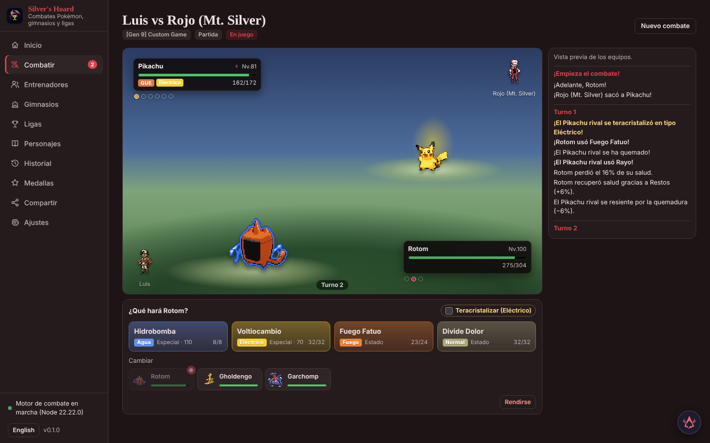
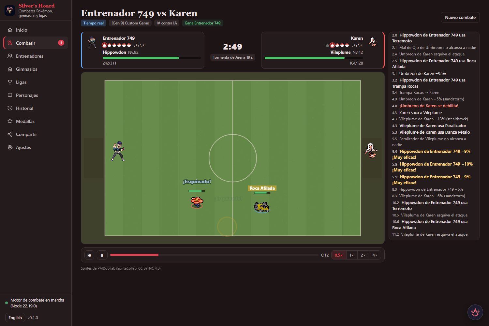

# Silver's Hoard

Finished real-time replays and recorded clips apply a saved forfeit at its exact simulation tick. Seeking and restarting use the same reader. `battle_get` exposes the forfeiting side from the verified result, including older records with a saved forfeit reason and winner, without rewriting their data.

Create a trainer with just a name and choose Pokémon later in the visual team builder. Pasting a team or filling a random team at creation remains optional. Empty trainers are saved normally; they need a team before battling. The same flow is available through `trainer_create` and `trainer_update` in REST/MCP.

Real-time mechanical fog now draws the existing mist on any court while the simulator's public `fog` flag is active. Pyre retains its decorative mist without a duplicate layer; combat rules and arena settings are unchanged.

Share can group saved replay exercises into a themed `.silverexercise` pack, import every position in a fresh library and practise each independently. Themes are curated labels, and imports reconstruct all positions before saving them together. Individual exercise files remain compatible. UI, REST and MCP share `exercise_pack_export` and normal Import. See [exercise packs](docs/EXERCISE_PACKS.md).

`trainers_list` returns the complete matching trainer catalog through REST/MCP, including long fields, without the generic response truncation. Existing query, origin, game and region filters remain available.

Trainer cards can be exported as PNG posters with their current portrait, team and earned badges, using existing sprites and badge artwork. Selected style references supply the palette; recorded credits and origins stay in the image and PNG metadata. Available in the trainer page and `trainer_poster` (REST/MCP), as a local background job using Playwright and Chrome/Edge. [Details](docs/TRAINER_POSTER.md).

Expert doubles battles can label the two moves actually executed by both slots, after the turn resolves. The same recorded pairs appear in the log and `battle_explain`, with an ordinary saved setting to hide them. Replays do not reveal pair labels before their public boundary. See [executed expert pairs](docs/EXPERT_COMBINATIONS.md).

Finished replays can export a printable battle newspaper in English or Spanish, with the saved result, damage table, MVP ties and original log. It uses saved engine figures with explicit units and missing-record notices; no simulation or image generation is needed. See [battle newspapers](docs/BATTLE_JOURNAL.md).

History can search all saved replays by species, move used, trainer, format and result, with paused links to matching turns or RT moments. Filters follow the same recorded actor, report unavailable or ambiguous replay evidence, and leave the originals intact. See [replay search](docs/BATTLE_SEARCH.md).

History includes read-only replay frequencies for move uses, participating species and opening species, filtered by kind, mode and trainer. Tables show record coverage and omit ambiguous identities; they read saved logs without simulating battles. The same `replay_statistics` tool is available through UI, REST and MCP. See [replay frequencies](docs/REPLAY_STATISTICS.md).

Settings includes **Controller diagnostics**: inspect sticks, analog triggers and buttons locally, view bindings for real time, mass battles, gym maps, Pokéathlon and the Arcade roulette, and download a bounded JSON session log. It does not remap controls or send readings to the server. `controller_guide` exposes the same mode guide and a read-only firewall command for Silver's configured port; live hardware is only visible to its browser. See [controller diagnostics](docs/CONTROLLER_DIAGNOSTICS.md) for limits and troubleshooting.

Supplied sprites appear throughout navigation, contests, secret bases and battle effects: 584 entries, including 138 Generation IV goods, 253 animated attack frames and 128 English/Spanish Z-Move title images. The existing Z-Move choice previews Sun/Moon artwork; execution uses the Ultra title without changing move rules. Search 117 contest accessories and 276 base objects; large furniture reserves every occupied tile and survives normal JSON sharing. `leisure_catalog` supports section/query/offset/limit and title language/variant metadata for complete API/MCP browsing. See [supplied sprites](docs/SUPPLIED_SPRITES.md) for credits, coverage, reproduction and remaining unused sheets.

Move sound types load from generated JSON data; playable exports embed the same table. The 935 move mappings and the existing fallback when data cannot load are preserved.

New AI commentary uses the language selected when a battle, challenge, cup, practice or exercise starts (English by default through API/MCP). Later stages keep that choice even if the interface language changes. Existing saved lines and trainer dialogue remain literal.

Z-A Mega forms keep their own appearance when no matching PMD animation exists, including all 49 new gender and cosmetic variants, normal/shiny and front/back. `overworld_import` and `overworld_list` add the supplied Mega ZIP and Delphox-line sheet as persistent user art: ten Megas have four-direction walking sprites, with artist credits and the same images embedded in playable exports. Other forms use static battle images. See [sprite sources](docs/MEGA_SPRITES.md) and [sheet import](docs/OVERWORLD_SPRITES.md).

New real-time battles use rules version 11: **Silver special is optional and off by default**. Enable it in Settings for new battles and playable-page exports; saved matches and results keep their choice, and replays from versions 5–10 retain their special attack. Mega Evolution stays available independently. Version 10's slower walking, partial-speed AI sidesteps, shorter rolls with 2 s recovery and delayed AI dodges remain. Saved grass and sand arenas show their original floor textures in the battle picker.

Real-time battles now distinguish Dig (hide/emerge), Fly and Bounce (rise/descent), Rollout and Ice Ball (sprite rotation), and Seismic Toss impacts (a brief target lift). PMD pose playback follows the engine windup. These are presentation effects, without added invulnerability, damage or physical displacement. Seismic Toss does not pause other fighters for a cinematic.

Grass and sand floors use original textures with stable visual variants; water projectiles add a transparent animated atlas. Plain particles and loading/decode fallbacks remain available. The replay clock drives these effects; reduced motion removes decorative rotation and aerial displacement. The same assets and renderer ship in exported playable pages.

A local Pokémon battle simulator for the Hoard family. It runs on Pokémon Showdown's battle engine (through `@pkmn/sim`), so every generation from 1 to 9, singles and doubles, plays with the real mechanics. You keep trainers, fight them or watch them fight, build gyms and leagues, and send your trainers and gyms to friends as a page they open in any browser.

[Versión en español](README.es.md)

180 shared tools, including `practice_suggestions`, `battle_abilities`, exercises, contests and secret bases; ordinary `import` reads exercise text and files.

The Battle menu changes trainer pictures and lets you pick and order six Pokémon from larger trainer pools. Photo references stay visible while drawing; **Style references** accepts your images, existing trainer sprites and official art, with an explicit active selection. Animated Poké Balls play during switches in both battle modes and in exported pages. PMD animations use available `SpAttack` sheets and actual `HitFrame` markers; missing sheets and offline caches keep their existing fallback.

**Contests** have presentation, an eight-step dance and four appeals to three judges, with saved entries and ribbons. **Secret bases** have an editable 8×8 room, furniture and Pokémon dolls, walking, host battles, recoverable archives and portable JSON sharing. These use Silver's own rules inspired by the games; [rules and limits](docs/LEISURE.md) describe what is implemented. The extra real-time attack is labelled **Silver special**, separately from the Pokémon's four moves.





## What it does

- **Suggested practice positions.** A finished classic replay with decisions can compare either side's recorded choices with a balanced expert trainer, using only information revealed at that time. Analyse ten-turn sections, continue through the whole replay, inspect the actual move and alternative (including target and special transformation), practise or save an exercise, or dismiss a suggestion. Differences are heuristic trainer scores, not win probabilities or proof of a mistake. Singles and doubles are supported; decisions without a comparable option are counted as skipped. Analysis runs separately from the live engine and does not change the source or records.
- **Ability activation banners.** Both battle screens and exported playable pages show a lateral notice with the Pokémon and the activated ability, in Spanish or English. They use public activation events, keep damage animations, deduplicate related messages, support reduced motion and clear on seeking/restarting. `battle_abilities` reads the same revealed activations with turn or tick. New real-time battles use rules v7: Mold Breaker follows the dex's breakable flag for immunities, defensive damage modifiers, Sturdy and status immunity; Thunder Wave can trigger electric absorption, two Magic Bounce users reflect once, and Mist no longer pretends to be an ability. Replays v1–6 retain their rules. Checks cover representative entry, immunity, absorption, contact, status and bypass effects; real time remains its own adapted simulator, not complete parity with every classic ability.

- **Saved exercises.** From a finished classic replay with saved decisions, choose a turn and side and save a goal: win (optionally within a number of turns), or survive a number of turns or win earlier. Share its text or `.silverexercise` file and import it through Share in another library: it contains the starting position and past decisions, never the future or a link requiring the original battle. Each attempt is a separate practice battle, resumable after restart, with its own result and no records, badges or cup advancement. The exercise list shows attempts and explains the suggested difficulty: after three completed successes or failures at the same level, move one level up or down (random through expert). Manual difficulty, including the existing master level, remains available. Exercises can be archived and restored. This practice requires a turn decision record; old replays, imported results, samples and real-time battles cannot supply one.

- **Trainers.** A name, a title, a team, an AI level and style, an avatar and battle lines (start, last Pokémon, last Pokémon at half HP or less, win, lose, and one after the battle on the result screen), plus an optional change of tactics like the bosses in the games: when its team's HP falls to half, or with its last Pokémon, its AI switches to another level or style and it says its line, shown with its Pokémon's angry face crossing the field (turn by turn and in real time, in gym challenges and on the playable page, where the check of a friend's result replays the AI with the same change). Create them by pasting a Showdown export (or PokéPaste, JSON, a packed team), with the visual team builder (species, item, ability, nature, Tera type and moves; each move slot opens a list of what the species learns (in a National Dex format, or for a Pokémon left out of its generation's games, the National Dex movepool with the moves its line learned in earlier games), with type, category, power, accuracy, PP and the in-game description (in Spanish when the app is), filters and search, and the move can still be typed by hand; training as Pokémon Champions does it, 66 stat points with at most 32 in one stat and each one a stat point more at level 50, stored as EVs, or classic EVs and IVs; the team cards show the points; below it, a damage calculator: each move of a team member against any Pokémon or one from another trainer, with the 16 damage rolls, critical hits and hits to KO, stat boosts, Tera, Mega Evolution, weather, terrain, screens and HP left, measured with the game's own formula), or roll a random one from Showdown's random-battle sets. The list has region, game and origin dropdowns: all, your own (the random ones you rolled count as yours, and one you rename, re-team or re-draw stops being marked random), friends', the games' and random ones. Duplicate, favourite, trash and restore. *Sets* on each team member shows Smogon's popular sets for the format (or the nearest one with data) and the species' usage on Showdown's ladder (items, abilities, moves, Tera types, teammates); one click fills the member. *Sample team* builds a team from the format's most used Pokémon. They come from data.pkmn.cc when asked for and are kept a week. From the copilot or MCP, `team_popular_sets` gives a trainer a whole team of the Pokémon you name, written any way ("Mega Delphox", "Shaymin Forma Cielo", "Alolan Raichu"), each with its most popular set: the first written set of the closest format, the Pokémon Champions sets for the Mega Evolutions of Legends Z-A (held as the base species with its stone, stat points turned into EVs), or the ladder's most used build when there is no written one; a name that is not a Pokémon saves nothing and comes back with suggestions. `sets_popular` takes the same names.
- **Characters of every generation.** 214 Gym Leaders, Elite Four members, champions, rivals, villains and their admins, Frontier Brains and other battle facility bosses from Red and Blue to Scarlet and Violet (and the Stadium games and Legends: Arceus), with the over 1,800 teams they used game by game and battle by battle: first battle, rematches, tournaments, battle facilities (the remakes' Battle Tower Master Class, Battle Frontier symbols and prints, Subway, Maison, Tree and Tower pools), multi battles (only their own side), rivals' teams for each starter. Browse them by game: each game is a card that opens its characters in sections (Gym Leaders, Elite Four, champions, captains and kahunas, rivals, villains, battle facilities, tournaments, others), or list them by character with filters for generation, game and category. Each team has its levels, moves, held items, abilities and natures, where it is fought and the game's note, checked against that generation's Pokédex. The romhack **Pokémon Unbound** has a card of its own with its Battle Frontier: 14 special trainers (Palmer, Pat, Pablo, Paula, Skeli, Golche, Gail, Lixdel, Cynthia, Red, Big Mo, Galavan, Candice and Giovanni) with the 67 pools of sets they draw from (special, legendary, Middle Cup and Little Cup; 816 sets), each with the ability Unbound gives that species (it changed them for over 500), played as generation 8 custom games; a trainer made from a pool takes its first six, all different species, and the ones made only for Unbound wear a Showdown trainer class sprite. Open a character to pick its look among all its Showdown sprites (Red and Blue, Yellow, Gold/Silver/Crystal, Ruby/Sapphire, Let's Go, Masters EX…), pick a team, and add it as a trainer, or start an own team for it from that team or from nothing.
- **In-game leagues.** The exact teams of Crystal (Johto and Kanto, Red on Mt. Silver included), FireRed/LeafGreen and Emerald, read from the games' code, and their whole leagues: eight gyms with their badges and types, the Elite Four and the champion, each gym capped at its leader's level. Twelve more leagues are built from the characters' teams of each game: Red/Blue, HeartGold/SoulSilver (Johto, and Kanto with its gyms, the rematch Elite Four and Lance), Omega Ruby/Alpha Sapphire, Platinum, Black/White, Black 2/White 2, X/Y, Sun/Moon and Ultra Sun/Ultra Moon (Elite Four and champion), Sword (the gyms, the Champion Cup and Leon) and Scarlet/Violet, with their cities, badges and types. The Leagues page shows all sixteen from the start in their own tab, next to your leagues and the ones friends sent you; one not opened yet sets up its gyms, Elite Four and champion the first time you open it (`leagues_catalog`).
- **HeartGold and SoulSilver cartridge data.** The HeartGold/SoulSilver teams of the characters are the cartridge's own, read from its decompilation (pret/pokeheartgold) with the game's personality generator: nature, IVs, ability, gender, held item and moves as the game makes them (Whitney's Miltank: Lum Berry, Rollout, Attract, Stomp and Milk Drink, Calm, IVs 12). Each team keeps its trainer's AI flags, which pick the AI level and style when it is added as a trainer, and its lines from the game in Spanish and English, including the one for the last Pokémon at half HP or less and the one after the battle. Kimono Girls, Rocket admins and Eusine come in as new characters. The Johto and Kanto leagues of HeartGold/SoulSilver bring every gym's real trainers, in the room's order, with their teams, AI and lines, and a gym map where each stands, looks and sees as in the game (`hgss_rom_get`; `character_get` marks these teams `cartridge`).
- **Pokémon Champions.** Pokémon Champions plays by its own rules in its formats ([Gen 9 Champions] OU and UU, Battle Stadium Singles and VGC 2026 regulations M-A and M-B, singles and doubles custom games; Showdown's champions mods, which @pkmn/sim does not ship, registered by the engine): stat points instead of EVs (HP = base + points + 75, the rest base + points + 20, then the nature; Silver's points go in as they are), no move above 20 PP, Champions' Megas, items and move changes, and each regulation's validator; real time uses the same stats.
- **Battles.** You against the AI, two people on one computer, or two AIs (played in the background, then replayed). The battle screen shows both sides with their sprites, HP, status, boosts, Terastal, weather, terrain and hazards; a log in Spanish or English (Spanish move, ability and item names, and the battle simulator's own messages in Spanish of Spain for the effects of moves, abilities and items, the field, the weather and why a Pokémon can't move); controls for moves (with type, power, PP and Terastal / Mega / Z / Dynamax when the generation has them), targets in doubles, switches, team preview and forfeit. Every move animates on the turn-based screen too. By default it plays Pokémon Showdown's own animation of that move (the 934 animations of its battle client: Ice Beam's line of icicles, Thunderbolt's bolt from the sky, Body Slam's leap onto the target, Earthquake shaking the field, the backdrop going dark for Hyper Beam…), with the sprites moving as they do there and the effect pictures downloaded once into `data/cache/fx` (the `fx_cache` tool can fetch them all ahead for offline battles); a third style plays Pokémon Reborn's animations (748 moves and the statuses, by The Pokémon Reborn Team, with their backgrounds and sounds) through our own player, each downloaded from pokerogue-assets the first time it comes up (`reborn_cache` fetches them all); the field shows one of Showdown's backdrops for the format's generation, with its weather and terrain overlays (or, in Settings, one of three pixel-art backgrounds: meadow, beach, snow). Settings can switch to Silver's own effects, which also cover any move Showdown has no animation for, and to Silver's gradient field. Silver's effects have the look they have in real time: beams, projectiles, claws, bites and punches, lightning and rocks from the sky, quakes that shake the screen, hit bursts by type with a flash on a critical hit and extra weight on a super effective one, auras for boosts and heals, status particles and weather particles; the damage shows when the move lands, in singles and doubles, in live battles, replays and the playable page. Settings has a switch for it (also on the arena); it follows the system's reduced-motion preference and is skipped at the fastest replay speed. Finished battles replay with play, pause, step, jump to a turn and four speeds. Live battles survive a restart. Battles have sound, in both modes: hits (normal, super effective, not very effective, critical), misses, faints, stat changes, status, healing, switches, a whoosh for each move tinted by its type, click sounds and victory and defeat jingles are synthesised in the browser (no audio files); each Pokémon cries when it is sent out (lower and shorter when it faints), and a battle track picked from the battle and the format's generation loops and fades out at the end. Settings can switch the music to PokeRogue's community tracks (only the ones its composers made, CC BY-NC-SA): gym battles play a track that fits the gym's type, the champion and the Elite Four have their own, and the rest pick from the pool. Cries and music are downloaded once and kept in `data/cache/audio`; without internet the battle plays with effects only. A speaker button on the field and a Sound section in Settings set master, music, effects and cries volumes and mute; the playable page has the effects too. Under the arena, *Why* shows each AI decision of the turn on screen: the options it weighed with the expected damage and KOs, the threat it was under, who was faster and, for the expert AI, the candidate turns it played out (for the master, the futures it searched, with each option's share of the search and estimated win); in a live battle it also tells you what the expert AI would do in your place (`battle_explain`). A finished battle, turn-based or real-time, becomes a video clip with its sound (*Video*, `battle_video`): a windowless Chrome or Edge plays the replay alone on a 16:9 stage (a real-time one on its arena with the bars and the credit line, at 1× or 2×), records the tab's picture and the page's effects, cries and music, and leaves an MP4 in the exports folder, optionally handed to Lumiere's Hoard, the family's video editor (needs `requirements-video.txt`). Trainers' lines show the face of their Pokémon on the field (SpriteCollab portraits: determined at the start, joyous when winning, sad when losing); a Pokémon that faints shows its pained face; Mega Evolution, Z-Moves and Terastallization cross the field with a band and the Pokémon's determined face; and the result shows the winner's joyous face next to the loser's crying one (downloaded once into `data/cache/pmd/portrait`, the closest emotion when a Pokémon has no such face; on the playable page straight from SpriteCollab). Besides Showdown's sets, the Pokémon can be drawn with the 3D sprites of Pokémon Champions, Legends: Z-A or Scarlet / Violet from PokeAPI's collection (downloaded once; formes they do not have use the gen 5 pixel art), and a Pokémon that is hit flashes white.
- **Real time.** A second way to play every battle, after Pokémon Legends: Z-A: the same trainers and teams on a 2D arena seen from above, with no turns and no PP. Each move has a cooldown in seconds (that game's own value for the 337 moves it has; the rest worked out from PP, power and kind, within 1.3 s of its table on average) that the user's Speed shortens, a wind-up during which the user stands still, and a shape on the field: strikes, dashes, projectiles, beams, cones, areas and blasts that land where the target stood. There is no accuracy: a move hits if it reaches, so you dodge by moving or rolling. Damage, types, abilities and items keep the turn-based formula; stat changes are one stage and last 20 s; sleep becomes drowsiness (cooldowns at half speed); three switches per trainer, back after every knockout; a time limit decides on Pokémon standing, then HP. Holding the lock-on keeps the Pokémon facing the foe, so it strafes and its moves aim at the foe; without it the Pokémon faces where it walks and its moves go that way (snapping to the foe only within 30°), so shots and beams can miss and strikes lunge forward and land only if they reach. The arena is open or, by default for new battles, has 3 to 6 rocks placed from the battle's seed and mirrored for both sides: they block walking, rolls, dashes, projectiles and beams, while quakes and blasts from the sky go over them, and the AI walks around them. Each trainer has a three-segment Mega Power gauge that fills a segment every 8 s (15 s in battles stored with rules version 2; faster when dealing damage); a full gauge Mega Evolves a Pokémon holding its Mega Stone (or Rayquaza with Dragon Ascent) once per battle: the Mega forme's stats, types, ability and sprite while the gauge drains a segment every 8 s, then back to its usual forme. There are no Plus moves (rules version 4); battles stored with versions 2 and 3 replay with theirs. In doubles formats each trainer has two Pokémon on the field at once: you move one of them (Tab or C swaps which, L on a gamepad) and the AI drives its partner, which stays within reach, dodges, keeps out of the way of your quakes and attacks the foe you lock on (X or the right stick click switches it) unless the other is clearly better; the screen marks the one you move and the foe you lock on, and shows both Pokémon of each side with their slot. Spread moves (Earthquake, Surf, Discharge, Rock Slide, Heat Wave, Hyper Voice...) hit every Pokémon in their area, your partner too for those that hit everything around the user, at ×0.75 when more than one is hit; Helping Hand powers up the partner's next attack ×1.5 and Follow Me and Rage Powder draw the foes' attacks for 3 s, bending projectiles already in the air; each fallen Pokémon's slot is refilled from the bench (you pick from the party bar), the three switches and the gauge are the trainer's, and a trainer loses when nobody is left to come out. The AI trainers play their two Pokémon the same way, choosing targets by damage and threat. Battles stored before these rules keep the old ones (always locked on, open arena, no gauge; doubles formats as singles), so their replays stay exact. You play with the keyboard or a gamepad, laid out as in Legends: Z-A (hold Shift / ZL to lock on, the four moves in a diamond like X A B Y on I L K J or the face buttons, Space / Y to roll, M / R to Mega Evolve, Q / E and the D-pad to pick a Pokémon and R / ▲ to send it out; a simple layout keeps A B X Y for the moves, is always locked on, and uses L for Mega) against the AI (the same five levels and styles, now with reflexes: dodging, spacing, switching), two people share one keyboard, or two AIs fight and you watch. Battles replay exactly from their seed and inputs, in the app and in the engine, which is how the result of a played battle is checked. Gym and league challenges, series and tournaments can be played in real time too (and friends can fight your gyms and trainers in real time on the playable page), and each trainer's page shows its moves' cooldowns. The arena draws Mystery Dungeon-style walking sprites in eight directions, downloaded once from PMDCollab's SpriteCollab, and each move has its own look: continuous beams (crystals along Ice Beam, zigzag lightning, flame and water jets, psychic rings, dragon helixes, Hyper Beam), shaped projectiles (fireballs, ice shards, leaves, rocks, shadow orbs, stars, crescents), claw marks, punches and bites, lightning and rocks from the sky, quakes that crack the ground and shake the screen, hit bursts by type, auras for boosts and heals, status particles and weather. Big blows hold the action for an instant (hit-stop: longest for a K.O., then critical and super-effective hits) and shake the screen by trauma (small hits barely, big ones hard); moves that cover an area (quakes, blasts around the user and cones) are drawn on the ground while they wind up, filling as they charge, so you know when to roll out of them; Mega Evolution crosses the screen with a band and the Pokémon's determined portrait. All of it happens on the screen only: the battle and its replays do not change. Training (Battle > Training) puts your trainer against a dummy that never faints (a knockout heals it back, and your own Pokémon too, so recoil never ends the session: a Sudowoodo or any trainer's team) that stands still, walks in circles, rolls away from attacks or fights back like the easy AI, with a panel of damage per second (overall and over the last 5 s), total damage, hits and criticals and each move's share; it counts for no record, progress or medal (`training_start`). Rules version 5 adds the ultimate gauge: dealing damage (a whole HP bar = half the gauge), taking it and knocking out fill it, and once full the Plus key (F, ZL + + on a gamepad) unleashes the active Pokémon's ultimate: a 150-power attack of its own type that falls on the foe after 0.9 s in a circle drawn on the ground, so it can be rolled out of; the AI uses it too, and older battles keep their rules. Particles use Kenney's textures (lights, sparks, stars, smoke and bubbles tinted to each effect; Settings can go back to drawn shapes), and Settings can add Scarloxy's pixel-art impacts on top: fire, water, ice, grass, claw and energy hits play a 4-frame animation.
- **Real-time presentation.** As in pixel-art battle videos: a VS screen with both trainers and their first Pokémon, Poké Balls thrown with "Go, X!" and "X, come back!", big callouts (Fight!, K.O.!, fainted, a trainer's last Pokémon, combos of 3 hits or more, clashes when both land a contact move at once), an impact frame with speed lines and both Pokémon's silhouettes on the hardest blows, red edges, a camera that pushes in on critical hits, K.O.s, Mega Evolutions and ultimates, marks that stay on the floor (cracks, craters, scorches, slashes, skids), a wave across the screen for Surf and the winner's band before the result. The bars show the Pokémon's face (grey once fainted) and a white chunk that drains after the damage. Own looks for Hypnosis and its kin (rings on the ground), Lick (a tongue), Wood Hammer and other hammers, Gear Grind and Shift Gear (gears), Hex and Bind (chains), Giga Drain and other draining moves (a tether of light to the drainer), Will-O-Wisp, Draco Meteor (a meteor shower), Double Team (copies) and orbs gathering before Shadow Ball or Sludge Bomb. Drawing only: the battle is the same with or without it (`engine/test/rt-show.test.mjs`). In Settings: show or plain, damage numbers in percent or HP, and the camera or the impact frame off.
- **Places, audience and lines in real time.** The arena designer has five places from the games as floors and templates (Mt. Pyre with gravestones and drifting fog, a snowy Mt. Silver with falling snow, Meteor Falls with puddles, stalagmites, crystals and light from above, a champion's room with tiles, a glowing golden emblem, carpets and columns, and a castle with a golden border, brick walls and columns). In every arena, Pokémon that live there watch from the edges (ghosts on Mt. Pyre, ice Pokémon on Mt. Silver…), drawn with SpriteCollab sprites, and jump on big blows, K.O.s, Mega Evolutions and the end. Trainers say their lines in speech bubbles during the battle: the intro at the start, their last Pokémon, a knockout or a faint, a super-effective hit, a switch, and winning or losing. The audience and the bubbles can be turned off in Settings; places do not change the rules.
- **The AI.** Seven levels: random, easy, normal, hard (the best calculated option every turn: damage measured with the game's own formula on a copy of the battle, status, boosts, hazards, recovery, switching, Terastal), expert (it plays each candidate turn out on copies of the battle against the opponent's likely answers and keeps the one with the best outcome; in doubles it does the same with pairings of both Pokémon's best options) and master (it searches hundreds of thousands of possible futures of the turn, about a second a turn, with the Monte Carlo tree search of poke-engine, an optional Rust battle engine: `requirements-master.txt`, `ai_levels`; 9th-generation singles, and elsewhere or without poke-engine it plays as the expert). and neural (a reinforcement-learning policy trained on millions of real battles, the metamon project's Kakuna, run on your GPU by a small local server from its own Python environment with PyTorch: `scripts/neural_ai_server.py`, settings in Settings › Neural AI or `neural_ai_*`, the `neural_ai` tool; it sees only what its side sees, plays singles of generations 1-4 and 9 in about 0.2 s a decision, and elsewhere or while its server is down plays as the expert; the battle notes say when the network chose). Five styles: balanced, aggressive, defensive, setup, stall.
- **Series, tournaments and team benchmarks.** The same two trainers N times (win rate, average turns, KOs, damage and survival of every Pokémon, the MVP of each side, one sample battle of each outcome), a tournament between up to 64 trainers (single elimination with byes or a round robin with a table, best of 1, 3, 5 or 7), or a team-variant benchmark: two or more trainers against the same rivals with one shared master seed (wins/losses/ties per rival, delta versus a reference, improved and worsened lists, MVP; the hall of fame is never written). They run as background jobs; Trabajo shows the tables when the job finishes.
- **Cups.** A knockout bracket that fills in on the screen as it is played: pick the trainers, draw them at random from yours (optionally filtered) or both, seed them at random or in the order picked, and choose one to play as. The AI plays every other match in the background one after another at the pace you choose, the bracket animates each result up to the champion, and your matches wait for you to play them (turn by turn or in real time) or to send them to the simulator; any AI match can be watched live instead. Best of 1 to 7, byes for the top seeds, every game stored as a replayable battle, and a strip on the battle screen to go back to the bracket (`cup_start`, `cup_get`, `cup_play`, `cup_simulate`, `cup_watch`…).
- **Arena designer.** Draw your own real-time arenas: up to 16 rocks placed by hand (drag to move, a size slider, left-right symmetry, templates) and a floor (grass, sand, ice, cave, indoors, water). Any battle, series, tournament or cup can be fought on one, a battle keeps the field it was played on so replays never change, and *Try it* starts an AI-vs-AI battle there (`arena_save`, `rt_arena=custom:<id>`).
- **Equalized levels.** Every battle, challenge, series and tournament can put all Pokémon at level 50 or 100 for that fight, so a level 88 team does not crush a level 44 one unless you want it (also a default in Settings).
- **Gyms and leagues.** A gym can have a map: a room you paint tile by tile (floor, walls, water, boulders, plants, carpet, grass), drawn in the gym's type colours or in pixel-art tiles, or make automatically, with its entrance, its leader and every gym trainer standing where you put them, each looking one way with a line of sight (or turning on the spot every so often, like the games' trainers). The map takes the games' gym puzzles: ice that slides you until something stops you, arrow tiles that carry you their way and switches that open the doors; and pixel-art buildings (a Pokémon Center, a shop, three gyms and four houses) that take up their room and can't be walked through. The automatic layout can add an ice, arrow or switch puzzle, and saving checks that everything is reachable under the puzzle's rules (`gym_map_generate`, `gym_save`). A challenge on it is walked with the keyboard, a gamepad or the on-screen pad: a trainer who sees you calls out, walks up and battles you, and the leader only takes you on once every trainer is beaten; it also works on the playable page you send friends, whose result then lists the battles in the order they were met. A gym can also fight all its real-time battles on its own arena and show a chosen backdrop in its turn-based battles (one of the simulator's, one of the pixel-art ones or a picture of your own, shrunk to travel); map, arena and backdrop travel with the gym. A gym has gym trainers (fought in order) and a leader, a type, a badge with its colour and picture (one of 18 drawn shapes, a picture of your own, or badges drawn by Prospero's Hoard from a description; the picture travels with the gym and the badges won keep it) and rules (fixed level, level cap, minimum level, extra Showdown rules). Challenge it yourself or let your trainer's AI do it; between battles your team is healed; winning every battle gives the badge. A league needs its badges, then the Elite Four and the champion; whoever beats it enters the hall of fame. A challenge can use the gym's own generation or current rules.
- **Friends.** Export a trainer, gym or league as a file (`.hoardtrainer`, `.hoardgym`, `.hoardleague`) for another Silver's Hoard, a share code to paste in a chat (with your own sprite inside, big drawings shrunk), the team as Showdown text, or a **playable page**: one HTML file of about 2 MB with the battle engine and the AI inside (packed; it unpacks itself when opened). Your friend opens it in any current browser (Chrome, Edge, Firefox or Safari from 2023 on), pastes or rolls a team and fights your gym or trainer, turn by turn or **in real time** (the export asks "Mode for your friend": turn by turn, real time, or their choice for each battle, the default; `friend_mode` on the `export` route and tool). In real time the page runs the same arena, rules, keyboard and gamepad controls, lock-on, rocks and Mega Evolution as the app, with the effects offline and no cries, music or walking sprites (the static battle sprites draw the Pokémon). At the end the page gives a result code (and a result file with the replay). A result with real-time battles (`SILVERWIN2-`) carries, for each one, the rules version, seed, arena, time limit, a key of the opponent's team and the input log (packed: about 4-6 characters per input change, so a keyboard battle of a few minutes is 2,000-6,000 characters and a stick can be several times that: past 6,000 the page pushes "download the code as a file", and the app takes the text or the file). Importing it here replays every real-time battle with the same simulator against the opponent as this app has it, and the battle, the badge or the win are only recorded if the replay ends with the friend's win; an edited code, a changed gym or an illegal team is refused with a message. Turn-based results (`SILVERWIN1-`) carry each battle's input log and are replayed the same way (codes from older pages without it are still accepted, unchecked). Every imported result goes to **Friends**: a leaderboard per gym or trainer with each friend's best result (a full win, checked by replaying, the furthest battle, the fewest turns, the most HP left; a code counts once; entries can be removed), and the **challenge of the week**: a page exported with *Challenge of the week* plays every battle turn by turn with that week's seed and AI luck, the same for everyone who plays it that week, and its results are ranked by week (`weekly` on `export`, tools `leaderboard` and `leaderboard_remove`). Teams also travel as pokepast.es links: *pokepast.es link* publishes a trainer's team (public, after a confirmation) and Import takes a link back as a new trainer, with the paste's title and the format named in its notes. A Pokémon Unbound save file (the .sav or .srm of version 2.1 that the emulator writes) can be imported too, from the same box or `unbound_save_import`: its party becomes a trainer with each Pokémon's forme, held item, the ability Unbound gave it (hidden ones included), moves, level, nature, EVs, IVs, nickname and shininess, played as a generation 8 custom game like the Unbound Battle Frontier trainers; eggs and anything Showdown does not know are left out and named in the trainer's notes. The **friends' league** adds up what friends bring back, season by season (calendar months, or all): per friend and gym or trainer the best result counts, a full win 3 points (+1 when replaying it checked out), each battle won on the way 1, the week's challenge +1; Friends shows the table and *Export and publish* saves it as a page to send and announces it on the family bus (`friends_league`, `friends_league_export`). The **week's vote** picks the rule of the week's challenge: offer a few Pokémon or team-building rules (monotype, Little Cup, a team of three, no repeated items), send the link (served by the same room server as live battles) and friends vote from any browser with their name; closing it makes the winner that week's rule, which the playable page asks for and the app checks on the returned team (`poll_open`, `poll_get`, `poll_vote`, `poll_close`, `week_rule_clear`).
- **Include a result's team.** A playable page's result has an optional Showdown-text copy of your team, off for every new attempt. The code shows its actual character count; including the text makes it longer. Replay data still includes the structured team either way. Importing a result with the text shows its canonical team to copy or explicitly save as a trainer, with an editable name; importing alone never saves a trainer. Both presentations of the same game count once, and older result codes remain supported.
- **Live battles with a friend.** Battle someone on another computer (Battle > Live, `pvp_open`): open a room with one of your trainers, turn by turn or in real time, and send its link; the friend opens it in any browser (nothing to install), brings a team (pasted, random or a trainer file) and joins, and you start (`pvp_start`). Turn by turn this app runs the battle and each side only sees its own view of it (the friend never gets your team's sets, nor you theirs) and sends its own choices; in real time both screens run the same simulator from the same seed in lockstep through the room (each input applies four ticks after it is read, a screen that reloads catches up from the start, the two screens compare a fingerprint of the battle every two seconds, Esc opens a give-up menu instead of pausing). The battle is stored here like any other, replayed from its inputs. While a room is open Silver listens on a second port (`pvp_port`, 5240) that serves only the rooms, each behind a key in its link; the links work on your own network, and Settings › Live battles takes the public address (a tunnel or an open port) for friends outside it. Each room also has a watch link: the audience sees the battle without playing (turn by turn the public view of the log, no hidden team; in real time its own copy of the simulator with both players' inputs, which the room forwards), and the room counts who is watching. To find a rival without passing links around, your lobby (`pvp_lobby`, `/lobby?c=…`) lists your open rooms: whoever has the address joins one waiting for a rival or watches one being played (a page that opens in any browser, or from another Silver); opening a room you choose whether it shows there. Your friends' lobby addresses are kept in Silver (`pvp_friend_add`) and their open rooms show together in Battle > Live (`pvp_friends`) and in the Hub's Today view, each with its join or watch button. `pvp_lobby_new_code` changes the code if an address went too far.
- **Mass battles.** Dozens or hundreds of Pokémon at once on one field (up to 1100: the whole National Dex fits), each with its own AI, in the style of epic battle simulators (Mass battle, `mass_start`): everybody against everybody until one is left (battle royale), teams (two armies or all nine generations at once) or many against a few (one or more giants, bigger, with far more health and harder hits, worked out from the crowd they face). Who fights comes from whole generations of the Pokédex, the strongest of each generation, the 27 starters, the legendaries, a random pick, a list of names (formes included, such as Eternamax Eternatus) or your trainers' teams; each one's moves are picked from what it can learn (its own types first, coverage and one extra: healing, a stat boost or a status). The rules are real time's (cooldowns, move shapes, reach, no accuracy) with the damage formula, types, critical hits, some abilities and statuses; area moves share their damage among whoever they reach. Ready-made battles come from the battle royale videos (all 1025 of the National Dex, Kanto's Pokédex, the starters, every shiny legendary, Paldea, the top 15 of every generation in teams, Gen 1 against Gen 3, Johto against Hoenn against Sinnoh, Eternamax Eternatus against Gen 1 or against Ultra Necrozma, Groudon and Kyogre, Mewtwo against the starters) and a builder makes your own (level, floor, time, named and coloured teams, shinies, the giants' multipliers). The engine plays the whole battle in seconds and keeps it; the screen plays it again from its seed and checks it ends the same way: an intro with a countdown, the field with everybody (walking Mystery Dungeon sprites, or Showdown's icons while they load and always in crowds over 300), each move's name in a pill of its type, beams, projectiles, areas marked on the ground, knockouts that dissolve, each team's bar and the giant's, a knockout feed, speeds up to ×8, a jump to the end, a camera that zooms and follows one Pokémon, and the result with the ranking and the best one. Any battle can be fought again with another seed. **Play one Pokémon of the crowd** (`mass_play`): pick any of them (a giant too) and lead it with WASD or the stick, its four moves on 1-4 (or the pad's buttons) at the mouse or the nearest foe, and a roll on Space that nothing can hit; everybody else keeps their AI. The screen records what you do tick by tick and the engine replays it to check it before keeping the run (place, KOs, damage, whether your side won); each battle has its table of played runs and any run can be watched again. **A page for friends** (`mass_export`): an HTML file with the battle inside that a friend opens in any browser to watch it or play one of its Pokémon; at the end it gives a `SILVERMASS1-` code you paste in Import and the app replays their run before recording it (importing the page itself into another Silver adds the battle). **Video** (`mass_video`): the battle or a played run, with sound and the camera following the action, as an MP4 (to Lumiere's Hoard too). On screen you hear the moves, hits and knockouts, and an auto camera frames whoever is still standing.
- **Battle facilities.** Win streaks as in the Battle Tower: the Emerald and Sinnoh Battle Towers, the Battle Subway (single and double trains), the Battle Maison and the Battle Tree (singles and doubles) and the Galar Battle Tower. One rival after another at level 50, three Pokémon a side (four in doubles) picked at team preview, rivals that get harder each round of seven, and each facility's bosses on their battle with their teams from the games (Palmer on 21 and 49, Ingo and Emmet on 21 and 49, the Battle Chatelaines on 20 and 50, Red and Blue on 20 and 50, Anabel on 35 and 70, Leon every 10; the Battle Tree's legends show up now and then). Play every battle, or let the AI play the streak up to a limit; turn-based or in real time. The record is each trainer's longest streak. The Battle Factory (Emerald, Platinum, and one with Scarlet/Violet sets) lends the team: three of six rental Pokémon each round of seven, and after each win one of them can be swapped for one of the beaten rival's.
- **Battle Frontier of HeartGold and SoulSilver.** The Battle Hall, Battle Arcade and Battle Castle with the rules of the cartridge, read from its decompilation (pret/pokeheartgold). Battle Hall: one of your Pokémon against rivals of the type you pick on a board of 17 types, each type with its rank from 0 to 10; the rival's level comes from the game's formula (your level, that type's rank and how many types you have ranked), its set and trainer class from the rank, and Argenta waits on battles 50 and 170. Battle Arcade: three Pokémon; before each battle a roulette of 16 panels spins at the speed of the streak and stops when you press (Space, Enter, a click or A) or on its own, and its event applies to the next battle: your side or the rival's poisoned, paralysed, burnt, asleep or frozen, HP lowered, sun, rain, sandstorm, hail, fog or Trick Room, berries or held items handed out, three levels more, the teams swapped, the battle skipped or Battle Points; the odds of each colour depend on how you did in the last battle; Dahlia on 21 and 49. Battle Castle: three Pokémon whose HP and PP carry over from battle to battle; Castle Points earned by the game's formula buy healing, PP, cures, rental berries and items, a look at the rival's Pokémon, their summary and moves, the rival's level up or down, rank-ups of each service and skipping a battle (50 points); Darach on 21 and 49. Thorton is the boss of the Platinum Battle Factory on 21 and 49. Every facility keeps its record and Battle Points; the Hall also plays in real time. A battle can start from a given state (HP, status, PP, weather, Trick Room and Generation 4 fog), which the Arcade and the Castle use (`frontier_get`, `frontier_hall_pick`, `frontier_arcade_stop`, `frontier_castle`).
- **Pokéathlon.** The ten Pokéathlon events of HeartGold and SoulSilver, playable in the browser with any Pokémon of every generation: Hurdle Dash, Pennant Capture, Relay Run, Block Smash, Circle Push, Disc Catch, Lamp Jump, Ring Drop, Snow Throw and Goal Roll, with the constants, the effect of each stat and the rival AI of the game. Five courses of three events (Speed, Power, Skill, Stamina and Jump), the Supreme Course with the strongest teams, and single events. Each Pokémon plays by its five stars (speed, power, skill, stamina, jump): the cartridge's for the Pokémon HeartGold and SoulSilver have (and their formes), and for the rest an estimate from base stats, weight, height and types fitted on the cartridge's (93 % within one star). Your three Pokémon come from any trainer or any species, with their stars set between their minimum and maximum; the rivals are the game's 100 teams, random Pokémon or ones you pick, or the CPU plays your team too and you watch. Mouse or touch, keyboard and gamepad. The closing ceremony gives the game's bonuses, the medal, Athlete Points and records (`pokeathlon_stats`, `pokeathlon_courses`, `pokeathlon_npc_teams`, `pokeathlon_result_save`, `pokeathlon_records`, `pokeathlon_history`).
- **Progress.** Each trainer's record (by kind of battle), current and best streak, KOs, star Pokémon, facility records, badges, 22 achievements and a Pokédex of the species it used, saw and knocked out, all worked out from what is stored; and every own trainer ranked by wins. In the Pokédex, the knocked-out tab shows every species seen, the ones still to knock out as silhouettes.
- **Avatars.** Pick any of the 1,500 Showdown trainer sprites, a picture of your own as it is (*Upload a picture* at the top of the picture dialog, Ctrl+V, dropping it on the dialog or pasting its link; kept up to 1024 px, nothing pixelated or generated; `avatar_from_url`), a character's or trainer class's official artwork game by game (the *Official art* tab and each character's page, from the Pokémon Wiki: the page shows it from the wiki and keeps it here only when chosen; `official_art_search`), one of *Your pictures* (everything uploaded, photos given to Prospero, drawings, sprites, poses and art, each picture once, searchable by trainer; `avatar_images`), turn a photo into a 96-px pixel-art sprite here (background removed, few colours, outline), or have Prospero's Hoard draw the trainer: from up to four photos of the same person and/or a description, in the games' anime art style taken from style references (three Black and White trainer sprites by default; add your own pictures, such as official art or anime stills, in Settings), cut out with background matting and returned both as the drawing and as the 96-px sprite (a job; Prospero must be running). Its *Pokémon style (not pixelated)* result draws it like the games' official art, keeps the drawing up to 1024 px and gives it to the trainer, with only your own pictures as style references (`avatar_draw` `look: art`; its prompt is a setting). Clicking a trainer's picture, a sprite in the picker, a pose or a character's look shows it big (pixel art enlarged by whole steps, drawings and art smoothed; arrows page through them); drawings, photos and art are smoothed wherever they appear, in battles and on gym maps too. Prospero can then draw your own sprite again from behind, shown on your side of a battle, and in a victory pose, shown when it wins (Poses tab; they belong to that sprite).
- **Battle lines with AI.** The family's language model (through Hoard Hub: the Sparks, Faustus or Ollama) writes a trainer's four lines from its team and a personality you describe. Trainers also have four lines they say by themselves during a battle (when their Pokémon knocks one out, when one of theirs faints, on a super-effective hit and when they switch), in the app and on the playable page; and with the setting The AI comments its moves, the model writes an in-character line for each AI move in the background (one per turn, never holding the battle up).
- **Family.** Faustus's copilot on every page, an MCP server with 180 tools (`mcp_server.py`), events on the family bus, and the shared Hoard look.

## What it does not do

- No online battles between two copies of the app: friends play your gyms and trainers against the AI in the playable page and send the result back.
- No Pokémon art in the repository or the app: sprites are downloaded from the Showdown sprite server the first time they are needed and kept in `data/cache/sprites`. Without internet the field shows initials until they are cached. Cries and battle music work the same way (`data/cache/audio`).
- By default the AI knows both teams, as in-game trainers do, but never the move a person has just picked: the expert guesses it. With *The AI does not see your team* (Settings, or `ai_hidden` on a seat) it plays like someone on the ladder: it only knows what the battle has shown (the Pokémon of team preview or sent in, the moves, items, abilities and Tera types seen) and guesses the rest from the format's usage statistics (or, without them, the strongest moves of each Pokémon's types); its notes say so. The expert's advice for a person never sees the other team. The expert searches in singles and doubles; in triples it plays as hard. The master searches only in 9th-generation singles.
- Real time plays singles and doubles formats (triples play as singles) and leaves out Z-Moves, Dynamax, Terastallization and the Alpha Pokémon of Legends: Z-A; Trick Room, Transform and a few copying moves have no effect there, and in doubles Wide Guard, Quick Guard, Ally Switch and the other ally-targeting moves except Helping Hand, Follow Me and Rage Powder have none either (`rt_rules`, `rt_cooldowns`). On the friends' playable pages it works offline except for the walking sprites, cries and music, which come from the app.
- The result codes are not signed, but each battle travels with its record and the app plays it again on import: turn-based battles from the simulator's own input log (same seed, the expected teams, every choice legal, the same ending, and with the same AI version the opponent's choices must be the ones its AI makes again), real-time ones from their inputs. A badge checked this way says so. That catches an edited code, not a battle played by a script or a tool that feeds the simulator inputs; codes from older pages (no record) are still taken as a record between friends.
- Noland and Thorton (Factory Heads) and Argenta (Hall Matron) have no fixed team in their games (rentals, or one Pokémon per type), so they are not among the characters; the Battle Factory facility plays the rental format.
- Planned work is in [OBJETIVOS.md](OBJETIVOS.md) and what is left to check in [PENDIENTES.md](PENDIENTES.md).
- The exact, code-read teams and ready-made leagues cover Crystal, FireRed/LeafGreen and Emerald; the characters of the other games come from Bulbapedia's tables, so their IVs and EVs are not known (they use 31 IVs and no EVs). Battles use held items only: no potions or other bag items. Battle facility pools (Battle Tree, Battle Tower) are left out.

## Install and run

```bash
npm ci                       # Node.js 20 or newer: the engine and the client
npm run build                # the UI and the playable page template
python -m venv venv && venv/Scripts/pip install -r requirements.txt   # or venv/bin/pip on Linux and macOS
venv/Scripts/python -m silvers_hoard    # http://127.0.0.1:5230
```

Hoard Hub finds it through `faustus-plugin.json`. Data lives in `data/` (or `SILVER_DATA_DIR`): `silver.db`, avatars, exports and the sprite cache.

## For assistants

`python mcp_server.py` is a stdio MCP bridge to the running app (it starts it when needed). The tools cover the whole app: `battle_start` / `battle_choose` to play, `series_start`, `tournament_start` and `benchmark_start`, `challenge_start`, `canon_install`, `characters_list` / `character_get` / `character_install`, `stat_points`, `damage_calc`, `facilities_list` (with `challenge_start` kind `facility`), `factory_pick` / `factory_swap`, `progress_get` / `progress_list`, `badge_image_set` / `badge_draw`, `backdrop_image_set`, `export` / `import`, `avatar_from_photo`, `avatar_from_url`, `avatar_images`, `official_art_search`, `trainer_dialogue_write`, the real-time tools (`mode: realtime` on `battle_start`, `challenge_start`, `series_start` and `tournament_start`; `rt_cooldowns`, `rt_rules`, `battle_rt_finish`) and the rest (`GET /api/agent/tools`).

## Practice from a replay

New played and individually watched turn-based battles keep their decision records. Once finished, **Try another move** lets you choose a turn and a side and open a separate playable battle from that point. The opponent uses only the revealed information about your team; **Why** still offers advice. Practice can be saved and resumed, and its winner and duration compared with the original. Practice does not earn badges or affect trainers' records.

MCP tools: `battle_practice` opens the branch and `battle_compare` compares results. `battle_get` reports practice availability and the link to the original. Old replays without decision records, imported results, series/tournament samples and real-time battles cannot be used for this turn-based practice.

## Credits

The app's *Credits* page (link under the menu and in Settings; `credits` tool) lists every source below with its licence and who drew each sprite: the artists of the trainer sprites, from Showdown's trainer sprite index (Showdown asks for credit to the artist), and of the real-time arena's walking sprites, from SpriteCollab's tracker, with a lookup by sprite or Pokémon. Trainer and character pages and the sprite picker name a sprite's artist, and the real-time arena names the artists of the walking sprites on screen. Both lists are downloaded once and kept in `data/cache/credits`.

Battle engine: Pokémon Showdown by Guangcong Luo and contributors, through the `@pkmn` packages (MIT). In-game teams from the pret disassemblies (pokecrystal, pokefirered, pokeemerald); the characters' teams of every game from Bulbapedia (CC BY-NC-SA 2.5). Spanish names of moves, abilities, items and natures, and Spanish descriptions of moves and abilities, from PokeAPI's data. Sprites, Pokémon cries and battle music are served by the Showdown sprite and audio servers (the cries and tracks belong to their game studios and composers). The log's official messages and the parser that fills them in: the simulator's `data/text` and its client's `battle-text-parser.ts` (both MIT). Real-time rules and move cooldowns from Pokémon Legends: Z-A as documented by Serebii and Bulbapedia. Turn-based move animations: Pokémon Showdown's battle client, `battle-animations-moves.ts` (CC0) and the tables of `battle-animations.ts` (MIT), played by our own canvas port; its effect pictures by Kris Johnson, Kevin Lau, Ridaz, Catherine D. (SailorCosmos), Shriansh Chari (Tb0lt) and the other artists in pokemonshowdown.com/credits, and its backdrops by Kyle Dove, downloaded on first use. The arena's walking sprites are PMDCollab's SpriteCollab (CC BY-NC 4.0, by its many artists; credit list in that repository), downloaded on first use; lining them up by the shadow's ground anchor follows PokéSurvivor's sprite tools (MIT). Reborn animation style: Pokémon Reborn's move animations, sheets and sounds (The Pokémon Reborn Team, rebornevo.com, reusable with credit), only the files pokerogue-assets marks as Reborn's, downloaded on first use. Optional community music: the tracks composed for PokeRogue by Firel, Lmz, Andr06, Leavannite, Bird_Obsession, MattCello, Veilure and Faces in the Clouds (CC BY-NC-SA 4.0), downloaded when chosen. Real-time particle textures: Kenney's Particle Pack (kenney.nl, CC0; scripts/build_kenney.py reduces them to 64 px). Pixel-art battle backgrounds (meadow, beach, snow), real-time hit effects and gym map tiles: Scarloxy's MyPixelWorld Special Packs #01 (scarloxy.itch.io/mpwsp01, CC BY 4.0; scripts/build_mpw.py bundles them). Optional 3D sprite sets: PokeAPI's sprite repository (github.com/PokeAPI/sprites; the pictures are the games' art), downloaded when chosen. Pokémon portraits with emotions: SpriteCollab (CC BY-NC 4.0). Official artwork of trainers and characters: the games' illustrators (© Nintendo, Creatures, GAME FREAK), as the Pokémon Wiki (pokemon.fandom.com) lists it; shown from the wiki and kept here only when chosen.

This is a fan project and is not affiliated with Nintendo, Game Freak, Creatures or The Pokémon Company. Pokémon and all related names are trademarks of their owners.

## Licence

MIT (code). See [LICENSE](LICENSE).

Own pictures retain their category (art, photo, drawing or sprite), credit, source and title when sharing and importing trainers through a code, file or page. The same data travels with trainers inside gyms and leagues; older files without these fields remain supported.

## Trainer selection and battle corrections

The shared picker shows portraits and names, searches Spanish and English names, and filters by origin, region and game. Battle, series, tournaments and each trainer's battle dialog use it. The whole character catalogue is available before installing teams: Leon/Lionel opens his twelve teams and installs the chosen one directly. Trainers filters saved teams using the same dropdowns. The catalogue adds documented teams for 33 named characters, including Hisui's main trainers, the Sada/Turo AIs, Zinnia, Benga and Paldea's teachers, and restores Rose. Legends: Arceus adaptations identify their limits; rental-only characters are not given invented fixed teams.

Cancel battle in Battle and History stops active battles without a winner or record changes (`battle_cancel`, also through MCP). Running jobs have a separate cancel button. History offers retry if its read exceeds fifteen seconds; this recovers a stuck read without claiming a single proven cause for the intermittent report.

Restarting a real-time replay clears the victory banner and previous effects. Export MP4 is available in the header and final result. The special attack's help explains its damage/K.O. gauge, input and dodgeable area. Rules v7 keep a benched Pokémon's Mega Evolution, pause its energy consumption and resume it on return; v1–6 recordings retain their original rules. Turn-based portraits expire independently of new animations, disappear when the active Pokémon changes and use species-specific image fallbacks.

English is the initial UI language when no valid preference is saved, including when browser storage is blocked. An explicit English or Spanish selection is preserved.

New mass-battle runs distinguish generated “You”/“Friend” labels from personal names, so the app, replay video and shared page translate the labels without changing names someone entered. Earlier runs without that distinction keep their saved names. Shared mass-battle pages also localize preset titles and move names. Native `mass_video` defaults to English when no language is supplied; explicit Spanish remains available.

Names the app made up follow the reader's language, and switch with it: characters' and cartridge trainers, random trainers ("Trainer 512"), the gyms and leagues of the games (city, badge, description and members), challenges and badges, ready-made mass battles, battle facility rivals and streak stages saved in Spanish ("Ace Trainer Nora", the Frontier Brains, the bosses' prints), and every battle's seats, title and winner. The battle log, the video title card and the real-time arena say the trainers' names the same way. A name or title the user typed keeps showing as typed. The API adds the names in both languages as `i18n` to what `/api/ui/call` and `/api/overview` return (`silvers_hoard/names_i18n.py`); the client reads them with `loc()` (`client/src/loc.js`).

Gyms, Leagues and Facilities filter by region and game (and gyms and leagues also by origin), with the same dropdowns as Trainers and the trainer picker; the API gives each gym, league and facility of the games its `region` and `game_id`.

Mass battles play by versioned rules (`spec.version`; a battle saved without one plays as version 1). Version 2 lets an area move hit every Pokémon it reaches and rolls Surf, Earthquake, Discharge and the other moves around the user out as a wave that hits each foe when its front arrives; version 3, the current one, makes a wave a spread move (three quarters of the damage) only when more than one foe is within its reach as it starts. Saved battles replay with their own version and fingerprint. The mass battle screen draws its moves with the real-time effects (beams, projectiles, strikes, waves, drops, type bursts and shake).

A page left open while the app is rebuilt reloads once when the mass battle, Pokéathlon or real-time screen it asks for is gone, instead of going blank.

Battle video recording waits for the real-time arena to finish loading and for tab capture to deliver its first frame before starting the replay, including its VS presentation. Capture prefers VP8 before conversion to H.264/AAC MP4. This keeps loading time out of the recorded battle and reduces encoder stalls; it does not change the battle's saved inputs or rules.

The recorded replay prepares its VS card while paused, so the first captured picture already shows both trainers. The full match label remains in the header; the card uses the trainer's name. Playback starts after capture warmup, rather than letting a slow 1080p capture skip the card's entrance.

New real-time battles use rules v8: each Pokémon recovers for one second after finishing a move before starting another, including its special attack. Individual move cooldowns still apply, and the move controls show the remaining recovery. Doubles partners recover independently; movement and dodging remain available. Saved battles v1–7 retain their original timing and result.
## Detailed real-time arena floors

Champion's room, Mt. Silver, Meteor Falls and the castle use original illustrated marble, snow, mineral stone and limestone floors in the arena editor, real-time battles and exported playable pages. Court boundaries, real rocks, spectators and atmosphere remain separate layers. The artwork is embedded in the playable page; it needs no extra image server. Ground textures change appearance only. A floor change or an image finishing loading now invalidates the cached court; failed images retain the procedural floor.

Exercise exports can be uploaded from their `.silverexercise` file in Share, including UTF-8 files with a BOM, as well as pasted as text. Each import creates an independent exercise; starting it does not change the original battle or award badges.

Fire projectiles and flame-beam heads use an original transparent four-frame sprite in textured and pixel particle styles. Its animation follows the renderer clock, including pause and replay restart. Plain particles and unavailable images retain the procedural effect. The sprite is embedded in exported playable pages; move timing, damage and collision sizes are unchanged.

Spinning and pulsing projectile shapes also follow the battle renderer clock: their phase freezes when paused and returns to the same point when a replay restarts, in both the app and playable pages.

Mass battles expose their own live clock to the shared effects renderer, including animated fire projectiles and beam heads, so these effects also render and pause correctly there and in shared mass-battle pages.

The six stat-point rows have draggable sliders as well as number fields and +/− controls. New team members start at zero in every stat; saved and explicitly imported spreads keep their values. The existing 32-point per-stat and 66-point total limits still apply. On narrow screens each slider spans its own row.

Changing a member to a different species starts a fresh Pokémon: moves, ability, item, nature, nickname, Tera type, gender and shiny status return to their empty defaults; EVs return to zero and IVs to 31. The current level is kept. Editing only the spelling of the same species does not reset its set.

The battle, series and tournament real-time arena picker shows saved arenas as selectable previews, including the illustrated floor and actual rock positions. The arena editor and picker share the same drawing. Illustrated floor styles become selectable battle arenas after saving them in Arenas; a floor style alone does not create a saved arena.

Video exports attach the audio recorder before the real-time replay loads, so music that starts while the replay is paused is included in the MP4. Previously exported files need to be exported again to include that music.

Video jobs report the duration of the finished MP4 or WebM, rounded to tenths of a second, when ffprobe can read it. Without readable duration metadata they retain the recorder's estimate. This also applies to mass battle videos.

When editing a team, each Pokémon has its own **Smogon sets** button. Pick a published variant and **Apply set** to fill only that member's moves, item, ability, nature, EVs, IVs and Tera type, then save the team. The other members keep their sets. **Sample team** remains a separate action that replaces the roster.

The real-time VS presentation waits for an available trainer picture, portrait or battle sprite, for up to 1.5 seconds. Slow image downloads can still leave early frames empty; see [picture loading](docs/RT_INTRO.md).

Ice Beam and ice projectiles such as Ice Shard and Icicle Spear use original animated ice artwork in real-time battles, videos and playable pages. Plain effects and image-loading fallbacks remain available. The original PNG, exact lossless WebP, prompt and rebuild instructions are included in [ice artwork provenance](client/src/battle/rt/art/ice/PROVENANCE.md).
