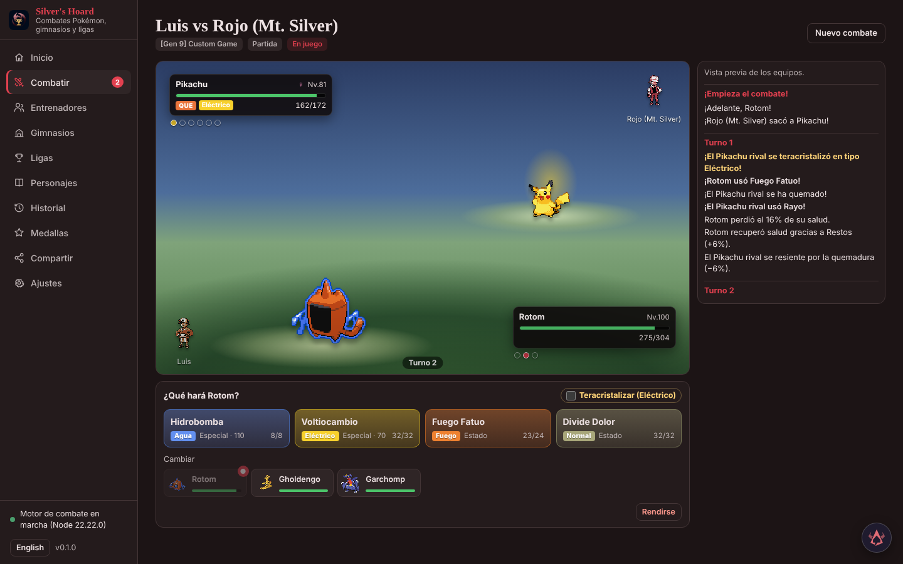
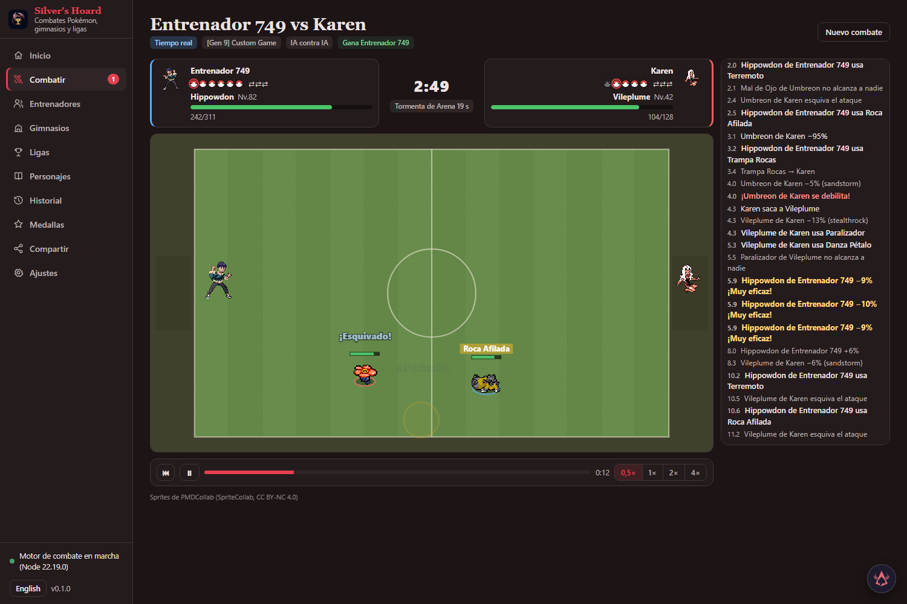
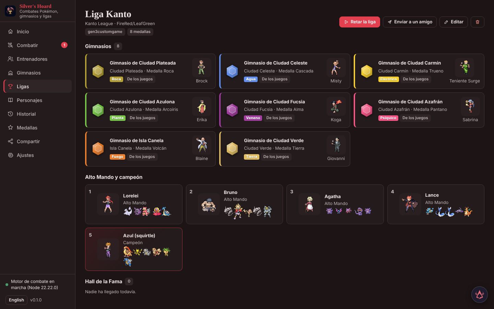
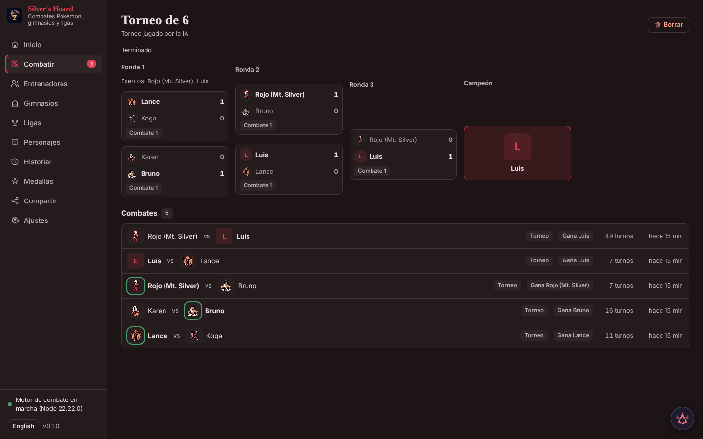
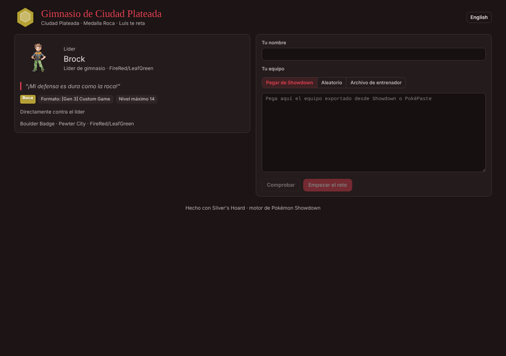
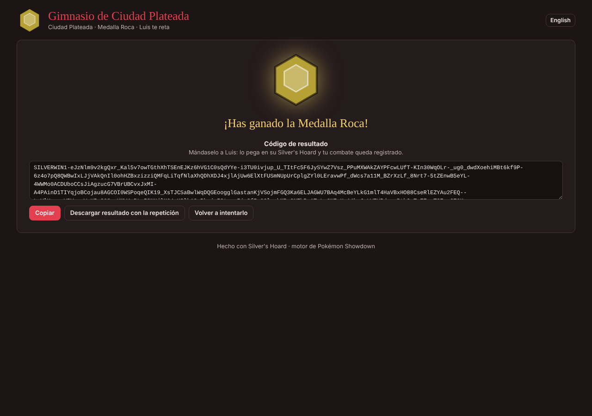

# Silver's Hoard

A Pokémon battle simulator built on Pokémon Showdown's engine, with trainers, AI opponents, gyms, leagues, real-time battles and playable pages you can send to friends. Part of the Hoard family. [Español](README.es.md)



## What it is

Silver's Hoard runs every generation of Pokémon battles, singles and doubles, on the `@pkmn` simulator. You build trainers (a team, an AI level and style, an avatar, battle lines), play them against the AI or another person, or let two AIs fight and watch the replay. Around that it adds series, tournaments, cups, gyms, leagues, the in-game characters of every main-series game, battle facilities and mini-games.

Every battle can also be played in real time: the same teams on a 2D arena seen from above, with move cooldowns instead of turns. Anything you build can be exported as a single HTML page that a friend opens in a browser, with the engine and the AI inside.

It runs locally (default port 5230), keeps its data in a SQLite file, and is also driven by assistants through an MCP server.

## What it does

### Trainers and teams
- Create trainers by pasting a Showdown export, PokéPaste, JSON or a packed team, or by building a team in the editor; each has an AI level and style, an avatar, a title and battle lines (start, last Pokémon, low HP, win, lose, after the battle).
- Optional change of tactics, as for game bosses: when the team falls to half HP or sends out its last Pokémon, the AI switches level or style and the trainer says a line.
- Battle lines can be written by the family's language model (through Hoard Hub) from a team and a personality, and the AI can comment its own moves in character.
- Avatars: any Showdown trainer sprite, your own picture, the games' official artwork of characters and trainer classes, pixel art made from a photo, or art drawn by Prospero's Hoard.
- Damage calculator, popular sets, Pokémon Champions stat points and regulations, and equalised levels (50 or 100) for any battle.

### Characters and leagues of the games
- 214 gym leaders, Elite Four members, champions, rivals, villains, Frontier Brains and facility bosses from Red/Blue to Scarlet/Violet, with their teams battle by battle (first fights, rematches, tournaments, facilities, multi battles).
- Whole in-game leagues ready to install: gyms with badges, Elite Four and champion. Crystal, FireRed/LeafGreen, Emerald and HeartGold/SoulSilver use teams read from the games' code; the rest are built from the characters' teams.
- Battle facilities with win streaks (Battle Towers, Subway, Maison, Tree, HeartGold/SoulSilver Battle Frontier) and the ten Pokéathlon events.

### Battles
- Play against the AI, two people on one computer, or two AIs in the background. The screen shows sprites, HP, status, boosts, Terastal, weather, terrain and hazards, with a log in Spanish or English, per-move animations and sound.
- Seven AI levels from random to master (Monte Carlo tree search with the optional poke-engine); an AI mode that only knows what the battle has revealed; a neural level for singles of generations 1–4 and 9.
- Series of N battles with win rates, KOs and MVPs; tournaments up to 64 trainers (knockout or round robin); team-variant benchmarks; cups with a live bracket where you play your matches and the AI plays the rest.
- Mass battles with up to 1,100 Pokémon on one field: battle royale, armies, or many against a few giants.
- Replays with turn-by-turn seeking, ability banners, suggested practice positions from a finished replay, saved exercises and a "try another move" branch.
- Live battles with a friend on another computer through a room link (turn by turn or real time).

### Real time
- A second way to play every battle: no turns, no PP, per-move cooldowns, wind-ups, and move shapes (strikes, dashes, projectiles, beams, cones, areas) that land where the target stood.
- Presentation with VS screen, thrown Poké Balls, callouts, impact frames, camera effects, a crowd watching, and speech bubbles for trainer lines.
- Arena designer for your own arenas (rocks, floors, symmetry, templates) and floors taken from the games.
- Pixel-art move effects (`pixelfx`) and an effects explorer.

### Gyms, leagues and cups
- Gyms with a leader, gym trainers, a badge and level rules; leagues with gyms, Elite Four, champion and a hall of fame.
- Walkable gym maps painted tile by tile, with trainers' lines of sight, ice, arrows, switches and pixel-art buildings; trainers who see you challenge you.
- Progress per trainer: records, streaks, KOs, badges, achievements and a Pokédex of species used, seen and knocked out.

### Portraits, sprites and media
- A PMD portrait library: 16 expressions in normal and shiny palettes for every form, shown in the VS intro, bars and reactions, and embedded in exported pages.
- Showdown sprites, cries and music cached on first use; Showdown's animation of every move and its battle backdrops.
- MP4 export of battles, trainer posters, contests, secret bases and other leisure features.

### Sharing with friends
- Export trainers, gyms and leagues as files (`.hoardtrainer`, `.hoardgym`, `.hoardleague`), share codes to paste in a chat, Showdown text, or one **playable HTML page** with the engine, AI and installed portraits inside.
- The friend plays your gym or trainer turn by turn or in real time and sends back a result code; importing it replays the battle to check it and records the badge. Codes are not signed: the replay check catches edited codes, not scripted play.
- Exercises can be shared as `.silverexercise` files.

## What it does not do
- No Pokémon art ships in the repository: sprites, cries and music are downloaded from the Showdown servers on first use and cached under `data/cache`. Offline, the field shows initials until they are cached.
- Characters other than Crystal, FireRed/LeafGreen, Emerald and HeartGold/SoulSilver come from public tables, so their IVs and EVs are unknown (31 IVs, no EVs). Battles use held items only, no bag items.
- Real time plays singles and doubles only and leaves out Terastallization and some copying and ally-targeting moves.
- The master AI searches only in 9th-generation singles; the expert searches singles and doubles.
- Noland, Thorton and Argenta have no fixed team in their games and are not among the characters.

## How to run it

Requirements: Node.js 20+, Python 3.11+.

```bash
npm ci                       # engine and client
npm run build                # UI and playable-page template
python -m venv venv && venv/Scripts/pip install -r requirements.txt   # venv/bin/pip on Linux and macOS
venv/Scripts/python -m silvers_hoard    # http://127.0.0.1:5230
```

Optional extras: `requirements-master.txt` (poke-engine, master AI), `requirements-video.txt` (Playwright, MP4 export), `requirements-icon.txt`.

Data lives in `data/` (or `SILVER_DATA_DIR`): `silver.db`, avatars, exports and the sprite, audio and credits caches.

## Connection with Faustus and Hoard Hub

- Hoard Hub finds the app through `faustus-plugin.json` (id `silver`, port 5230). Faustus's copilot is available on every page, and the app publishes events on the family bus.
- `python mcp_server.py` is a stdio MCP bridge to the running app (it starts the app when needed). The roughly 190 tools cover the whole app, grouped as: battles (`battle_start`, `battle_choose`, `battle_practice`, `battle_compare`), series, tournaments, cups and benchmarks, characters and leagues, facilities, trainers and teams (`damage_calc`, `stat_points`), avatars, real-time arenas and rules, export and import, progress, and credits. The bridge lists them from `GET /api/agent/tools`.

## Project layout

| Path | Contents |
|---|---|
| `silvers_hoard/` | FastAPI backend, battle controller, AI, sharing, MCP tools |
| `engine/` | Node bridge to `@pkmn/sim`, rules, parity checks and tests |
| `client/` | React app, playable page and friends page |
| `mcp_server.py` | MCP bridge for assistants |
| `scripts/` | Builders for characters, sprites, PMD library and other data |
| `docs/` | Feature notes and screenshots |
| `tests/` | Python test suite |
| `faustus-plugin.json` | Plugin manifest |

## Development

```bash
npm test               # Python tests, then the engine tests
npm run test:engine    # engine tests only
npm run client         # Vite dev server
python scripts/parity_poke_engine.py   # compare poke-engine with @pkmn/sim (needs the master extra)
```

Planned work is in [OBJETIVOS.md](OBJETIVOS.md) and open items in [PENDIENTES.md](PENDIENTES.md). More detail per feature is in [docs/](docs/); the PMD library is described in [docs/PMD_LIBRARY.md](docs/PMD_LIBRARY.md).

## Screens

<details>
<summary>More screenshots</summary>







</details>

## Credits and licence

The app's Credits page lists every source with its licence and the artists of the sprites. Battle engine: Pokémon Showdown through the `@pkmn` packages (MIT). In-game teams from the pret disassemblies; the other characters' teams from Bulbapedia (CC BY-NC-SA 2.5). Spanish names and descriptions from PokeAPI. Sprites, cries and music are served by the Showdown servers and belong to their authors and studios.

This is a fan project and is not affiliated with Nintendo, Game Freak, Creatures or The Pokémon Company. Pokémon and related names are trademarks of their owners.

Code under MIT, see [LICENSE](LICENSE).
